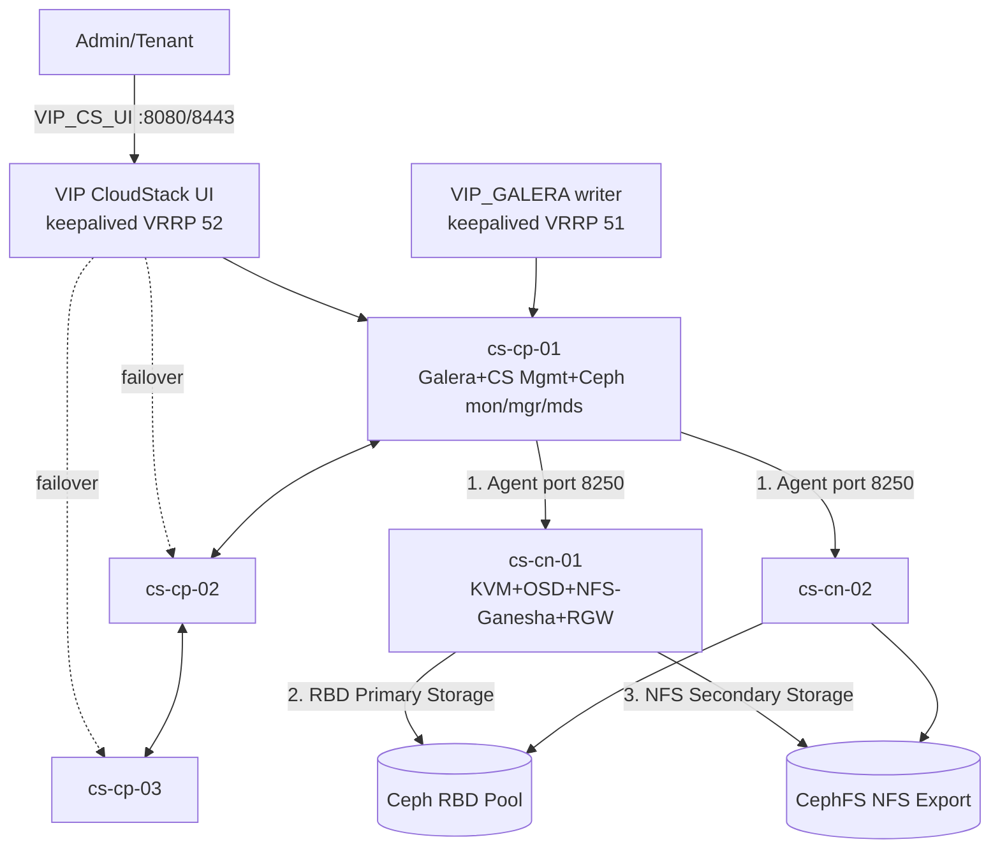

---
tags:
  - cloudstack
  - ceph
  - runbook
  - production
---

# CloudStack 4.23 & Ceph 19 (Squid) - Runbook Triển khai Production Cluster 5 Node (3 Control Plane + 2 Compute/OSD)

- **Bối cảnh và vấn đề**: Triển khai mới một cụm Apache CloudStack 4.23 production trên 5 server Dell R660 physical, dùng Ceph 19 (Squid) làm Primary Storage (RBD) và Secondary Storage (NFS qua CephFS). 3 node đóng vai trò control plane (MariaDB Galera + CloudStack Management + Ceph mon/mgr/mds), 2 node đóng vai trò compute (Ceph OSD + KVM hypervisor + NFS export + RGW). Không có external load balancer (F5, HAProxy rời) - dùng keepalived (VRRP) làm cơ chế failover. Hạ tầng mạng có 4 port 25GbE/node (2 riser) cần bonding LACP, và 8 VLAN được cấp để tách biệt traffic.
- **Cách giải quyết**: Bonding 802.3ad (LACP) toàn bộ 4 port thành 1 interface, tách VLAN sub-interface cho từng loại traffic qua Netplan. Dùng `cephadm` để bootstrap Ceph Squid, dùng `mariadb_repo_setup` + `galera-4` để dựng Galera Cluster 3 node, dùng `keepalived` cho 2 VIP độc lập (1 cho Galera writer, 1 cho CloudStack UI/API), cài `cloudstack-management` trên cả 3 node control plane và `cloudstack-agent` trên 2 node compute. UFW được cấu hình theo nguyên tắc default-deny, chỉ mở đúng port/đúng VLAN cho từng dịch vụ.
- **Kết quả sau khi hoàn thành**: Một cụm CloudStack 4.23 có HA ở tầng Management Server (3 node, propll qua `host=ip1,ip2,ip3` tới KVM agent) và tầng Database (Galera 3 node, VIP active-passive qua keepalived), Zone Advanced **với Security Groups** (guest isolation bằng ingress/egress rule layer 3/4 trên 1 Shared Network, không dùng VPC/Isolated Network per-tenant) với Primary Storage RBD + Secondary Storage NFS chạy trên Ceph, sẵn sàng add Host và deploy VM. Toàn bộ node được hardening UFW theo đúng traffic type.

> [!NOTE]
> Guest traffic isolation trong runbook này dùng **Security Groups** (ingress/egress rule layer 3/4 trên 1 Shared Network zone-wide), không dùng VXLAN/VLAN per-tenant hay SDN/FRRouting/EVPN - đây là lựa chọn kiến trúc chủ động (xem Bước 14), không phải thiếu sót. Runbook dừng ở bước Zone Advanced + Security Groups đã add Host + Storage + Enable Zone thành công, đủ để deploy VM test. Mọi thông tin version/port/cú pháp lệnh trong tài liệu này đều lấy từ tài liệu chính thức (`docs.ceph.com`, `mariadb.com/docs`, `galeracluster.com`, `docs.cloudstack.apache.org`, `kernel.org`, `netplan.io`) - những phần tài liệu chính thức không nêu rõ sẽ được đánh dấu `[!TODO]` để bạn tự kiểm tra lại trong môi trường thật trước khi áp dụng, **không tự suy diễn**.

## Prerequisites

- **Hạ tầng**: 5 server Dell R660 đã lắp OS tối thiểu (xem mục OS bên dưới), đã cắm đủ 4 port 25GbE/node (2 port/riser) vào switch, switch đã (hoặc sẽ) được cấu hình port-channel LACP tương ứng. 8 VLAN đã được network team cấp ID + subnet cụ thể.
- **Máy chủ**:
  - `cs-cp-01`, `cs-cp-02`, `cs-cp-03`: 1x CPU Intel Xeon Scalable Gold, 256GB RAM/node. Vai trò: MariaDB Galera, keepalived, CloudStack Management Server, Ceph mon + mgr + mds + label `_admin`.
  - `cs-cn-01`, `cs-cn-02`: 2x CPU Intel Xeon Scalable Gold, 1TB RAM/node. Vai trò: Ceph OSD, CloudStack KVM Agent, NFS-Ganesha export (Secondary Storage), RGW (S3).
- **OS**: Ubuntu 22.04 LTS (jammy) cho toàn bộ 5 node.

  > [!WARNING]
  > CloudStack 4.23 hỗ trợ chính thức cả Ubuntu 22.04/24.04/26.04 LTS, nhưng tại thời điểm viết runbook này có bug đã ghi nhận trên mailing list `ceph-users`: `cephadm add-repo --release squid` **trả về lỗi 404** trên Ubuntu 24.04 (noble) vì repo Ceph Squid chưa publish dist "noble" ([nguồn](https://www.spinics.net/lists/ceph-users/msg85279.html)). Chọn Ubuntu 22.04 (jammy) để tránh workaround không chính thức này. Nếu buộc phải dùng 24.04, xem mục Troubleshooting.

- **Tài khoản và quyền**: SSH key riêng cho cephadm (được cephadm tự sinh lúc bootstrap, không cần tạo tay) phải được distribute tới toàn bộ 5 node bằng user có quyền sudo (thường là `root`). Không dùng chung 1 password cho tất cả node - dùng SSH key.
- **Mạng**: Tất cả 5 node phải resolve được hostname của nhau qua `/etc/hosts` hoặc DNS nội bộ (cephadm yêu cầu `hostname` trên remote host khớp với tên truyền vào `ceph orch host add`). Toàn bộ 8 VLAN phải đã thông ở tầng switch (trunk) tới cả 5 node trước khi bắt đầu Bước 2.
- **Kiến thức nền**: Runbook giả định người đọc đã biết thao tác Linux networking cơ bản (ip, netplan), đã biết SQL cơ bản, và đã đọc qua khái niệm Ceph (mon/mgr/osd/mds/rgw) và CloudStack (Zone/Pod/Cluster/Host) ở mức tổng quan.

> [!WARNING]
> Bước bonding (Bước 2) và VLAN (Bước 3) sẽ làm gián đoạn kết nối mạng tạm thời trên từng node khi `netplan apply`. Luôn giữ 1 kết nối console/iDRAC (out-of-band) riêng biệt với NIC đang cấu hình để không bị mất quyền truy cập nếu cấu hình sai.

## Thông tin Planning liên quan

| Thành phần | Giá trị | Ghi chú |
| --- | --- | --- |
| OS | `Ubuntu 22.04 LTS (jammy)` | Tránh bug cephadm + noble, xem Prerequisites |
| `cs-cp-01/02/03` | `<IP_VLAN1_cp01>` / `02` / `03` | Control plane - Galera + CS Management + Ceph mon/mgr/mds |
| `cs-cn-01/02` | `<IP_VLAN1_cn01>` / `02` | Compute - Ceph OSD + KVM Agent + NFS-Ganesha + RGW |
| Bond vật lý | `bond0` (4x25GbE, `802.3ad`) | 2 port/riser - xác nhận với network team cả 4 port cùng 1 port-channel LACP (có thể span 2 switch nếu switch hỗ trợ MLAG/vPC) |
| VLAN 1 - Compute Mgmt | `<VLAN_ID_1>` / `<CIDR_1>` | SSH, OS management |
| VLAN 2 - CloudStack Management | `<VLAN_ID_2>` / `<CIDR_2>` | API/UI 8080/8443, Agent 8250, Galera 3306/4567/4568/4444, VRRP |
| VLAN 3 - Ceph Public | `<VLAN_ID_3>` / `<CIDR_3>` | mon/mgr/mds client traffic, RBD, **RGW dùng chung VLAN này** (xem ghi chú dưới bảng) |
| VLAN 4 - Ceph Cluster/OSD | `<VLAN_ID_4>` / `<CIDR_4>` | Replication OSD↔OSD, chỉ cần trên `cs-cn-*` |
| VLAN 5 - Ceph NFS/Secondary Storage | `<VLAN_ID_5>` / `<CIDR_5>` | NFS-Ganesha export tới CloudStack Secondary Storage VM |
| VLAN 6 - KVM Migration | `<VLAN_ID_6>` / `<CIDR_6>` | libvirt live migration, port 49152-49216 |
| VLAN 7 - KVM Guest | `<VLAN_ID_7>` / `<CIDR_7>` | Bridge `cloudbr-guest`, CloudStack Guest traffic type |
| VLAN 8 - Public Access | `<VLAN_ID_8>` / `<CIDR_8>` | CloudStack Public traffic type, IP public cấp tenant |
| Zone network model | `Advanced + Security Groups` | Chỉ hỗ trợ KVM, chọn lúc tạo zone (không đổi được sau), **không** dùng được VPC/Isolated Network - xem Bước 14 |
| Guest network offering | `DefaultSharedNetworkOfferingWithSGService` | Network offering built-in có service Security Group, dùng thay offering Isolated mặc định |
| `VIP_GALERA` | `<VIP_GALERA_IP>` trên VLAN 2 | keepalived `virtual_router_id 51`, active-passive writer Galera |
| `VIP_CS_UI` | `<VIP_CS_UI_IP>` trên VLAN 2 | keepalived `virtual_router_id 52`, entry point UI/API (không load-balance, chỉ failover) |
| `wsrep_cluster_name` | `cs_galera_prod` | |
| `wsrep_sst_method` | `mariabackup` | Yêu cầu cài `socat` trên cả 3 node |
| Ceph public network | CIDR của VLAN 3 | Flag `--mon-ip` + mặc định public network |
| Ceph cluster network | CIDR của VLAN 4 | Flag `--cluster-network` lúc bootstrap |
| CephFS cho Secondary Storage | `cloudstack_secondary` | Export qua `ceph nfs` (NFS-Ganesha managed by cephadm) |
| RGW service id | `rgw.s3` | Đặt trên `cs-cn-01`, `cs-cn-02` |

> [!NOTE]
> Bạn liệt kê **9 loại traffic** (compute mgt, cloudstack management, ceph public, ceph osd, ceph nfs/backup/secondary storage, kvm migration, kvm, rados gateway s3, public access tenant) nhưng chỉ được cấp **8 VLAN**. Runbook này gộp RGW vào chung VLAN Ceph Public vì theo kiến trúc Ceph, RGW chỉ là một **client** của cluster (nói chuyện với mon/osd qua public network), không có khái niệm "RGW network" riêng trong tài liệu chính thức. Nếu bạn muốn RGW nằm trên VLAN riêng (ví dụ để áp policy firewall khác với traffic quản trị Ceph), cần xin thêm 1 VLAN thứ 9 - `[!TODO]` xác nhận lại với bạn trước khi triển khai thật.

## Diagram



---

## Installation

### Bước 1 - Chuẩn bị baseline hệ điều hành trên cả 5 node

Thiết lập hostname, `/etc/hosts`, đồng bộ thời gian (bắt buộc cho Galera certification và Ceph) trước khi đụng tới network/storage.

- Đặt hostname đúng theo quy ước (chạy trên từng node, ví dụ `cs-cp-01`):

```bash
sudo hostnamectl set-hostname cs-cp-01
```

- Khai báo toàn bộ 5 node trong `/etc/hosts` trên **mọi** node (dùng IP VLAN 1 - Compute Mgmt, vì đây là mạng quản trị OS, và cephadm yêu cầu hostname phải resolve đúng):

`/etc/hosts`
```text
<IP_VLAN1_cp01>  cs-cp-01
<IP_VLAN1_cp02>  cs-cp-02
<IP_VLAN1_cp03>  cs-cp-03
<IP_VLAN1_cn01>  cs-cn-01
<IP_VLAN1_cn02>  cs-cn-02
```

> [!WARNING]
> cephadm yêu cầu: "tên host truyền vào `ceph orch host add` phải khớp đúng với output của lệnh `hostname` trên remote host" ([docs.ceph.com - Host Management](https://docs.ceph.com/en/squid/cephadm/host-management/)). Dùng bare hostname (không FQDN) để tránh lỗi.

- Cài đặt và cấu hình NTP client bằng `chrony` (toàn bộ 5 node):

```bash
sudo apt update
sudo apt install -y chrony
sudo systemctl enable chrony --now
```

- Kiểm tra kết quả bước này:

```bash
timedatectl status
ping -c2 cs-cp-01 && ping -c2 cs-cn-01
```

Kết quả mong đợi: `System clock synchronized: yes`, và ping resolve đúng qua `/etc/hosts` không lỗi "unknown host".

### Bước 2 - Cấu hình Bonding LACP (802.3ad) trên 4 port 25GbE

Gộp 4 port (2 riser) thành 1 bond LACP để tối đa throughput và chịu được mất 1 riser mà không rớt mạng. Theo tài liệu kernel bonding, mode `802.3ad` dùng LACP để switch và host tự thoả thuận aggregation group; **nguyên lý LACP không quan tâm port đến từ card vật lý nào, chỉ cần toàn bộ 4 port được switch đưa vào cùng 1 port-channel** - nếu 2 switch ToR riêng biệt, cả 4 port vẫn gộp được vào 1 bond nếu 2 switch chạy MLAG/vPC và expose ra 1 port-channel logic. Xác nhận với network team trước khi làm bước này.

> [!WARNING]
> Phải cấu hình port-channel LACP tương ứng trên switch **trước** khi `netplan apply`, nếu không bond sẽ không lên (LACP cần đồng thuận 2 đầu) và node mất kết nối mạng hoàn toàn. Chuẩn bị console/iDRAC out-of-band trước khi thực hiện.

- Xác định tên 4 interface vật lý (ví dụ `enp65s0f0`, `enp65s0f1`, `enp193s0f0`, `enp193s0f1` - tên thật tuỳ board, kiểm tra bằng `ip link`), tạo file cấu hình Netplan:

`/etc/netplan/00-bond.yaml`
```yaml
network:
  version: 2
  ethernets:
    enp65s0f0:
      dhcp4: false
    enp65s0f1:
      dhcp4: false
    enp193s0f0:
      dhcp4: false
    enp193s0f1:
      dhcp4: false
  bonds:
    bond0:
      interfaces:
        - enp65s0f0
        - enp65s0f1
        - enp193s0f0
        - enp193s0f1
      parameters:
        mode: 802.3ad
        lacp-rate: fast
        mii-monitor-interval: 100
        transmit-hash-policy: layer3+4
```

Giải thích tham số (theo [kernel.org bonding.txt](https://www.kernel.org/doc/Documentation/networking/bonding.txt) và [netplan YAML reference](https://netplan.readthedocs.io/en/stable/netplan-yaml/)):
- `mode: 802.3ad`: LACP dynamic link aggregation, yêu cầu switch hỗ trợ IEEE 802.3ad.
- `lacp-rate: fast`: yêu cầu đối phương gửi LACPDU mỗi 1 giây thay vì 30 giây (mặc định `slow`) - phát hiện lỗi link nhanh hơn.
- `mii-monitor-interval: 100`: kiểm tra trạng thái link mỗi 100ms. Tài liệu kernel nhấn mạnh **phải** set `miimon` (hoặc `arp_interval`), nếu không "sẽ gây suy giảm mạng nghiêm trọng khi 1 link lỗi" vì kernel không phát hiện được.
- `transmit-hash-policy: layer3+4`: hash theo IP+port để phân tải tốt hơn `layer2`, nhưng tài liệu kernel ghi rõ cách này **không tuân thủ hoàn toàn chuẩn 802.3ad** (có thể gây reorder packet với traffic fragment) - xác nhận switch tolerate được trước khi dùng ở production; nếu switch khó chịu, đổi sang `layer2+3` (vẫn 802.3ad-compliant).

- Áp dụng cấu hình:

```bash
sudo netplan apply
```

- Kiểm tra kết quả bước này:

```bash
cat /proc/net/bonding/bond0
```

Kết quả mong đợi: `MII Status: up`, `Aggregator ID` giống nhau trên cả 4 slave interface, mỗi slave hiện `MII Status: up` và `Link Failure Count: 0`.

### Bước 3 - Tạo VLAN sub-interface cho 8 traffic type qua Netplan

Tách `bond0` thành 8 sub-interface VLAN (theo Planning table ở trên), mỗi node chỉ cần khai báo đúng những VLAN liên quan đến vai trò của nó (control plane không cần VLAN 4/5/6/7/8; compute node cần đủ cả 8).

- Ví dụ cấu hình đầy đủ 8 VLAN trên 1 node compute (`cs-cn-01`) - với node control plane, chỉ giữ lại VLAN 1, 2, 3:

`/etc/netplan/01-vlans.yaml`
```yaml
network:
  version: 2
  vlans:
    bond0.1:
      id: <VLAN_ID_1>
      link: bond0
      addresses: [<IP_VLAN1_cn01>/<PREFIX_1>]
    bond0.2:
      id: <VLAN_ID_2>
      link: bond0
      addresses: [<IP_VLAN2_cn01>/<PREFIX_2>]
    bond0.3:
      id: <VLAN_ID_3>
      link: bond0
      addresses: [<IP_VLAN3_cn01>/<PREFIX_3>]
    bond0.4:
      id: <VLAN_ID_4>
      link: bond0
      addresses: [<IP_VLAN4_cn01>/<PREFIX_4>]
    bond0.5:
      id: <VLAN_ID_5>
      link: bond0
      addresses: [<IP_VLAN5_cn01>/<PREFIX_5>]
    bond0.6:
      id: <VLAN_ID_6>
      link: bond0
      addresses: [<IP_VLAN6_cn01>/<PREFIX_6>]
    bond0.7:
      id: <VLAN_ID_7>
      link: bond0
      # Không gán IP ở VLAN này - đây là VLAN trunk cho bridge cloudbr-guest,
      # IP thuộc về Virtual Router của tenant do CloudStack quản lý, không phải IP host.
    bond0.8:
      id: <VLAN_ID_8>
      link: bond0
      # Tương tự VLAN 7 - Public traffic type do CloudStack quản lý range IP public,
      # không gán IP tĩnh cho host ở đây.
```

> [!NOTE]
> VLAN 7 (KVM Guest) và VLAN 8 (Public Access) không cần IP tĩnh trên host - chúng sẽ được khai báo làm **traffic label** khi tạo Physical Network trong CloudStack Zone (Bước 14), CloudStack tự tạo bridge (`cloudbr-guest`, `cloudbr-public`) trên các VLAN sub-interface này.

- Áp dụng:

```bash
sudo netplan apply
```

- Kiểm tra kết quả bước này:

```bash
ip -d link show bond0.<VLAN_ID_2>
ip addr show bond0.<VLAN_ID_2>
```

Kết quả mong đợi: interface `UP`, đúng VLAN ID hiển thị trong phần `vlan protocol 802.1Q id <VLAN_ID_2>`, đúng IP đã khai báo.

### Bước 4 - Thiết lập UFW baseline trên cả 5 node

Thiết lập chính sách mặc định deny-incoming trước khi mở port cho từng dịch vụ ở các bước sau. Luôn mở SSH trước khi enable để không mất quyền truy cập.

```bash
sudo apt install -y ufw
sudo ufw default deny incoming
sudo ufw default allow outgoing
sudo ufw allow in on bond0.<VLAN_ID_1> to any port 22 proto tcp
sudo ufw logging on
sudo ufw enable
```

> [!WARNING]
> Lệnh `ufw allow ... to any port 22` chạy **trước** `ufw enable` là bắt buộc - nếu enable trước, bạn sẽ mất SSH ngay lập tức (trừ khi đang ở console/iDRAC). Rule còn giới hạn SSH chỉ trên VLAN 1 (Compute Mgmt) qua `in on bond0.<VLAN_ID_1>`, không cho SSH từ VLAN khác.

- Kiểm tra kết quả bước này:

```bash
sudo ufw status verbose
```

Kết quả mong đợi: `Status: active`, `Default: deny (incoming), allow (outgoing)`, có rule `22/tcp ALLOW IN` gắn với interface VLAN 1.

Các rule UFW riêng cho từng dịch vụ (Galera, Ceph, CloudStack, NFS, RGW, keepalived) được thêm dần ở các bước cài đặt tương ứng bên dưới.

### Bước 5 - Cài đặt MariaDB Galera Cluster 3 node (control plane)

Dựng backend database cho CloudStack Management Server. 3 node là số lẻ tối thiểu được MariaDB khuyến nghị cho production ("minimum of three... một server hoặc switch có thể fail mà không sập cluster", theo [MariaDB Galera Cluster Usage Guide](https://mariadb.com/docs/galera-cluster/readme/mariadb-galera-cluster-usage-guide)) - quorum yêu cầu hơn nửa số node còn sống trong Primary Component.

- Thêm MariaDB repository chính thức và cài package (chạy trên cả 3 node `cs-cp-*`):

```bash
sudo apt update
sudo apt install -y dirmngr software-properties-common apt-transport-https ca-certificates curl
curl -LsS https://downloads.mariadb.com/MariaDB/mariadb_repo_setup | sudo bash
sudo apt update
sudo apt install -y mariadb-server mariadb-client galera-4 socat
```

`socat` bắt buộc khi dùng SST method `mariabackup` (dùng để stream backup từ donor sang joiner, theo [mariadb-backup SST Method](https://mariadb.com/docs/galera-cluster/high-availability/state-snapshot-transfers-ssts-in-galera-cluster/mariadb-backup-sst-method)).

- Cấu hình Galera trên cả 3 node, chỉnh `wsrep_node_address`/`wsrep_node_name` khác nhau mỗi node:

`/etc/mysql/mariadb.conf.d/60-galera.cnf`
```ini
[mariadb]
wsrep_on=ON
wsrep_provider=/usr/lib/galera/libgalera_smm.so
wsrep_cluster_address="gcomm://<IP_VLAN2_cp01>,<IP_VLAN2_cp02>,<IP_VLAN2_cp03>"
wsrep_cluster_name="cs_galera_prod"
wsrep_node_address="<IP_VLAN2_cp01>"
wsrep_node_name="cs-cp-01"
wsrep_sst_method=mariabackup

binlog_format=ROW
default_storage_engine=InnoDB
innodb_autoinc_lock_mode=2
bind_address=0.0.0.0
```

Giải thích tham số bắt buộc (theo [Galera Cluster System Variables](https://mariadb.com/docs/galera-cluster/reference/galera-cluster-system-variables)):
- `innodb_autoinc_lock_mode=2`: "interleaved lock mode" - bắt buộc với Galera vì các node ghi song song cần auto-increment không bị lock serial.
- `binlog_format=ROW`: Galera chỉ hỗ trợ replication row-based, không hỗ trợ statement-based.
- `wsrep_sst_method=mariabackup`: tài liệu MariaDB khuyến nghị đây là "lựa chọn tốt nhất cho cluster lớn với tải cao" và là method duy nhất không block donor node khi SST chạy.

> [!WARNING]
> Đây là cluster 3 node Galera **multi-master ở tầng engine** nhưng runbook này chủ động chỉ cho 1 node nhận write qua VIP active-passive ở Bước 6, để tránh rủi ro certification conflict mà tài liệu MariaDB mô tả: "tăng số node làm tăng theo cấp số nhân thời gian phản hồi transaction và tỷ lệ conflict/deadlock" khi nhiều node ghi đồng thời vào cùng row ([MariaDB Galera Cluster Known Limitations](https://mariadb.com/kb/en/mariadb-galera-cluster-known-limitations/)).

- Mở UFW cho Galera, chỉ cho phép nội bộ VLAN 2 giữa 3 node control plane (theo [Galera Firewall Settings](https://mariadb.com/docs/galera-cluster)):

```bash
sudo ufw allow from <CIDR_2> to any port 3306 proto tcp
sudo ufw allow from <CIDR_2> to any port 4567 proto tcp
sudo ufw allow from <CIDR_2> to any port 4567 proto udp
sudo ufw allow from <CIDR_2> to any port 4568 proto tcp
sudo ufw allow from <CIDR_2> to any port 4444 proto tcp
```

| Port | Protocol | Mục đích |
| --- | --- | --- |
| 3306 | TCP | MySQL/MariaDB client |
| 4567 | TCP + UDP | Galera replication traffic (gcomm), UDP dùng khi multicast replication |
| 4568 | TCP | Incremental State Transfer (IST) |
| 4444 | TCP | State Snapshot Transfer (SST) - mariabackup/rsync |

- Bootstrap cluster lần đầu - **chỉ chạy trên `cs-cp-01`**:

```bash
sudo galera_new_cluster
```

`galera_new_cluster` là wrapper script của package MariaDB trên Ubuntu, dùng `systemctl set-environment _WSREP_NEW_CLUSTER='--wsrep-new-cluster'` rồi start service ([MariaDB Getting Started with Galera Cluster](https://mariadb.com/docs/galera-cluster/galera-management/installation-and-deployment/getting-started-with-mariadb-galera-cluster)). Chỉ chạy lệnh này trên đúng 1 node đầu tiên.

- Join 2 node còn lại (`cs-cp-02`, `cs-cp-03`) - mỗi node đã có `wsrep_cluster_address` trỏ đủ 3 IP ở trên nên tự join:

```bash
sudo systemctl start mariadb
```

- Kiểm tra kết quả bước này (chạy trên node bất kỳ):

```sql
SHOW STATUS LIKE 'wsrep_cluster_size';
SHOW STATUS LIKE 'wsrep_cluster_status';
SHOW STATUS LIKE 'wsrep_ready';
```

Kết quả mong đợi: `wsrep_cluster_size` = `3`, `wsrep_cluster_status` = `Primary`, `wsrep_ready` = `ON`.

### Bước 6 - Cài đặt keepalived cho 2 VIP (Galera writer + CloudStack UI)

Dùng keepalived (VRRP) thay external load balancer theo đúng yêu cầu. Tạo 2 `vrrp_instance` độc lập trên cùng 3 node control plane: một VIP cho Galera (chỉ 1 node nhận write tại 1 thời điểm để tránh multi-writer conflict đã nêu ở Bước 5), một VIP cho CloudStack UI/API.

> [!NOTE]
> keepalived chỉ cung cấp **failover** (1 node active tại 1 thời điểm), không phải Layer 4/7 load balancing thật như HAProxy. Tài liệu CloudStack khuyến nghị dùng load balancer có session persistence cho port 8080/8250 khi chạy nhiều Management Server ([HA for Management Server](https://docs.cloudstack.apache.org/en/4.20.0.0/adminguide/reliability.html)) - thiết kế active-passive qua keepalived ở đây **thoả điều kiện persistence một cách tự nhiên** vì chỉ bao giờ có 1 backend active, đổi lại là không phân tải được UI/API ra cả 3 node cùng lúc (admin muốn tận dụng cả 3 node UI phải connect trực tiếp IP từng node, không qua VIP). Riêng kết nối Agent (KVM host → Management Server) **không cần VIP** - CloudStack có tính năng native multi-management-server cho agent qua global setting `host` dạng `ip1,ip2,ip3` ([Multiple Management Servers Support on agents](https://cwiki.apache.org/confluence/display/CLOUDSTACK/Multiple+Management+Servers+Support+on+agents)), sẽ cấu hình ở Bước 12.

- Cài đặt (chạy trên cả 3 node `cs-cp-*`):

```bash
sudo apt install -y keepalived mariadb-client
```

- Tạo script health-check cho Galera (kiểm tra `wsrep_cluster_status` = `Primary` trước khi giữ VIP):

`/etc/keepalived/check_galera.sh`
```bash
#!/bin/bash
STATUS=$(mysql -N -e "SHOW STATUS LIKE 'wsrep_cluster_status';" 2>/dev/null | awk '{print $2}')
[ "$STATUS" = "Primary" ] && exit 0 || exit 1
```

```bash
sudo chmod +x /etc/keepalived/check_galera.sh
```

- Cấu hình keepalived - ví dụ trên `cs-cp-01` (priority giảm dần trên `cs-cp-02`/`03`, ví dụ 150/140/130):

`/etc/keepalived/keepalived.conf`
```text
vrrp_script check_galera {
    script "/etc/keepalived/check_galera.sh"
    interval 2
    fall 2
    rise 2
    weight -30
}

vrrp_instance VI_GALERA {
    state BACKUP
    interface bond0.<VLAN_ID_2>
    virtual_router_id 51
    priority 150
    advert_int 1
    nopreempt
    authentication {
        auth_type PASS
        auth_pass <8_KY_TU_PASS>
    }
    virtual_ipaddress {
        <VIP_GALERA_IP>/<PREFIX_2>
    }
    track_script {
        check_galera
    }
}

vrrp_instance VI_CLOUDSTACK {
    state BACKUP
    interface bond0.<VLAN_ID_2>
    virtual_router_id 52
    priority 150
    advert_int 1
    authentication {
        auth_type PASS
        auth_pass <8_KY_TU_PASS_KHAC>
    }
    virtual_ipaddress {
        <VIP_CS_UI_IP>/<PREFIX_2>
    }
}
```

Giải thích tham số (theo [keepalived.conf manpage](https://manpages.ubuntu.com/manpages/focal/man5/keepalived.conf.5.html)):
- `state BACKUP` trên cả 3 node: để `priority` quyết định ai làm MASTER lúc khởi động, tránh tình trạng 2 node cùng tự nhận MASTER khi khởi động đồng thời.
- `virtual_router_id` phải **khác nhau** giữa `VI_GALERA` (51) và `VI_CLOUDSTACK` (52) trên cùng interface, nếu trùng 2 VRRP instance sẽ xung đột election.
- `nopreempt` trên `VI_GALERA`: tránh việc node cũ quay lại với priority cao hơn giành VIP ngay, gây gián đoạn write đang chạy (CloudStack/Galera cần failback có kiểm soát, không phải tự động ngay khi node phục hồi). Yêu cầu `state` ban đầu phải là `BACKUP` để tham số này có hiệu lực.
- `auth_pass` giới hạn tối đa 8 ký tự theo tài liệu - đây **không phải secret thật**, chỉ là giá trị tham chiếu trong file, xem mục "Khai báo thông tin nhạy cảm".
- `weight -30` trong `vrrp_script`: khi health check Galera fail, giảm priority đi 30 để node khác (đang `Primary`) giành VIP.

> [!WARNING]
> Đoạn trên dùng **multicast mặc định** (224.0.0.18) cho VRRP advertisement - chỉ hoạt động nếu switch VLAN 2 không chặn multicast. Nếu switch có ACL chặn multicast, đổi sang unicast bằng `unicast_src_ip <IP_node_này>` và `unicast_peer { <IP_2_node_khac> }` trong từng `vrrp_instance`.

- Mở UFW cho VRRP (protocol 112, không phải TCP/UDP port thông thường). UFW hỗ trợ keyword `vrrp` trực tiếp:

```bash
sudo ufw allow to 224.0.0.18 from <CIDR_2> proto vrrp
```

> [!WARNING]
> Nếu UFW chặn protocol 112 mà không chặn hẳn (ví dụ chỉ chặn 1 chiều), cả 2 node có thể đồng thời tin rằng node kia đã chết và cùng giành VIP → **split-brain**, 2 node cùng nhận write Galera cùng lúc gây data conflict nghiêm trọng. Verify kỹ bước này bằng `tcpdump -i bond0.<VLAN_ID_2> proto 112` trước khi tin tưởng VIP hoạt động đúng.

```bash
sudo systemctl enable keepalived --now
```

- Kiểm tra kết quả bước này:

```bash
ip addr show bond0.<VLAN_ID_2> | grep <VIP_GALERA_IP>
sudo journalctl -u keepalived -n 50 --no-pager
```

Kết quả mong đợi: đúng 1 node hiện `<VIP_GALERA_IP>` trong `ip addr`, log keepalived báo `Entering MASTER STATE` trên node đó và `Entering BACKUP STATE` trên 2 node còn lại.

### Bước 7 - Triển khai Ceph Cluster bằng cephadm (bootstrap + mon/mgr/mds)

Bootstrap cụm Ceph 19 (Squid) trên `cs-cp-01`, sau đó add 4 node còn lại và deploy mon/mgr/mds lên đủ 3 node control plane.

- Tải và cài `cephadm` trên `cs-cp-01`:

```bash
curl --silent --remote-name --location https://raw.githubusercontent.com/ceph/ceph/squid/src/cephadm/cephadm
chmod +x cephadm
sudo ./cephadm add-repo --release squid
sudo ./cephadm install
```

> [!NOTE]
> Nếu `add-repo --release squid` trả về lỗi 404 (xem Prerequisites) - đây là lý do chính runbook khuyến nghị dùng Ubuntu 22.04. Workaround nếu bắt buộc dùng 24.04: xem Troubleshooting.

- Mở UFW cho SSH giữa các node Ceph trước khi cephadm distribute key (SSH port 22 đã mở ở Bước 4 cho VLAN 1, cephadm dùng chính kênh SSH đó).

- Bootstrap cluster, chỉ định `--mon-ip` trên VLAN 3 (Ceph Public) và `--cluster-network` trên VLAN 4 (Ceph Cluster/OSD):

```bash
sudo cephadm bootstrap \
  --mon-ip <IP_VLAN3_cp01> \
  --cluster-network <CIDR_4> \
  --initial-dashboard-user admin \
  --initial-dashboard-password '<DASHBOARD_PASSWORD>'
```

> [!WARNING]
> `--initial-dashboard-password` sẽ hiện mật khẩu trong lịch sử shell và log. Đây chỉ là mật khẩu tạm dùng để verify; đổi ngay sau khi bootstrap xong qua Ceph Dashboard hoặc `ceph dashboard ac-user-set-password`.

- Mở UFW cho Ceph trên VLAN 3 (public) và VLAN 4 (cluster) - port theo [Ceph Network Configuration Reference](https://docs.ceph.com/en/latest/rados/configuration/network-config-ref/):

```bash
sudo ufw allow from <CIDR_3> to any port 3300 proto tcp
sudo ufw allow from <CIDR_3> to any port 6789 proto tcp
sudo ufw allow from <CIDR_3> to any port 6800:7568 proto tcp
sudo ufw allow from <CIDR_4> to any port 6800:7568 proto tcp
sudo ufw allow from <CIDR_3> to any port 8443 proto tcp
sudo ufw allow from <CIDR_3> to any port 9283 proto tcp
```

| Port | Protocol | Dịch vụ | Mạng |
| --- | --- | --- | --- |
| 3300 | TCP | Monitor (msgr2) | Ceph Public (VLAN 3) |
| 6789 | TCP | Monitor (msgr1, legacy) | Ceph Public (VLAN 3) |
| 6800-7568 | TCP | mgr/mds/osd (dải port cephadm dùng khi daemon restart) | Public (VLAN 3) + Cluster (VLAN 4) |
| 8443 | TCP | Ceph Dashboard | Ceph Public (VLAN 3) |
| 9283 | TCP | Prometheus Module (mgr) | Ceph Public (VLAN 3) |

> [!TODO]
> Tài liệu chính thức không liệt kê port Grafana/Alertmanager cố định trong Network Configuration Reference (chỉ nói port này cấu hình được qua service spec) - nếu bạn deploy luôn monitoring stack (Grafana/Alertmanager/Node Exporter) qua cephadm, kiểm tra port thực tế bằng `ceph orch ls` sau khi deploy và mở UFW tương ứng, đừng suy diễn port mặc định.

- Lấy SSH public key của cephadm và copy sang 4 node còn lại:

```bash
ceph cephadm get-pub-key > ~/ceph.pub
ssh-copy-id -f -i ~/ceph.pub root@cs-cp-02
ssh-copy-id -f -i ~/ceph.pub root@cs-cp-03
ssh-copy-id -f -i ~/ceph.pub root@cs-cn-01
ssh-copy-id -f -i ~/ceph.pub root@cs-cn-02
```

- Add 4 host còn lại vào cluster, gắn label `_admin` cho `cs-cp-02`/`03` (host `cs-cp-01` đã tự có `_admin` từ lúc bootstrap):

```bash
ceph orch host add cs-cp-02 <IP_VLAN3_cp02> --labels _admin
ceph orch host add cs-cp-03 <IP_VLAN3_cp03> --labels _admin
ceph orch host add cs-cn-01 <IP_VLAN3_cn01>
ceph orch host add cs-cn-02 <IP_VLAN3_cn02>
```

Label `_admin` khiến cephadm tự copy `ceph.conf` và keyring `client.admin` sang host đó ([Host Management](https://docs.ceph.com/en/squid/cephadm/host-management/)) - đúng yêu cầu "3 node control plane dùng làm Ceph `_admin`".

- Deploy đủ 3 mon và 3 mgr lên 3 node control plane:

```bash
ceph orch apply mon --placement="cs-cp-01,cs-cp-02,cs-cp-03"
ceph orch apply mgr --placement="cs-cp-01,cs-cp-02,cs-cp-03"
```

3 mon là số lẻ tối thiểu khuyến nghị cho Paxos quorum - chịu được mất 1 mon mà cluster vẫn còn quorum.

- Tạo CephFS (chuẩn bị cho mds + Secondary Storage ở Bước 9) và áp mds lên 3 node control plane:

```bash
ceph fs volume create cloudstack_secondary --placement="cs-cp-01,cs-cp-02,cs-cp-03"
```

- Kiểm tra kết quả bước này:

```bash
ceph -s
ceph orch host ls
ceph fs status cloudstack_secondary
```

Kết quả mong đợi: `ceph -s` báo `HEALTH_OK` (hoặc `HEALTH_WARN` nếu chưa có OSD - bình thường ở bước này), `mon: 3 daemons`, `mgr: ... (active, standbys: ...)`, `ceph orch host ls` liệt kê đủ 5 host, `cs-cp-02`/`03` có label `_admin`.

### Bước 8 - Tạo Ceph OSD trên 2 node compute

- Mở UFW cho Ceph OSD trên cả 2 node compute (đã có rule VLAN 3/4 từ Bước 7, chạy lại nếu chưa áp dụng trên `cs-cn-*`):

```bash
sudo ufw allow from <CIDR_3> to any port 6800:7568 proto tcp
sudo ufw allow from <CIDR_4> to any port 6800:7568 proto tcp
```

- Tạo OSD từ toàn bộ disk trống (raw, chưa format) trên `cs-cn-01` và `cs-cn-02` bằng OSD spec YAML - chạy trên `cs-cp-01` (node có quyền admin/orchestrator):

`osd_spec.yml`
```yaml
service_type: osd
service_id: cloudstack_osd_spec
placement:
  hosts:
    - cs-cn-01
    - cs-cn-02
spec:
  data_devices:
    all: true
```

```bash
ceph orch apply osd -i osd_spec.yml
```

> [!WARNING]
> `data_devices: all: true` sẽ zap (xoá dữ liệu) **mọi** disk trống chưa được dùng trên 2 host này. Xác nhận lại không còn disk nào chứa dữ liệu quan trọng trước khi apply. Hiệu lực của `ceph orch apply` là persistent - disk thêm vào sau cũng sẽ tự động bị add làm OSD, cẩn thận khi thêm disk mới cho mục đích khác sau này.

- Kiểm tra kết quả bước này:

```bash
ceph osd tree
ceph -s
```

Kết quả mong đợi: `ceph -s` chuyển `HEALTH_OK`, `ceph osd tree` hiện đủ OSD trên cả `cs-cn-01` và `cs-cn-02` ở trạng thái `up`/`in`.

### Bước 9 - Tạo NFS-Ganesha export từ CephFS làm Secondary Storage

Dùng `ceph nfs` (NFS-Ganesha quản lý qua cephadm) thay vì tự cài `nfs-kernel-server`, vì đây là cách được tài liệu Ceph gọi là "cách đơn giản và được ưu tiên để quản lý NFS-Ganesha cluster và CephFS export" ([CephFS & RGW Exports over NFS](https://docs.ceph.com/en/latest/mgr/nfs/)) - tự quản lý HA/failover giữa node, tránh rủi ro 2 tiến trình `nfs-kernel-server` tự cài cùng serve 1 export dễ bị lock conflict.

- Tạo NFS cluster với Virtual IP riêng cho Secondary Storage (ingress mode tự quản lý failover giữa `cs-cn-01`/`cs-cn-02`):

```bash
ceph nfs cluster create cs-secondary "cs-cn-01,cs-cn-02" --ingress --virtual_ip <VIP_NFS_SECONDARY_IP>
```

- Tạo export CephFS:

```bash
ceph nfs export create cephfs --cluster-id cs-secondary --pseudo-path /cloudstack-secondary --fsname cloudstack_secondary
```

- Mở UFW cho NFSv4 (chỉ cần 1 port duy nhất, không cần rpcbind/mountd rời như NFSv3):

```bash
sudo ufw allow from <CIDR_5> to any port 2049 proto tcp
```

| Port | Protocol | Ghi chú |
| --- | --- | --- |
| 2049 | TCP | NFSv4-only - gộp mount/lock/data access vào 1 port duy nhất, không cần `rpcbind` (111), `mountd`, `statd`, `lockd` rời như NFSv3 |

> [!TODO]
> `ceph nfs export create` mặc định chỉ enable NFSv4 ([NFS — Ceph Documentation](https://docs.ceph.com/en/latest/cephfs/nfs/)). Nếu CloudStack SSVM cần NFSv3 (một số version SystemVM template cũ mount theo v3), thêm cờ `--enable-nfsv3` lúc tạo cluster và mở thêm port `111` (TCP+UDP) cho rpcbind - xác nhận lại version SystemVM template thực tế trước khi quyết định.

- Kiểm tra kết quả bước này:

```bash
ceph nfs export ls cs-secondary
showmount -e <VIP_NFS_SECONDARY_IP>
```

Kết quả mong đợi: export `/cloudstack-secondary` hiện trong danh sách, `showmount` trả về export path không lỗi connection refused.

### Bước 10 - Deploy RGW (S3 Gateway)

- Deploy RGW trên cả 2 node compute, trên VLAN 3 (Ceph Public - theo quyết định gộp VLAN ở Planning table):

```bash
ceph orch apply rgw rgw.s3 --placement="cs-cn-01,cs-cn-02"
```

Mặc định RGW bind port 80 nếu không cấu hình gì khác ([RGW Service](https://docs.ceph.com/en/squid/cephadm/services/rgw/)). Đổi sang port riêng (ví dụ 7480, giá trị port truyền thống của RGW) qua service spec để không đụng port 80 chuẩn web:

`rgw_spec.yml`
```yaml
service_type: rgw
service_id: s3
placement:
  hosts:
    - cs-cn-01
    - cs-cn-02
spec:
  rgw_frontend_port: 7480
```

```bash
ceph orch apply -i rgw_spec.yml
```

- Mở UFW cho RGW trên VLAN 3:

```bash
sudo ufw allow from <CIDR_3> to any port 7480 proto tcp
```

> [!TODO]
> Nếu RGW cần phục vụ S3 cho traffic từ ngoài VLAN 3 (ví dụ tenant truy cập S3 qua VLAN 8 - Public Access), cần thêm rule UFW tương ứng và xem xét đặt SSL/HTTPS (`rgw_frontend_ssl_certificate`) - phần này cần quyết định kiến trúc thêm, không nằm trong 8 VLAN đã cấp cho mục đích nội bộ Ceph.

- Kiểm tra kết quả bước này:

```bash
ceph orch ps --service_name rgw.s3
curl -s -o /dev/null -w "%{http_code}" http://<IP_VLAN3_cn01>:7480
```

Kết quả mong đợi: `ceph orch ps` hiện 2 daemon RGW `running`, `curl` trả về HTTP 200 (trang XML list bucket rỗng của RGW).

### Bước 11 - Cài đặt CloudStack Management Server trên 3 node control plane

- Thêm CloudStack apt repository chính thức (chạy trên cả 3 node `cs-cp-*`), thay `jammy`/`4.23` nếu khác version:

```bash
echo "deb https://download.cloudstack.org/ubuntu jammy 4.23" | sudo tee /etc/apt/sources.list.d/cloudstack.list
wget -O - https://download.cloudstack.org/release.asc | sudo tee /etc/apt/trusted.gpg.d/cloudstack.asc
sudo apt update
sudo apt install -y cloudstack-management
```

CloudStack 4.23 yêu cầu Java 17 JRE, package `cloudstack-management` tự kéo theo dependency này ([CloudStack 4.23 Compatibility Matrix](https://docs.cloudstack.apache.org/en/latest/releasenotes/compat.html)).

- Mở UFW cho CloudStack Management trên VLAN 2:

```bash
sudo ufw allow from <CIDR_2> to any port 8080 proto tcp
sudo ufw allow from <CIDR_2> to any port 8250 proto tcp
sudo ufw allow from <CIDR_2> to any port 9090 proto tcp
sudo ufw allow from <CIDR_8> to any port 8080 proto tcp
```

| Port | Protocol | Mục đích |
| --- | --- | --- |
| 8080 | TCP | API/UI - mở cho VLAN 2 (admin nội bộ) và VLAN 8 (tenant qua Public Access nếu expose UI/API ra ngoài) |
| 8250 | TCP | Kênh kết nối Agent (KVM host → Management Server) |
| 9090 | TCP | Management Server (cluster-internal) |

> [!WARNING]
> Tài liệu chính thức nhấn mạnh: "đảm bảo Internet công khai **không** truy cập được port 8096 hoặc 8250 trên Management Server" - port 8250 chỉ mở cho VLAN 2 nội bộ, **không bao giờ** mở ra VLAN 8 (Public Access).

- Khởi tạo database - chỉ chạy `cloudstack-setup-databases` trên **node đầu tiên** (`cs-cp-01`), trỏ vào `VIP_GALERA` (không trỏ trực tiếp vào 1 node Galera cụ thể, để failover tự động khi VIP chuyển):

```bash
sudo cloudstack-setup-databases cloud:<DB_PASSWORD>@<VIP_GALERA_IP> \
  --deploy-as=root:<GALERA_ROOT_PASSWORD> \
  -i <IP_VLAN2_cp01>
```

- Trên `cs-cp-02` và `cs-cp-03`, **không** chạy lại `cloudstack-setup-databases` (database đã tồn tại) - chỉ cần đảm bảo `db.properties` của cả 3 node cùng trỏ `VIP_GALERA_IP`:

`/etc/cloudstack/management/db.properties`
```ini
db.cloud.host=<VIP_GALERA_IP>
```

> [!TODO]
> Tài liệu `cloudstack-setup-databases` không nêu rõ tham số riêng cho Galera (không có flag "galera mode"). CloudStack coi Galera như một MySQL endpoint thông thường qua `db.cloud.host` - đây là thiết kế đúng vì VIP che giấu việc có Galera phía sau, nhưng cần tự kiểm tra lại timeout/retry connector JDBC phù hợp (`autoReconnect`, `connectTimeout`) nếu VIP failover gây gián đoạn kết nối tạm thời trong lúc Management Server đang chạy - tài liệu CloudStack không có mục riêng cho việc này.

- Hoàn tất setup trên **từng node** (cả 3 node đều chạy lệnh này, độc lập):

```bash
sudo cloudstack-setup-management
```

- Kiểm tra kết quả bước này:

```bash
sudo systemctl status cloudstack-management
curl -s -o /dev/null -w "%{http_code}" http://127.0.0.1:8080/client/api?command=listCapabilities
```

Kết quả mong đợi: service `active (running)`, API trả về HTTP 200 trên cả 3 node.

### Bước 12 - Cài đặt KVM Hypervisor Agent trên 2 node compute

- Cài package (chạy trên cả 2 node `cs-cn-*`):

```bash
sudo apt install -y cloudstack-agent
```

- Cấu hình libvirt - chỉnh `/etc/libvirt/libvirtd.conf`:

`/etc/libvirt/libvirtd.conf`
```ini
listen_tls = 0
listen_tcp = 0
tls_port = "16514"
tcp_port = "16509"
auth_tcp = "none"
mdns_adv = 0
```

```bash
sudo systemctl restart libvirtd
```

- Mở UFW cho KVM Agent/libvirt trên VLAN 2 (quản lý), VLAN 6 (migration), và console VNC:

```bash
sudo ufw allow from <CIDR_2> to any port 8250 proto tcp
sudo ufw allow from <CIDR_2> to any port 1798 proto tcp
sudo ufw allow from <CIDR_2> to any port 16509 proto tcp
sudo ufw allow from <CIDR_2> to any port 16514 proto tcp
sudo ufw allow from <CIDR_2> to any port 5900:6100 proto tcp
sudo ufw allow from <CIDR_6> to any port 49152:49216 proto tcp
```

| Port | Protocol | Mục đích | VLAN |
| --- | --- | --- | --- |
| 22 | TCP | SSH | VLAN 1 (đã mở ở Bước 4) |
| 1798 | TCP | CloudStack KVM agent | VLAN 2 |
| 16509 | TCP | libvirt (`tcp_port`, `auth_tcp=none`) | VLAN 2 |
| 16514 | TCP | libvirt TLS (`tls_port`) | VLAN 2 |
| 5900-6100 | TCP | VNC console cho VM | VLAN 2 |
| 49152-49216 | TCP | libvirt live migration | VLAN 6 |

- Cấu hình global setting để agent biết cả 3 Management Server (không cần qua VIP cho kênh agent, dùng tính năng multi-management-server native) - thực hiện qua UI/API CloudStack (`Global Settings`), không phải file cấu hình trên compute node:

```bash
cloudmonkey update configuration name=host value=<IP_VLAN2_cp01>,<IP_VLAN2_cp02>,<IP_VLAN2_cp03>
cloudmonkey update configuration name=indirect.agent.lb.algorithm value=roundrobin
```

`roundrobin` phân đều host theo host ID giữa 3 Management Server, khác với `static` (dùng đúng thứ tự list) hoặc `shuffle` (random - tài liệu không khuyến nghị dùng ở production).

- Add host qua CloudStack UI/API (`cloudstack-setup-agent` sẽ được chính Management Server trigger lúc Add Host, không cần chạy tay trước):

```bash
sudo /usr/bin/cloudstack-setup-agent --help
```

Dùng lệnh trên chỉ để xác nhận binary cài đúng và chạy được với quyền sudo; việc add host thật thực hiện ở Bước 14 qua UI.

- Kiểm tra kết quả bước này:

```bash
sudo systemctl status libvirtd
virsh -c qemu:///system list --all
```

Kết quả mong đợi: `libvirtd` `active (running)`, `virsh` kết nối được không lỗi permission/socket.

### Bước 13 - Add Primary Storage (Ceph RBD) và Secondary Storage (NFS) vào CloudStack

- Tạo pool RBD riêng cho CloudStack Primary Storage trên Ceph (chạy trên `cs-cp-01`):

```bash
ceph osd pool create cloudstack_primary
rbd pool init cloudstack_primary
```

- Tạo user Ceph riêng cho CloudStack (không dùng chung `client.admin`):

```bash
ceph auth get-or-create client.cloudstack mon 'profile rbd' osd 'profile rbd pool=cloudstack_primary' mgr 'profile rbd pool=cloudstack_primary' -o /etc/ceph/ceph.client.cloudstack.keyring
ceph auth print-key client.cloudstack
```

Giữ lại giá trị secret in ra từ lệnh trên - đây là `RADOS Secret` cần điền vào CloudStack ở bước sau.

- Add Primary Storage qua UI CloudStack (`Infrastructure > Primary Storage > Add Primary Storage`), hoặc qua API/cloudmonkey, với các field chính xác theo tài liệu [Add Primary Storage](https://docs.cloudstack.apache.org/en/latest/installguide/configuration.html):

| Field | Giá trị |
| --- | --- |
| Protocol | `RBD` |
| RADOS Monitor | `<IP_VLAN3_cp01>:3300,<IP_VLAN3_cp02>:3300,<IP_VLAN3_cp03>:3300` |
| RADOS Pool | `cloudstack_primary` |
| RADOS User | `cloudstack` |
| RADOS Secret | giá trị lấy từ `ceph auth print-key client.cloudstack` ở trên |

> [!NOTE]
> CloudStack agent tự tạo storage pool RBD tương ứng trong libvirt khi Add Primary Storage thành công - không cần tự tạo `virsh secret` tay trên từng KVM host.

- Add Secondary Storage qua UI (`Infrastructure > Secondary Storage > Add Secondary Storage`):

| Field | Giá trị |
| --- | --- |
| Provider | `NFS` |
| NFS Server | `<VIP_NFS_SECONDARY_IP>` (VIP từ Bước 9) |
| Path | `/cloudstack-secondary` |

- Import System VM Template (KVM) - chạy trên node đang mount Secondary Storage (thường chính Management Server sau khi NFS đã mount tạm):

```bash
mkdir -p /mnt/secondary
mount -t nfs <VIP_NFS_SECONDARY_IP>:/cloudstack-secondary /mnt/secondary
/usr/share/cloudstack-common/scripts/storage/secondary/cloud-install-sys-tmplt \
  -m /mnt/secondary \
  -u http://download.cloudstack.org/systemvm/4.22/systemvmtemplate-4.22.0-x86_64-kvm.qcow2.bz2 \
  -h kvm -F
umount /mnt/secondary
```

> [!TODO]
> Tài liệu CloudStack 4.23 hiện vẫn tham chiếu SystemVM Template version **4.22** cho KVM ([The System VM Template](http://docs.cloudstack.apache.org/en/4.23.0.0/adminguide/systemvm.html)) - kiểm tra lại URL template mới nhất tại `download.cloudstack.org/systemvm/` ngay trước khi chạy, vì SystemVM template có thể được cập nhật độc lập với version CloudStack.

- Kiểm tra kết quả bước này:

```bash
cloudmonkey list storagepools
cloudmonkey list imagestores
```

Kết quả mong đợi: Primary Storage hiện `state=Up`, Secondary Storage hiện template `systemvm` đã seed thành công.

### Bước 14 - Tạo Zone Advanced với Security Groups, Add Host, Enable Zone

Bước tổng kết - tạo Zone Advanced **với Security Groups enabled** (thay cho mô hình Isolated Network + Virtual Router mặc định), khai Physical Network với traffic label khớp đúng VLAN sub-interface đã tạo ở Bước 3, add 2 host compute, rồi enable zone.

> [!WARNING]
> Theo tài liệu chính thức ([Security Groups](https://docs.cloudstack.apache.org/en/latest/adminguide/networking/security_groups.html)): "Security groups cannot be enabled for an existing zone" - cờ Security Groups **chỉ chọn được lúc tạo Zone lần đầu**, không bật được sau khi zone đã tồn tại. Kiểm tra kỹ bước này trước khi submit wizard, sai thì phải xoá zone làm lại từ đầu.
>
> Hệ quả quan trọng cần biết trước khi tenant onboard: theo [Guest Traffic](https://docs.cloudstack.apache.org/en/latest/adminguide/networking_and_traffic.html), **"In security groups-enabled Advanced zones and Basic zones, creation of VPC and isolated Networks are not supported."** Toàn bộ tenant trong zone này dùng chung 1 Shared Network zone-wide, cô lập nhau bằng Security Group rule (ingress/egress theo CIDR hoặc theo account) ở layer 3/4, **không** có VPC multi-tier hay Isolated Network per-tenant. Nếu sau này cần VPC cho một nhóm tenant cụ thể, phải tạo thêm Zone riêng (Isolated/VR) - không chuyển đổi được zone đã tồn tại.

- Qua UI CloudStack (`Infrastructure > Zones > Add Zone > Advanced`), khai 4 traffic type với traffic label tương ứng VLAN interface đã tạo:

| Traffic Type | Traffic Label | VLAN |
| --- | --- | --- |
| Management | `bond0.<VLAN_ID_2>` | VLAN 2 |
| Guest | `bond0.<VLAN_ID_7>` | VLAN 7 |
| Public | `bond0.<VLAN_ID_8>` | VLAN 8 |
| Storage | `bond0.<VLAN_ID_3>` | VLAN 3 (Ceph Public - traffic RBD giữa KVM Agent và Ceph) |

- Ở bước "Network" của wizard (sau khi khai Physical Network), tick chọn **Enable Security Groups**, và khi tạo Guest Network, chọn network offering **`DefaultSharedNetworkOfferingWithSGService`** (network offering built-in có service Security Group) thay vì offering Isolated mặc định (`DefaultIsolatedNetworkOfferingWithSourceNatService`). Giới hạn đã xác nhận trong tài liệu chính thức, giữ đúng mô hình 1 VLAN/1 Shared Network cho Guest traffic - **không** khai nhiều VLAN range cho cùng 1 Security Group-enabled shared network và **không** dùng 2 IP range cùng VLAN nhưng khác gateway/netmask ([Security Groups - Limitations](https://docs.cloudstack.apache.org/en/latest/adminguide/networking/security_groups.html)) - đúng khớp với thiết kế 1 VLAN 7 duy nhất cho KVM Guest ở runbook này.

> [!TODO]
> Tài liệu chính thức **không nêu rõ** cấu hình bridge-netfilter (`net.bridge.bridge-nf-call-iptables`, `ip6tables`, `arptables`) hay package `ebtables` cần cài thêm trên KVM host để Security Group filter hoạt động đúng ở tầng bridge - thông tin này chỉ thấy ở một số bài viết cộng đồng (ShapeBlue), **chưa xác nhận được từ `docs.cloudstack.apache.org`**. Sau khi Add Host ở bước dưới, kiểm tra thật bằng cách tạo 2 VM trong 2 Security Group khác nhau (1 group chặn hết inbound, 1 group mở port cần test) và thử kết nối thật giữa chúng - nếu rule không có hiệu lực (VM vẫn thông mạng dù bị chặn), cần tự tra cứu thêm cấu hình sysctl bridge trên Ubuntu 22.04 trước khi đưa vào production.

- Tạo Pod, Cluster (Hypervisor = KVM) trong zone, add 2 host `cs-cn-01`/`cs-cn-02` vào Cluster đó qua UI (`Infrastructure > Clusters > Add Host`), CloudStack sẽ tự SSH vào host và trigger `cloudstack-setup-agent` lúc này.
- Gán Primary Storage và Secondary Storage đã tạo ở Bước 13 vào Zone/Cluster tương ứng.
- Enable Zone sau khi đủ Pod + Cluster + Host + Storage.

- Kiểm tra kết quả toàn bộ hệ thống (end-to-end):

```bash
cloudmonkey list hosts
cloudmonkey list zones
```

| Hạng mục cần kiểm tra | Cách kiểm tra | Kết quả đúng |
| --- | --- | --- |
| Host KVM | `cloudmonkey list hosts` | Cả 2 host `cs-cn-01`/`02` state `Up` |
| Zone | `cloudmonkey list zones` | `allocationstate=Enabled` |
| System VM | UI `Infrastructure > System VMs` | SSVM + CPVM chạy `Running` trên 1 trong 2 compute host |
| Galera VIP failover | Tắt `mariadb` trên node đang giữ `VIP_GALERA`, xem `ip addr` node còn lại | VIP chuyển sang node khác trong vài giây, CloudStack UI vẫn truy cập được |
| Security Group rule có hiệu lực | Tạo 2 Security Group (1 deny-all inbound, 1 allow port cần test), gán cho 2 VM, thử kết nối giữa chúng | VM ở group deny-all không nhận được traffic inbound dù cùng Shared Network/VLAN 7 |

Thao tác kích hoạt luồng end-to-end hoàn chỉnh nhất: deploy 1 VM test từ UI sau khi import Guest OS template, gán vào Security Group cụ thể - nếu VM lên trạng thái `Running`, SSH được theo đúng rule Security Group đã gán, toàn bộ chuỗi Management Server → KVM Agent → Ceph RBD (root disk) → Network (Guest/Public VLAN, cô lập bằng Security Group) đã hoạt động đúng.

## Khai báo thông tin nhạy cảm

- Các giá trị nhạy cảm xuất hiện trong runbook này: `<DB_PASSWORD>`, `<GALERA_ROOT_PASSWORD>`, `<DASHBOARD_PASSWORD>`, `auth_pass` trong `keepalived.conf`, `RADOS Secret` của user `client.cloudstack`.
- Không lưu các giá trị này trực tiếp trong file cấu hình dạng plaintext lâu dài trên hệ thống quản lý version/backup - dùng password manager nội bộ hoặc secret store (Vault/Bitwarden) để lưu, và giới hạn quyền đọc file cấu hình chứa secret (`chmod 600`) trên từng node.
- `auth_pass` của keepalived chỉ dùng để chống 1 node keepalived "lạ" join nhầm VRRP group trên cùng VLAN, **không phải lớp bảo mật mạnh** (VRRPv2 bỏ hẳn authentication theo RFC3768) - không coi đây là kiểm soát truy cập chính, phải dựa vào việc VLAN 2 đã được switch cô lập đúng.

## Troubleshooting

| Triệu chứng | Nguyên nhân | Cách xử lý |
| --- | --- | --- |
| `cephadm add-repo --release squid` trả lỗi 404 trên Ubuntu 24.04 | Repo Ceph Squid chưa publish dist "noble" tại thời điểm viết runbook ([ceph-users mailing list](https://www.spinics.net/lists/ceph-users/msg85279.html)) | Sửa `/etc/apt/sources.list.d/ceph.list` đổi codename sang 1 bản Debian/Ubuntu đã có sẵn package tương thích (ví dụ `bookworm`), hoặc chuyển về Ubuntu 22.04 (jammy) như khuyến nghị ở Prerequisites |
| 2 node keepalived cùng giữ VIP Galera (split-brain) | UFW chặn 1 chiều protocol 112 giữa 2 node | Kiểm tra `ufw status` có đúng rule `proto vrrp`, dùng `tcpdump -i bond0.<VLAN_ID_2> proto 112` xác nhận advertisement 2 chiều thông suốt |
| Galera SST fail khi node join lại cluster | Thiếu `socat` (bắt buộc cho SST method `mariabackup`) | `sudo apt install socat`, retry `systemctl start mariadb` trên node joiner |
| KVM Agent không connect được Management Server | UFW chặn port 8250/1798 trên VLAN 2, hoặc `host` global setting chưa đúng IP cả 3 Management Server | Kiểm tra `ufw status`, kiểm tra `cloudmonkey list configurations name=host` |

## Rollback

- Thứ tự hoàn tác, ngược với Installation:

```bash
# Bước 14 - Disable Zone trước khi gỡ Host/Storage
cloudmonkey update zone id=<ZONE_ID> allocationstate=Disabled

# Bước 11/12 - Dừng Management Server và Agent
sudo systemctl stop cloudstack-management   # trên cs-cp-*
sudo systemctl stop cloudstack-agent         # trên cs-cn-*

# Bước 6 - Dừng keepalived
sudo systemctl stop keepalived               # trên cs-cp-*

# Bước 5 - Dừng Galera (dừng từng node, không dừng đồng thời cả 3)
sudo systemctl stop mariadb                  # lần lượt từng node cs-cp-*
```

> [!CAUTION]
> **Bước 8 (tạo OSD) là gần như không thể hoàn tác an toàn** nếu đã có dữ liệu thật ghi vào pool - `ceph orch rm osd` xoá OSD sẽ kéo theo rebalance/data loss nếu pool đang ở mức replica thấp. Nếu cần gỡ OSD, dùng đúng quy trình `ceph orch osd rm <id> --replace` (drain trước khi remove) và đảm bảo `ceph -s` về `HEALTH_OK` giữa mỗi lần xoá 1 OSD, không xoá đồng loạt.

> [!CAUTION]
> Nếu cluster Galera bị dừng đồng thời cả 3 node (mất điện, v.v.), **không** chạy `galera_new_cluster` tuỳ ý trên node bất kỳ. Kiểm tra `seqno` trong `/var/lib/mysql/grastate.dat` trên cả 3 node, chỉ node có `seqno` cao nhất mới được set `safe_to_bootstrap: 1` và dùng để bootstrap lại - bootstrap sai node có thể làm mất transaction đã commit trên node khác ([Resetting the Quorum](https://mariadb.com/docs/galera-cluster/high-availability/resetting-the-quorum-cluster-bootstrap/)).

## Reference

- [MariaDB Galera Cluster Usage Guide](https://mariadb.com/docs/galera-cluster/readme/mariadb-galera-cluster-usage-guide)
- [Galera Cluster System Variables](https://mariadb.com/docs/galera-cluster/reference/galera-cluster-system-variables)
- [Getting Started with MariaDB Galera Cluster](https://mariadb.com/docs/galera-cluster/galera-management/installation-and-deployment/getting-started-with-mariadb-galera-cluster)
- [mariadb-backup SST Method](https://mariadb.com/docs/galera-cluster/high-availability/state-snapshot-transfers-ssts-in-galera-cluster/mariadb-backup-sst-method)
- [MariaDB Galera Cluster Known Limitations](https://mariadb.com/kb/en/mariadb-galera-cluster-known-limitations/)
- [Resetting the Quorum (Cluster Bootstrap)](https://mariadb.com/docs/galera-cluster/high-availability/resetting-the-quorum-cluster-bootstrap/)
- [Galera Cluster Firewall Settings](https://mariadb.com/docs/galera-cluster)
- [Using cephadm to Deploy a New Ceph Cluster (Squid)](https://docs.ceph.com/en/squid/cephadm/install/)
- [Ceph Host Management](https://docs.ceph.com/en/squid/cephadm/host-management/)
- [Ceph Network Configuration Reference](https://docs.ceph.com/en/latest/rados/configuration/network-config-ref/)
- [OSD Service — Cephadm](https://docs.ceph.com/en/squid/cephadm/services/osd/)
- [RGW Service — Cephadm](https://docs.ceph.com/en/squid/cephadm/services/rgw/)
- [CephFS & RGW Exports over NFS](https://docs.ceph.com/en/latest/mgr/nfs/)
- [NFS — Ceph Documentation](https://docs.ceph.com/en/latest/cephfs/nfs/)
- [Ceph Dashboard](https://docs.ceph.com/en/latest/mgr/dashboard/)
- [Prometheus Module](https://docs.ceph.com/en/latest/mgr/prometheus/)
- [cephadm add-repo squid 404 on Ubuntu 24.04 - ceph-users mailing list](https://www.spinics.net/lists/ceph-users/msg85279.html)
- [Apache CloudStack 4.23.0.0 Compatibility Matrix](https://docs.cloudstack.apache.org/en/latest/releasenotes/compat.html)
- [CloudStack Management Server Installation](http://docs.cloudstack.apache.org/en/latest/installguide/management-server/)
- [CloudStack Host KVM Installation](https://docs.cloudstack.apache.org/en/4.23.0.0/installguide/hypervisor/kvm.html)
- [CloudStack Configuring your Installation (Add Primary/Secondary Storage)](https://docs.cloudstack.apache.org/en/latest/installguide/configuration.html)
- [The System VM Template](http://docs.cloudstack.apache.org/en/4.23.0.0/adminguide/systemvm.html)
- [HA for Management Server](https://docs.cloudstack.apache.org/en/4.20.0.0/adminguide/reliability.html)
- [Security Groups — Apache CloudStack 4.23.0.0](https://docs.cloudstack.apache.org/en/latest/adminguide/networking/security_groups.html)
- [Guest Traffic — Apache CloudStack 4.23.0.0](https://docs.cloudstack.apache.org/en/latest/adminguide/networking_and_traffic.html)
- [Multiple Management Servers Support on agents](https://cwiki.apache.org/confluence/display/CLOUDSTACK/Multiple+Management+Servers+Support+on+agents)
- [keepalived.conf manpage](https://manpages.ubuntu.com/manpages/focal/man5/keepalived.conf.5.html)
- [Linux Kernel Bonding Documentation](https://www.kernel.org/doc/Documentation/networking/bonding.txt)
- [Netplan YAML Configuration Reference](https://netplan.readthedocs.io/en/stable/netplan-yaml/)
- [Ubuntu Server - Network File System (NFS)](https://ubuntu.com/server/docs/network-file-system-nfs)
- [ufw(8) manpage - Debian](https://manpages.debian.org/unstable/ufw/ufw.8.en.html)
