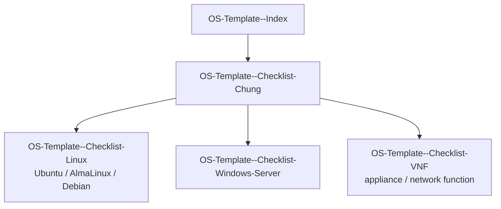

---
tags:
  - os-template
  - checklist
  - kvm
  - moc
---

# OS Template - Build Checklist (KVM: CloudStack / OpenStack / OpenNebula)

MOC (Map of Content) cho bộ checklist dùng khi build/publish OS template trên hạ tầng KVM, áp dụng chung cho CloudStack, OpenStack và OpenNebula.

## Cách dùng

1. Mọi lần build template mới hoặc rebuild template cũ, đi qua [[OS-Template--Checklist-Chung]] trước — đây là phần bắt buộc, không phụ thuộc OS hay platform.
2. Sau đó mở checklist riêng theo nhóm OS đang build:
   - [[OS-Template--Checklist-Linux]] — Ubuntu, AlmaLinux, Debian
   - [[OS-Template--Checklist-Windows-Server]] — Windows Server
   - [[OS-Template--Checklist-VNF]] — virtualized network function / appliance (FortiGate, vRouter, load balancer ảo...)
3. Tick đủ cả 2 file (chung + riêng) trước khi đánh dấu template `ispublic`/`visibility=public`/sẵn sàng bàn giao.

> [!NOTE]
> Checklist riêng theo OS chỉ liệt kê **điểm khác biệt/đặc thù** so với checklist chung — không lặp lại toàn bộ nội dung chung để tránh 2 nơi dễ lệch nhau khi update.

## Sơ đồ quan hệ

## Quyết định đã chốt

- **Hardening baseline**: CIS Benchmark **Level 1** — vì đây là template dùng chung cho nhiều mục đích, không áp Level 2 (quá chặt, dễ gãy ứng dụng chạy trên template).
- **Windows licensing model**: **KMS** — không activate trong image, client tự activate qua KMS server nội bộ ở lần boot đầu.
- **Rebuild cadence**: **định kỳ theo lịch** (không rebuild ngay mỗi khi có CVE critical phát sinh) — xem lịch cụ thể ở [[OS-Template--Checklist-Chung]] mục 9.

Chi tiết áp dụng xem [[OS-Template--Checklist-Chung]] và [[OS-Template--Checklist-Windows-Server]].
