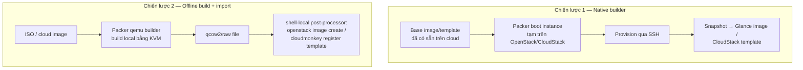

# Packer — OpenStack & CloudStack Builders

> [!info] Phạm vi version
> Packer **1.16.1** (mới nhất, 2026-09-18, [endoflife.date](https://endoflife.date/hashicorp-packer)). Plugin `openstack` **v1.1.4** (2026-08-13, đang được maintain tích cực). Plugin `cloudstack` **v1.0.2** (2022-08-19) — gần như **bỏ hoang 4 năm**, đọc kỹ phần Gotchas trước khi dùng cho CloudStack.

Build image cho private cloud như OpenStack/CloudStack khác hẳn build AMI hay `.box` — vì **không có base image "chuẩn" sẵn trên cloud của bạn** như AWS có AMI public của Canonical. Hai câu hỏi phải trả lời trước khi viết template: build **trên** cloud đang chạy hay build **offline** rồi mới đem lên; và mỗi hypervisor bên dưới (KVM/XenServer/VMware) đòi format image khác nhau.

---

## Hai chiến lược build — chọn cái nào

Ví dụ dễ hình dung: build "trên cloud" giống **thuê thợ tới tận công trường** dựng nhà mẫu rồi chụp ảnh lại làm catalogue — cần công trường (network, flavor, security group) đã có điện nước sẵn. Build "offline" giống **lắp nhà sẵn trong xưởng** rồi chở nguyên khối tới công trường — không cần công trường có gì cả, chỉ cần nơi nhận hàng.



| | Chiến lược 1 — Native builder (`source "openstack"` / `"cloudstack"`) | Chiến lược 2 — Offline `qemu` + import |
|---|---|---|
| Cần gì trước | Cloud đã có network/flavor/**base image sẵn** để boot instance tạm | Chỉ cần máy build có KVM, không đụng tới cloud cho tới bước cuối |
| Vấn đề con gà quả trứng | Có — cần 1 image gốc tồn tại trước để tạo image mới | Không — build từ ISO/cloud image public, độc lập hoàn toàn với cloud đích |
| Build từ ISO trắng (cài OS từ đầu) | OpenStack: không hỗ trợ (builder chỉ nhận `source_image` có sẵn). CloudStack: về mặt lý thuyết có (`source_iso`) nhưng **thực tế không chạy được** với plugin chính thức — xem Gotchas | Chạy tốt — đây là sở trường của `qemu` builder, giống hệt cách build `.box`/AMI đã có trong [[Core Concepts]] |
| Phù hợp khi | Chỉ cần "customize thêm" từ 1 image/template đã có sẵn trên cloud (cài thêm app, patch) | Build "golden image" từ số 0, cần kiểm soát toàn bộ OS install, hoặc cloud chưa có image nào để làm điểm xuất phát |
| Khuyến nghị | Dùng cho incremental update trên image đã tồn tại | **Mặc định khuyến nghị** cho build image lần đầu / golden image định kỳ, nhất là với CloudStack |

---

## Chiến lược 1 — Native builder

### source "openstack"

```hcl
packer {
  required_plugins {
    openstack = {
      version = ">= 1.1.4"
      source  = "github.com/hashicorp/openstack"
    }
  }
}

source "openstack" "app" {
  # Auth — chọn 1 trong các cách bên dưới (xem bảng Auth)
  identity_endpoint = var.os_auth_url
  username          = var.os_username
  password          = var.os_password
  tenant_name       = var.os_project_name
  region            = var.os_region

  # Instance tạm để provision
  flavor         = "m1.small"
  source_image   = var.base_image_id      # UUID image đã có sẵn trong Glance
  networks       = [var.network_id]
  security_groups = ["packer-build"]
  ssh_username   = "ubuntu"

  # Output image
  image_name        = "app-${var.app_version}"
  image_disk_format = "qcow2"
  image_tags        = ["managed-by:packer"]
}
```

**Cách hoạt động:** Packer gọi Nova API boot 1 instance từ `source_image`, SSH vào chạy provisioner, rồi gọi Glance snapshot instance đó thành image mới, cuối cùng terminate instance tạm — logic giống hệt `amazon-ebs` đã có ở [[Core Concepts]], chỉ đổi Nova/Glance thay cho EC2/AMI.

#### Auth — các cách xác thực

| Cách | Khi dùng | Field chính |
|---|---|---|
| `clouds.yaml` | Khuyến nghị — cùng file `clouds.yaml` dùng chung với `openstack` CLI, không hardcode credential vào `.pkr.hcl` | `cloud = "mycloud"` |
| Username/password + biến `OS_*` | Quen thuộc với ai hay dùng `source <user>-openrc.sh` | `identity_endpoint`, `username`, `password`, `tenant_name`/`tenant_id`, `domain_name` (Identity v3) |
| Application credential | An toàn hơn password — scope giới hạn, revoke riêng không ảnh hưởng user chính, không cần đổi khi user đổi password | `application_credential_id`, `application_credential_name`, `application_credential_secret` |
| Token | Khi đã có token từ hệ thống khác (ít dùng trực tiếp trong Packer) | `token` |

Dù chọn cách nào, set `insecure = true` chỉ khi identity endpoint dùng self-signed cert nội bộ — đừng bật mặc định, tắt luôn verify TLS là tự mở cửa cho MITM trên network quản trị.

### source "cloudstack"

```hcl
packer {
  required_plugins {
    cloudstack = {
      version = ">= 1.0.2"
      source  = "github.com/hashicorp/cloudstack"
    }
  }
}

source "cloudstack" "app" {
  api_url    = var.cs_api_url      # hoặc env CLOUDSTACK_API_URL
  api_key    = var.cs_api_key      # hoặc env CLOUDSTACK_API_KEY
  secret_key = var.cs_secret_key   # hoặc env CLOUDSTACK_SECRET_KEY

  source_template  = var.base_template_id   # clone từ template có sẵn — path khuyến nghị
  service_offering = "Medium Instance"
  network          = "packer-build-net"
  zone             = "zone-01"

  template_name    = "app-${var.app_version}"
  template_os      = "Ubuntu 22.04 LTS"
  ssh_username     = "ubuntu"
}
```

`source_iso` và `source_template` **loại trừ nhau** — chỉ khai báo 1 trong 2. Builder clone/boot từ nguồn đó, provision qua SSH, rồi gọi CloudStack API tạo template mới.

---

## Chiến lược 2 — Build offline bằng `qemu` rồi import (khuyến nghị)

Dùng `source "qemu"` y hệt note [[Core Concepts]] đã có (cài OS qua `boot_command`/cloud image, output `qcow2`), rồi thêm 1 bước `post-processor "shell-local"` gọi CLI của cloud đích để đăng ký image/template:

```hcl
build {
  sources = ["source.qemu.app"]

  provisioner "shell" {
    script = "scripts/install-deps.sh"
  }

  # Sysprep — xem phần Golden Image Sysprep bên dưới, luôn là provisioner CUỐI CÙNG
  provisioner "shell" {
    inline = ["sudo cloud-init clean --logs --machine-id --seed"]
  }

  post-processor "shell-local" {
    only = ["qemu.app"]
    inline = [
      "openstack image create ${var.app_version} --disk-format qcow2 --container-format bare --file output-qemu/app --private"
    ]
  }
}
```

Với CloudStack không có CLI tương đương `openstack image create` dựng sẵn trong ecosystem HashiCorp — dùng `cloudmonkey` (CLI chính thức Apache CloudStack) trong `shell-local`:

```hcl
post-processor "shell-local" {
  only = ["qemu.app"]
  inline = [
    "cmk registerTemplate name=app-${var.app_version} displayText=app-${var.app_version} format=QCOW2 hypervisor=KVM ostypeid=<id> url=file:///path/to/output-qemu/app zoneid=<zone-id>"
  ]
}
```

Chiến lược này **không phụ thuộc vào builder native của cloud đích** — nên đây là đường vòng đáng tin cậy nhất khi builder `cloudstack` gặp giới hạn (xem Gotchas ngay dưới).

---

## Image format theo hypervisor

| Cloud / Hypervisor | Format bắt buộc | Ghi chú |
|---|---|---|
| OpenStack (hầu hết KVM) | `qcow2` hoặc `raw` qua Glance | `container_format` thường để `bare` |
| CloudStack + KVM | `qcow2` | `hypervisor = "KVM"` trong template |
| CloudStack + XenServer | `VHD` | Dùng `qemu-img convert -f qcow2 -O vpc` để convert nếu build gốc ra qcow2 |
| CloudStack + VMware | `OVA` | Cần đóng gói OVF + VMDK thành OVA, qemu builder không ra thẳng OVA — cần bước convert thêm |

---

## Golden Image Sysprep — dọn trước khi snapshot

Image build 1 lần nhưng được clone ra hàng chục/hàng trăm VM — nếu không dọn, VM nào cũng **giống hệt nhau ở những chỗ lẽ ra phải là duy nhất**, kiểu như photocopy luôn cả chữ ký tay. Hai chỗ hay bị quên nhất:

- **`/etc/machine-id`**: không reset → mọi VM clone ra chia sẻ chung machine-id, một số hệ thống dùng nó để cấp DHCP lease/systemd journal ID bị lẫn lộn giữa các VM.
- **SSH host key** (`/etc/ssh/ssh_host_*`): không xoá → mọi VM clone ra xài chung host key, client SSH connect vào VM khác nhau nhưng cùng fingerprint — về lý thuyết mở đường cho impersonation/MITM giữa các VM trong cùng tenant.

Lệnh dọn chuẩn, chạy làm **provisioner cuối cùng** trước khi Packer snapshot (đúng nguyên tắc "cleanup trước khi provisioner kết thúc" đã ghi ở [[Provisioners & Post-Processors]]):

```bash
sudo cloud-init clean --logs --machine-id --seed
sudo rm -f /etc/ssh/ssh_host_*
```

`cloud-init clean --machine-id` set `/etc/machine-id` về trạng thái uninitialized để lần boot tiếp theo tự sinh ID mới; `--seed`/`--logs` xoá luôn semaphore cloud-init để VM mới coi đây là **first boot** thật sự — nếu không, cloud-init thấy đã chạy rồi và bỏ qua luôn bước inject SSH key/hostname từ metadata, VM lên nhưng không SSH vào được bằng key đã inject.

---

## Gotchas

- **CloudStack: `boot_command` có trong docs nhưng không có trong plugin** — Theo chia sẻ thực tế tại CloudStack Collaboration Conference 2024 (Swen Brüseke, proIO GmbH), builder `cloudstack` chính thức của HashiCorp **không implement** cơ chế gõ `boot_command` để tự động hoá cài đặt từ `source_iso` — nghĩa là build template CloudStack từ ISO trắng **không chạy unattended được** dù docs liệt kê field này. Symptom: build đứng chờ ở bước boot ISO, không có cách nào gửi phím tự động qua console. Cause: thiếu implementation, phụ thuộc console access qua VNC-over-websocket mà thư viện `go-vnc` plugin dùng đã bị archive từ 2024-07-22, gây lỗi auth `no suitable auth schemes found`. Cách tránh: dùng `source_template` (clone từ template có sẵn) thay vì `source_iso`, hoặc dùng Chiến lược 2 (build qua `qemu` rồi `cmk registerTemplate`). Nguồn: [CCC 2024 — Using the Packer Provider for CloudStack: What's Missing](https://www.cloudstackcollab.org/wp-content/uploads/2024/12/CCC-2024-Using-the-Packer-Provider-for-Cloudstack-Swen-Brueseke-2.pdf).
- **Plugin `cloudstack` gần như bỏ hoang** — Release mới nhất `v1.0.2` từ 2022-08-19, hơn 4 năm không có release mới tính tới thời điểm viết note này (2026-10). Có fork cộng đồng [sbrueseke/packer-plugin-cloudstack](https://github.com/sbrueseke/packer-plugin-cloudstack) cố fix phần console/VNC nhưng PR gửi về repo chính thức chưa được merge, và biến `{{ .HTTPIP }}` vẫn chưa hoạt động đúng trong fork này. Đừng đặt cược golden image pipeline production vào builder native này cho CloudStack — ưu tiên Chiến lược 2. Nguồn: cùng slide CCC 2024 ở trên, và [releases page](https://github.com/hashicorp/packer-plugin-cloudstack/releases).
- **OpenStack native builder đòi `source_image` có sẵn — vấn đề con gà quả trứng** — Khác AWS (luôn có AMI public Canonical/RedHat sẵn), 1 cloud OpenStack mới dựng có thể **chưa có image nào trong Glance** để `source_image` trỏ vào. Cách tránh: dùng `external_source_image_url` (builder tự tải cloud image từ URL về Glance trước khi boot) cho lần đầu, hoặc chuyển hẳn sang Chiến lược 2 để không phụ thuộc image có sẵn. Nguồn: [OpenStack Builder docs](https://developer.hashicorp.com/packer/integrations/hashicorp/openstack/latest/components/builder/openstack).
- **Metadata service không reachable → cloud-init treo, SSH key không được inject** — Trên network OpenStack bị cô lập/firewall chặn, instance tạm của Packer không gọi được `169.254.169.254` (metadata service chạy qua Neutron router/DHCP namespace) → cloud-init timeout, instance boot xong nhưng không có SSH key, Packer connect SSH fail liên tục cho tới hết `ssh_timeout`. Cách tránh: set `config_drive = true` trong `source "openstack"` — Nova ghi metadata thẳng vào 1 drive gắn kèm instance, không phụ thuộc network reach được metadata service. Nguồn: [Nova Config Drive docs](https://docs.openstack.org/nova/latest/admin/config-drive.html).
- **Source image thiếu `cloud-init` → OpenStack/CloudStack không inject được SSH key/hostname** — Nếu base image/ISO dùng để build không có sẵn `cloud-init` (hay gặp khi tự build ISO minimal), VM deploy ra từ template/image mới sẽ **không nhận keypair** lúc launch — login bằng key đã chọn trong Nova/CloudStack bị reject, phải fallback password hoặc console. Cách tránh: cài `cloud-init` (và `cloud-utils-growpart` để tự giãn disk) trong provisioner, trước bước sysprep. Nguồn: thực hành phổ biến khi build qua `qemu` cho OpenStack, xem ví dụ tại [Shan's Corner — Customized Ubuntu Images using Packer + QEMU + Cloud-Init](https://shantanoo-desai.github.io/posts/technology/packer-ubuntu-qemu/).
- **`disk_format`/`container_format` sai khi `openstack image create`** — Image lên Glance ở trạng thái `active` (coi như "thành công") nhưng instance deploy từ nó không boot được hoặc kernel panic, vì Glance tin theo đúng format khai báo trong flag, không tự detect. Ví dụ build ra `raw` nhưng khai `--disk-format qcow2` thì Nova đọc sai cấu trúc file. Cách tránh: `qemu-img info output-qemu/app` kiểm tra format thật trước khi `openstack image create`, đảm bảo khớp 100% với flag `--disk-format`. Nguồn: [OpenStack image command reference](https://docs.openstack.org/python-openstackclient/latest/cli/command-objects/image/v2/index.html).

---

## Cross-References

- Builder `qemu` (nền tảng cho Chiến lược 2): xem [[Core Concepts#qemu (build image cho KVM/libvirt)]]
- Cleanup provisioner trước khi snapshot: xem [[Provisioners & Post-Processors#Gotchas]]
- Glance — Image Service chi tiết (API, image properties, member sharing): xem [[Glance - Image]]
- Kiến trúc tổng thể OpenStack: xem [[OpenStack]]
- Kiến trúc tổng thể CloudStack, Secondary Storage nơi template được lưu: xem [[Cloudstack]]
- Ví dụ thực tế import template + deploy VM trên CloudStack (dùng UI, không qua Packer): xem [[CloudStack Template - Import Guest OS Template và Deploy VM đầu tiên]]

## Resources

- [OpenStack Builder — official docs](https://developer.hashicorp.com/packer/integrations/hashicorp/openstack/latest/components/builder/openstack)
- [CloudStack Builder — official docs](https://developer.hashicorp.com/packer/integrations/hashicorp/cloudstack/latest/components/builder/cloudstack)
- [packer-plugin-openstack — GitHub](https://github.com/hashicorp/packer-plugin-openstack)
- [packer-plugin-cloudstack — GitHub](https://github.com/hashicorp/packer-plugin-cloudstack)
- [CCC 2024 — Using the Packer Provider for CloudStack: What's Missing (PDF)](https://www.cloudstackcollab.org/wp-content/uploads/2024/12/CCC-2024-Using-the-Packer-Provider-for-Cloudstack-Swen-Brueseke-2.pdf) — nguồn chính cho các gotcha CloudStack ở trên
- [OpenMetal — Creating Custom Images with Packer](https://openmetal.io/docs/manuals/engineers-notes/custom-image-packer) — ví dụ end-to-end native builder trên OpenStack thật
