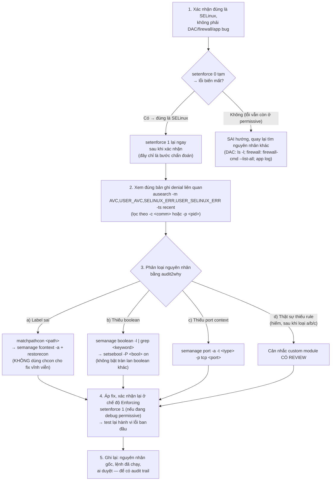

# SELinux — Incident/Denial Triage Runbook
Tier: 2
Parent: [[selinux]]
Related: [[selinux--troubleshooting]], [[selinux--contexts-and-labeling]], [[selinux--booleans]], [[selinux--port-network-labeling]]
Tags: #selinux #runbook #incident

## What it does

Quy trình xử lý khi có báo cáo "service lỗi/permission denied nghi do SELinux" — thứ tự các bước đúng để không đi tắt sang "tắt SELinux cho xong" hay "audit2allow bừa".

## Why it exists

Áp lực khi có sự cố production ("site down") rất dễ dẫn tới quyết định sai: `setenforce 0` hoặc disable hẳn để "cứu hoả" rồi quên bật lại — hoặc ngược lại, `audit2allow -M x -a | semodule -i` không review, vô tình mở lỗ hổng. Runbook này ép đi đúng thứ tự chẩn đoán trước khi hành động.

## How it works (flow/diagram)

## Config gotchas

- Bước 1 (`setenforce 0` để chẩn đoán) chỉ nên làm trên hệ thống có thể chấp nhận rủi ro tạm thời MAC bị tắt vài phút — với hệ thống cực kỳ nhạy cảm, ưu tiên cô lập bằng `semanage permissive -a <domain_nghi_ngờ>` thay vì hạ cả hệ thống (xem [[selinux--modes-and-relabeling]]).
- Đừng bỏ qua bước 3 để nhảy thẳng bước "generate module" — tỷ lệ denial thực tế do label/boolean/port sai cao hơn nhiều so với thiếu rule thật sự, theo đúng khuyến nghị chính thức RHEL.
- Sau khi fix bằng `semanage fcontext`, nhớ đây là thay đổi **persistent** — ghi vào tài liệu bàn giao/runbook nội bộ, không chỉ để trong lịch sử shell cá nhân.

## Security notes

- Một denial log không tự động là "bug cần fix" — nếu domain/path liên quan tới hành vi lạ (VD: process web server cố đọc `/etc/shadow`, hoặc domain không quen thuộc cố bind port lạ), đây có thể là **dấu hiệu tấn công đang bị chặn đúng** — việc "sửa" ở đây phải là điều tra, không phải mở quyền.
- Luôn đặt câu hỏi trước khi mở bất kỳ quyền nào: "nếu đây là hành vi độc hại, việc tôi vừa allow có tạo lỗ hổng mới không?"

## Refs

- [Chapter 5 — Troubleshooting problems related to SELinux (RHEL 9)](https://docs.redhat.com/en/documentation/red_hat_enterprise_linux/9/html/using_selinux/troubleshooting-problems-related-to-selinux_using-selinux)
