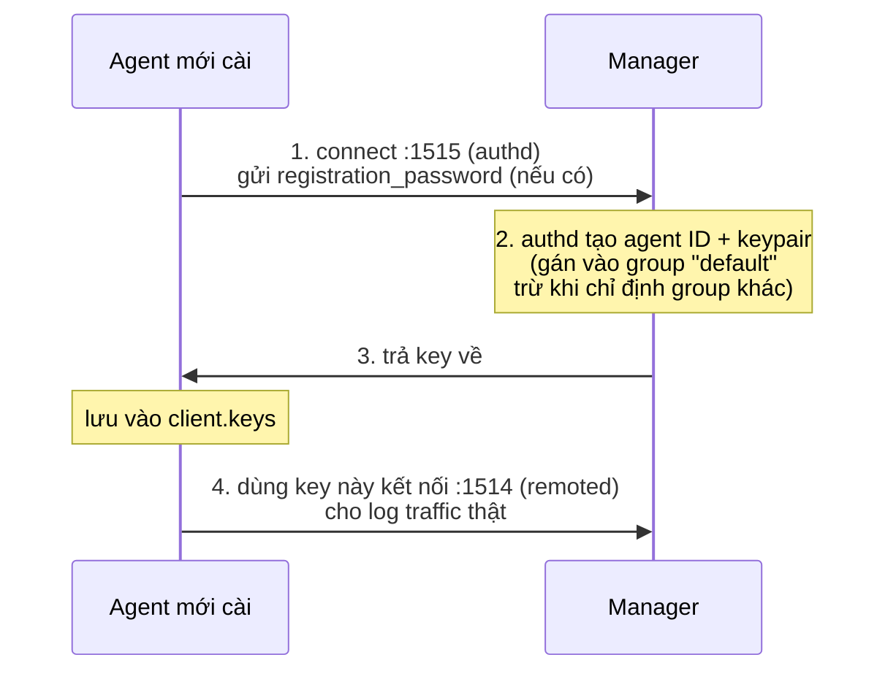

# Wazuh — Agent Enrollment
Tier: 2
Parent: [[wazuh]]
Related: [[wazuh--rules-decoders]], [[wazuh--active-response]]
Tags: #wazuh #agent #auth

## What it does

Quá trình một endpoint mới cài `wazuh-agent` xin được manager "công nhận": nhận một agent ID + key mã hoá duy nhất, lưu local (`client.keys`), rồi dùng key đó để mọi giao tiếp sau này (1514) được manager tin và giải mã đúng.

## Why it exists

Manager không thể chấp nhận data từ nguồn chưa xác thực — nếu không, ai cũng gửi log giả vào được. Với vài chục server thì copy tay key qua `manage_agents` ổn, nhưng với hàng nghìn endpoint (autoscaling, cloud instance ephemeral) thì cần cơ chế tự động bootstrap trust — đó là `authd`.

## How it works (flow/diagram)

Cách thủ công (không dùng authd): admin chạy `manage_agents` trên manager để add agent + export key, rồi import key đó vào agent bằng tay (`manage_agents -i`). An toàn hơn nhưng không scale.

## Config gotchas

- `registration_password` **mặc định rỗng** — nếu 1515 mở ra ngoài mà không set, bất kỳ ai cũng enroll được agent giả.
- Enrollment config nằm trong block `<enrollment>` của `ossec.conf` (agent) — dễ quên set khi build golden image, agent enroll xong nhưng vào nhầm group mặc định "default" thay vì group có ruleset đúng cho loại host đó.
- Group-based enrollment: agent được gán config/ruleset theo group — enroll nhầm group = agent chạy sai policy (vd server DB bị áp policy generic thay vì policy riêng có rule DB).
- `<allowed-ips>` giới hạn dải IP được phép enroll qua authd — hay bị bỏ trống khi setup nhanh, nên thêm vào production.

## Security notes

- Chỉ expose 1515 (authd) trong mạng nội bộ/VPN, không public — đây là bước xác thực ban đầu nên là điểm yếu nhất trong toàn chuỗi trust.
- Rotate `registration_password` định kỳ, không để trong golden image dạng plaintext lâu dài.
- `client.keys` bị lộ (endpoint compromise, backup image leak...) = attacker impersonate agent đó — có thể gửi alert giả để che dấu attack thật đang diễn ra trên chính host đó, hoặc dùng connection đó làm covert channel.
- Cân nhắc dùng client certificate (`<ssl_manager_cert>`, `verify_manager_ip`) thay vì chỉ dựa password cho môi trường compliance cao.

## Refs

- https://documentation.wazuh.com/current/user-manual/registering/index.html
