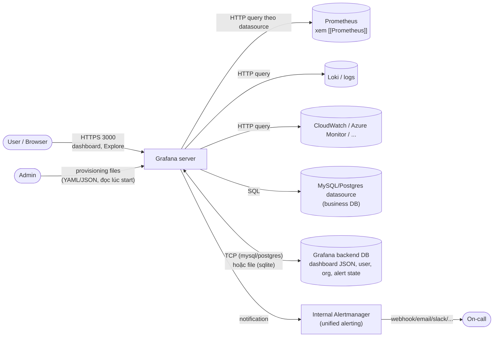
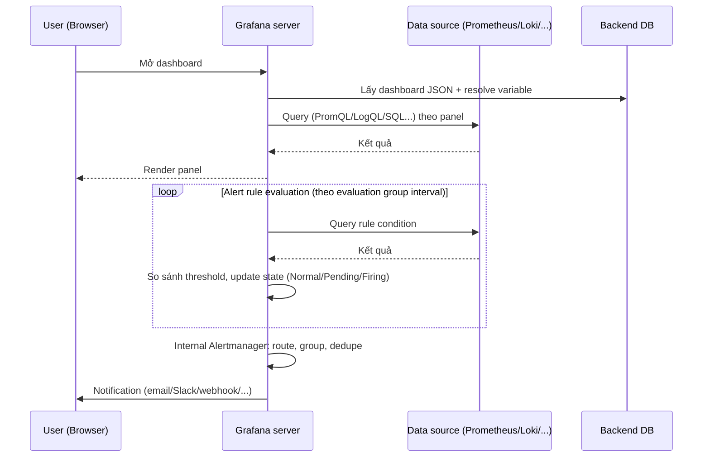

# Grafana — Platform visualization & dashboarding

> [!info] Phạm vi version
> Note áp dụng cho **Grafana OSS 13.3.0** (latest stable tại ngày 2026-11-01, [download page](https://grafana.com/grafana/download?edition=oss)). Note pin theo bản **OSS (Apache 2.0, self-hosted)** — các tính năng chỉ có ở **Enterprise** hoặc **Cloud** được đánh dấu inline `(Enterprise)`/`(Cloud)`.

## 1. What — Nó là cái gì?

> Nếu Prometheus là cuốn sổ ghi số liệu thô thì Grafana là **người thuyết trình** cầm cuốn sổ đó lên vẽ biểu đồ, kể chuyện cho cả phòng hiểu — cùng một cuốn sổ, vẽ kiểu khác nhau là ra câu chuyện khác nhau.

Grafana là platform visualization & dashboarding mã nguồn mở — tự nó **không lưu metric/log/trace**, mà kết nối tới nhiều nguồn dữ liệu (Prometheus, Loki, MySQL, CloudWatch...) qua data source, rồi vẽ thành dashboard, kèm hệ thống alerting riêng (unified alerting) đánh giá và gửi notification dựa trên dữ liệu từ các nguồn đó.

## 2. Why — Tại sao tồn tại / Vấn đề nó giải quyết?

Mỗi hệ thống lưu trữ (Prometheus, Loki, CloudWatch, Postgres...) có UI query riêng, khác nhau hoàn toàn. Không có Grafana, team phải mở nhiều tool khác nhau để ráp lại một bức tranh — ví dụ muốn xem CPU (Prometheus) cùng lúc với log lỗi (Loki) của cùng một incident là phải chuyển qua lại 2 tab, tự khớp mốc thời gian bằng tay.

Grafana giải quyết việc đó bằng một layer **thống nhất**: một time range control cho mọi panel, một ngôn ngữ dashboard JSON duy nhất bất kể data source phía sau là gì, và một hệ thống alerting duy nhất có thể đánh giá rule trên nhiều data source khác nhau cùng lúc.

## 3. When — Dùng khi nào / KHÔNG dùng khi nào?

**Dùng khi:**
- Cần dashboard trực quan, chia sẻ được, cho nhiều nguồn dữ liệu khác nhau cùng lúc.
- Cần một nơi duy nhất quản lý alerting rule cho nhiều data source (Prometheus, Loki, CloudWatch...).
- Team cần self-service dashboard (mỗi team tự build dashboard riêng trên data source chung).

**KHÔNG dùng / cân nhắc thay thế khi:**
- Cần **lưu trữ** metric/log — Grafana không phải nơi lưu data, nó chỉ đọc; vẫn cần Prometheus/Loki/Mimir phía sau.
- Chỉ cần 1 dashboard tĩnh đơn giản cho 1 data source duy nhất, không cần chia sẻ — đôi khi dashboard built-in của data source đó (ví dụ Prometheus UI, Kibana cho Elasticsearch) đã đủ, không cần thêm Grafana vào kiến trúc.
- Cần reporting PDF/scheduled report tự động — tính năng này chỉ có ở **Enterprise/Cloud**, OSS phải tự build qua script gọi render API hoặc dùng plugin bên thứ 3.
- Cần SSO/SAML + RBAC chi tiết theo action — OSS chỉ có RBAC cơ bản (basic roles: Viewer/Editor/Admin), SAML/custom RBAC role là **Enterprise/Cloud**.

## 4. Where — Architecture & Deployment



Điểm cần nhìn: Grafana **đứng giữa** — không có mũi tên nào đi từ Prometheus/Loki/CloudWatch *vào* Grafana một cách chủ động, luôn là Grafana **chủ động query** ra ngoài (giống Prometheus scrape target). Backend DB (SQLite/MySQL/Postgres) là nơi lưu **state của Grafana** (dashboard JSON, user, org, alert rule, alert state) — không liên quan gì tới nơi lưu metric thật.

- **Vị trí trong hệ thống:** tầng visualization + alerting, nằm phía trên mọi data source, phía dưới người dùng cuối.
- **Component chính:** Grafana server (web + API + query proxy), backend DB (state), unified alerting engine (có Alertmanager riêng bên trong), plugin system.
- **Traffic/data flow:** User → Grafana UI → Grafana server proxy query tới data source → trả về panel; alert rule evaluation → internal Alertmanager → notification.
- **Dependency:** Database backend (SQLite cho dev/nhỏ, MySQL/Postgres cho production/HA — xem [[grafana--ha-database]]), network tới mọi data source (mất network tới 1 datasource chỉ hỏng panel dùng nó, không sập cả Grafana), SMTP/webhook endpoint cho notification nếu dùng alerting.

### Mô hình triển khai

| Mô hình | Khi nào chọn | Số node tối thiểu | Không bảo vệ được |
|---|---|---|---|
| Single node + SQLite | Lab, dev, 1 người dùng | 1 | Mất node = mất toàn bộ dashboard/config; không scale concurrent user |
| Single node + MySQL/Postgres | Production nhỏ, không cần HA | 1 Grafana + 1 DB | Mất node Grafana vẫn downtime (dù data không mất vì đã ở DB ngoài) |
| HA — nhiều Grafana instance + shared DB + load balancer | Production cần uptime cao, nhiều user | 2+ Grafana + 1 shared MySQL/Postgres (nên tự HA luôn) + LB | Không tự giải quyết datasource phía sau down; alerting HA cần thêm cấu hình gossip riêng, xem [[grafana--ha-database]] |

## 5. How — Cơ chế hoạt động

Core concepts cần nắm:

- **Dashboard, Panel & Variables** — đơn vị hiển thị cơ bản và cách làm dashboard "động" theo lựa chọn người xem. → [[grafana--dashboards-panels-variables]]
- **Data source** — cách Grafana kết nối và query ra hệ thống khác, kèm access mode (proxy/direct) ảnh hưởng bảo mật. → [[grafana--datasources]]
- **Unified Alerting** — hệ thống alerting riêng của Grafana, có Alertmanager nội bộ, Grafana-managed rule vs data source-managed rule. → [[grafana--alerting]]
- **Provisioning as code** — nạp dashboard/datasource/alert rule từ file YAML/JSON lúc start, phục vụ GitOps. → [[grafana--provisioning]]
- **Plugin system** — panel plugin, data source plugin, app plugin — mở rộng Grafana ra ngoài core. → [[grafana--plugins]]
- **RBAC, Teams & Organizations** — mô hình phân quyền 3 lớp (org role, team, folder/resource permission). → [[grafana--rbac-teams-orgs]]
- **HA & Database backend** — cách chạy nhiều Grafana instance và chọn DB backend đúng. → [[grafana--ha-database]]
- **Explore** — chế độ query ad-hoc không cần tạo dashboard, dùng để debug nhanh 1 query trên 1 data source (Tier 1, không có config/failure mode riêng để cần note riêng).
- **Annotations** — đánh dấu event (deploy, incident) lên timeline của mọi panel cùng lúc, có thể tạo tay hoặc tự động từ data source/API (Tier 1).

### Ai thắng khi xung đột

Nguyên tắc chung: **dashboard được provisioning từ file luôn thắng chỉnh sửa UI** khi Grafana reload config — chi tiết đầy đủ ở [[grafana--provisioning#Ai thắng khi xung đột]]. Ở mức root note, điểm cần nhớ là nguyên tắc tổng về permission:

| Bên A | Bên B | Kết quả | Im lặng hay báo lỗi? |
|---|---|---|---|
| Org role (Viewer/Editor/Admin) | Folder/dashboard permission cụ thể | Permission cụ thể hơn **thắng** nếu được set riêng (ví dụ Viewer org role nhưng được gán Edit permission trên 1 folder cụ thể) | Im lặng — không có cảnh báo conflict |
| Provisioned dashboard (`allowUiUpdates: false`) | User sửa trên UI | User **không sửa được**, nút Save bị disable hoặc sửa xong bị revert lúc Grafana reload | Báo lỗi/disable rõ trên UI nếu `false`; im lặng bị đè lại nếu `true` + provisioning file reload |



Điểm cần để ý: Grafana có **2 vòng lặp độc lập** giống Prometheus — vòng query khi user mở dashboard (on-demand) và vòng evaluate alert rule (định kỳ, chạy ngay cả khi không ai mở dashboard). Alert rule evaluation vẫn tốn tài nguyên data source dù không ai đang nhìn dashboard.

## 6. Key Config — Cấu hình cần nhớ

| Config | Default | Khuyến nghị | Vì sao |
|---|---|---|---|
| `[server] http_port` | `3000` | Giữ hoặc đổi theo chuẩn hạ tầng, luôn đặt sau reverse proxy có TLS | Grafana không tự làm TLS cho web UI theo default |
| `[security] admin_user` / `admin_password` | `admin` / `admin` | Đổi ngay lần đầu login, hoặc set qua env var trước khi start lần đầu | Default `admin/admin` là mục tiêu đầu tiên của mọi scanner tự động |
| `[security] secret_key` | Giá trị mặc định cố định trong binary | Đổi sang giá trị random riêng, nhất là trước khi backup/clone DB | `secret_key` dùng để mã hoá secret của datasource trong DB — giữ default là ai có bản DB leak cũng decrypt được secret |
| `[database] type` | `sqlite3` | Đổi sang `mysql`/`postgres` cho production/HA | SQLite không hỗ trợ nhiều Grafana instance cùng truy cập, không phù hợp HA |
| `[auth.anonymous] enabled` | `false` | Giữ `false`, nếu cần bật thì `org_role = Viewer`, không bao giờ `Admin` | Bật kèm `Admin` là cho ai chạm được network full quyền admin không cần đăng nhập |
| `[dashboards] default_home_dashboard_path` | Rỗng | Set dashboard tổng quan làm home, tránh lộ dashboard nhạy cảm làm mặc định | Dashboard mặc định hiện cho mọi user mới — chọn sai dễ lộ thông tin không cần thiết |
| Data source **Access** mode | `Server (proxy)` (khuyến nghị, hiện hầu hết UI chỉ còn lựa chọn này cho datasource mới) | Luôn dùng `proxy` | `Browser (direct)` (legacy) để browser gọi trực tiếp datasource — credential/token datasource có thể lộ ra phía client, đây là nguồn gốc CVE-2026-27877 |

## 7. Network — Port & Firewall Rules

| Nguồn → Đích | Port/Proto | Mục đích | Default? | Triệu chứng khi bị chặn |
|---|---|---|---|---|
| User/Admin → Grafana | `3000/tcp` | Web UI + HTTP API | có (`[server] http_port`) | Browser báo `connection refused`/timeout khi mở dashboard |
| Grafana → Prometheus/Loki/... | `9090/tcp` (Prometheus), tuỳ datasource | Query data source qua proxy mode | tuỳ datasource | Panel hiện lỗi `Bad Gateway`/`datasource error`, data source test connection fail |
| Grafana → Backend DB (MySQL/Postgres) | `3306/tcp` (MySQL) / `5432/tcp` (Postgres) | Lưu dashboard/user/org/alert state | tuỳ cấu hình `[database]` | Grafana không start được, log báo lỗi connect DB ngay lúc boot |
| Grafana ↔ Grafana (HA alerting) | Port gossip tự chọn, thường `9094/tcp+udp` qua memberlist | Đồng bộ silence/notification state giữa instance | cần cấu hình `[unified_alerting.ha]` | 2 instance gửi trùng notification hoặc silence chỉ áp dụng 1 phần cluster — xem [[grafana--ha-database#Network]] |
| Grafana → SMTP/Slack/PagerDuty... | `25`/`587`/`443/tcp` tuỳ receiver | Gửi alert notification | tuỳ receiver | Alert evaluate đúng (state `Firing`) nhưng không ai nhận được gì |
| Grafana → Image Renderer plugin/service | `3000/tcp` (nếu chạy renderer dạng remote service riêng) | Render panel thành ảnh cho alert screenshot/PDF | cần cài thêm, không có default nếu không cài | Alert notification thiếu ảnh kèm, hoặc export PDF lỗi timeout |

^ports

**Kiểm tra nhanh khi nghi rule bị xoá:**

```bash
# TCP: "succeeded" = thông; "Connection refused" = thông mạng nhưng service không listen; timeout = bị firewall drop
nc -vz -w 3 <grafana-host> 3000
curl -s http://<grafana-host>:3000/api/health
```

> [!tip] Timeout vs refused
> `Connection timed out` gần như luôn là firewall/security group drop packet. `Connection refused` là mạng đã thông nhưng không có process listen (service chết hoặc bind sai interface). Phân biệt được hai cái này là biết nên gọi network team hay tự xem lại service.

## 8. Security Considerations

### Attack surface

- **Web UI/API `:3000`** — ai chạm được port này gặp màn hình login; nếu default credential chưa đổi hoặc anonymous access bật `Admin`, coi như full quyền.
- **Data source credential lưu trong Grafana DB** — mọi secret (API key, DB password của datasource) nằm trong backend DB, mã hoá bằng `secret_key` — leak DB + biết `secret_key` là lộ hết credential datasource.
- **Public dashboard** — tính năng share dashboard không cần login; nếu datasource phía sau dùng access mode cũ (`direct`) hoặc cấu hình sai, có thể lộ thêm thông tin không chủ đích (xem CVE dưới).
- **Plugin bên thứ 3** — plugin chạy code trong tiến trình Grafana (đặc biệt app plugin), nguồn cài đặt không chính thức là một bề mặt tấn công thêm.

### Misconfiguration gây breach

| Misconfiguration | Hậu quả |
|---|---|
| Không đổi `admin/admin` lúc setup lần đầu | Ai đoán được URL là login thẳng vào quyền Admin |
| `auth.anonymous.org_role = Admin` | Bất kỳ ai chạm network tới Grafana có full quyền admin không cần đăng nhập |
| Public dashboard + data source access mode `direct`/cấu hình sai | CVE-2026-27877 — password của **mọi** direct-mode data source trong org bị lộ qua public dashboard, kể cả data source không dùng trong dashboard đó (đã fix ở các bản ≥12.4.2/≥12.3.6/≥12.2.8..., 13.3.0 đang pin không bị ảnh hưởng) |
| Để Editor-role tuỳ ý xoá contact point protected | CVE-2026-72585 — Editor xoá được contact point mà không có quyền tương ứng trên bản ≤13.2.0 (đã fix trước bản 13.3.0 đang pin) |

### Hardening checklist tối thiểu

- [ ] Đổi `admin_user`/`admin_password` ngay khi setup, hoặc set qua provisioning/env var trước lần start đầu tiên.
- [ ] Đổi `[security] secret_key` sang giá trị random riêng cho từng môi trường — không dùng chung giữa dev/staging/production.
- [ ] Giữ `auth.anonymous.enabled = false` trừ khi thật sự cần public status page, và nếu bật thì `org_role = Viewer` tuyệt đối không `Admin`.
- [ ] Đặt reverse proxy TLS trước Grafana — Grafana không tự TLS cho web UI theo default.
- [ ] Review toàn bộ data source đang dùng access mode `Browser (direct)` — chuyển sang `Server (proxy)`.
- [ ] Review danh sách public dashboard đang active, đặc biệt nếu org có data source `direct` mode (liên quan CVE-2026-27877).
- [ ] Giới hạn quyền cài plugin (`plugin_admin_enabled`) chỉ cho Admin, review nguồn plugin trước khi cài — xem [[grafana--plugins#Security notes]].

## 9. Ops Runbook — Production Notes

> [!tip] Checklist hằng ngày & triage sự cố
> Phần này giải thích *vì sao*. Làm gì mỗi ngày và xử lý sự cố theo triệu chứng: [[Monitor--Runbook]].

- **Health check:** `curl http://<host>:3000/api/health` — trả JSON có `"database": "ok"` khi healthy.
- **Log quan trọng:** mặc định stdout hoặc `<data-dir>/log/grafana.log` tuỳ cách deploy. Grep `lvl=error`, `failed to connect to database`, `plugin`.
- **Metric cần alert:** Grafana tự expose metric tại `/metrics` (format Prometheus) — theo dõi `grafana_api_response_status_total` (tỉ lệ lỗi API), `grafana_alerting_rule_evaluation_failures_total` (rule alerting lỗi), `grafana_database_conn_*` (connection pool DB cạn).
- **Restart / rollback:** trong HA, restart từng instance 1 lần, không restart toàn bộ cùng lúc (mất khả năng evaluate alert tạm thời nếu backend alerting HA chưa đủ node còn sống).
- **Backup / restore:** backup backend DB (MySQL/Postgres dump, hoặc file SQLite) + thư mục provisioning/plugin cài thêm. Dashboard provisioning từ Git coi như đã có "backup" tự nhiên; dashboard tạo tay qua UI chỉ nằm trong DB.
- **Upgrade:** đọc release notes mỗi major version — Grafana core thường giữ backward-compat tốt, nhưng plugin bên thứ 3 có thể cần version matching riêng.

## 10. Gotchas & Lessons Learned

### Hay nhầm lẫn

| Dễ nhầm | Thực tế | Hậu quả khi nhầm |
|---|---|---|
| Grafana Alerting (unified alerting) vs Prometheus Alertmanager | Grafana có **Alertmanager nội bộ riêng** (fork từ model Prometheus), độc lập với Alertmanager của Prometheus — 2 hệ thống alerting khác nhau, không tự đồng bộ silence/notification | Config silence ở Alertmanager của Prometheus không ảnh hưởng gì tới alert rule chạy trong Grafana, và ngược lại |
| Grafana-managed alert rule vs Data source-managed alert rule (Mimir/Loki ruler) | Grafana-managed lưu & evaluate **trong Grafana**; data source-managed lưu & evaluate **trong Mimir/Loki** (qua Ruler API), chỉ hỗ trợ 2 loại datasource đó | Chọn nhầm loại rule khi cần scale alerting lớn — data source-managed mới tận dụng được khả năng scale ngang của Mimir/Loki |
| Data source Access mode `Server (proxy)` vs `Browser (direct)` | `proxy` nghĩa là **Grafana server** gọi datasource (browser không cần thấy credential); `direct` là **browser** gọi trực tiếp | Dùng `direct` cho datasource có credential nhạy cảm là lộ credential ra tận trình duyệt người xem |
| Dashboard UID vs Title | Grafana match dashboard theo **UID**, không theo title — đổi title không tạo dashboard mới | Provisioning 2 file khác UID nhưng title giống nhau tạo ra 2 dashboard riêng, dễ nhầm là "duplicate do lỗi" |

### Bẫy vận hành

#### `secret_key` default + backup DB bị leak lộ toàn bộ credential datasource

- **Triệu chứng:** backup database Grafana bị lộ (ví dụ snapshot để sai ACL trên S3), kèm theo đó mọi credential datasource trong instance đều bị lộ ngay khi attacker có cùng `secret_key` default.
- **Nguyên nhân:** `[security] secret_key` dùng để mã hoá secret của datasource trong DB, nếu không đổi khỏi giá trị mặc định thì bất kỳ Grafana instance nào dùng default đều decrypt được secret từ bất kỳ DB backup nào khác cũng dùng default.
- **Cách tránh / xử lý:** luôn set `secret_key` riêng ngay từ lúc setup, backup DB phải coi như tài sản nhạy cảm tương đương secret thật.
- **Nguồn:** [Grafana configuration docs — security section](https://grafana.com/docs/grafana/latest/setup-grafana/configure-grafana/)

#### Public dashboard lộ password datasource không liên quan (CVE-2026-27877)

- **Triệu chứng:** audit phát hiện password của data source **không được dùng** trong dashboard public vẫn bị lộ qua response của public dashboard API.
- **Nguyên nhân:** lỗi ở cách Grafana serialize config datasource cho public dashboard — không lọc kỹ field password khi datasource ở access mode direct, ảnh hưởng toàn bộ org chứ không riêng datasource được dùng.
- **Cách tránh / xử lý:** upgrade lên version đã fix (xem bảng Misconfiguration ở trên), review lại toàn bộ public dashboard đang active, chuyển hết datasource về `proxy` mode.
- **Nguồn:** [Grafana security advisory GHSA — CVE-2026-27877](https://grafana.com/security/security-advisories/cve-2026-27877/)

#### Provisioning reload đè mất chỉnh sửa UI tưởng đã lưu

- **Triệu chứng:** user sửa dashboard trên UI, bấm Save báo thành công, nhưng vài phút sau dashboard tự "trở lại" bản cũ.
- **Nguyên nhân:** dashboard được provisioning từ file, Grafana reload file theo `updateIntervalSeconds` và **luôn ghi đè** bản trong DB bằng bản trong file, bất kể UI đã sửa gì.
- **Cách tránh / xử lý:** với dashboard provisioned, sửa ở file nguồn (Git) rồi để Grafana tự reload, không sửa tay qua UI; nếu cần cho phép sửa UI tạm thời, hiểu rõ `allowUiUpdates` chỉ trì hoãn việc bị đè, không ngăn hẳn. Chi tiết: [[grafana--provisioning#Ai thắng khi xung đột]].
- **Nguồn:** [Grafana provisioning docs](https://grafana.com/docs/grafana/latest/administration/provisioning/)

### Lesson learned thực tế

> [!todo] Bổ sung khi có sự cố hoặc kinh nghiệm thực tế
> Format: `YYYY-MM-DD — <chuyện gì xảy ra> — <impact> — <root cause> — <bài học>` + link `[[incident note]]` nếu có.

## 11. Resources

- **Official docs (13.3.0):** <https://grafana.com/docs/grafana/latest/>
- **Download / release notes:** <https://grafana.com/grafana/download?edition=oss>
- **Security advisories:** <https://grafana.com/security/>
- **Bài viết thực tế:** [CVE-2026-27877 advisory](https://grafana.com/security/security-advisories/cve-2026-27877/), [Grafana HA setup tutorial](https://grafana.com/tutorials/ha_setup)
- **Note liên quan:** [[grafana--dashboards-panels-variables]], [[grafana--datasources]], [[grafana--alerting]], [[grafana--provisioning]], [[grafana--plugins]], [[grafana--rbac-teams-orgs]], [[grafana--ha-database]], [[Prometheus]] — data source phổ biến nhất đi kèm Grafana

---

## Glossary

| Term | Nghĩa ngắn gọn |
|---|---|
| **Panel** | Một ô hiển thị dữ liệu trong dashboard (graph, table, stat...) — xem [[grafana--dashboards-panels-variables]] |
| **Data source** | Kết nối tới hệ thống lưu dữ liệu thật (Prometheus, Loki, SQL...) — xem [[grafana--datasources]] |
| **Variable (template variable)** | Biến dùng để làm dashboard động theo lựa chọn người xem — xem [[grafana--dashboards-panels-variables]] |
| **Unified Alerting** | Hệ thống alerting hiện tại của Grafana (thay cho legacy alerting cũ) — xem [[grafana--alerting]] |
| **Contact point** | Đích nhận notification (email, Slack, webhook...) trong unified alerting |
| **Provisioning** | Nạp config (dashboard/datasource/alert) từ file lúc start, phục vụ GitOps — xem [[grafana--provisioning]] |
| **Org (Organization)** | Đơn vị cách ly dữ liệu/user cao nhất trong 1 Grafana instance — xem [[grafana--rbac-teams-orgs]] |
