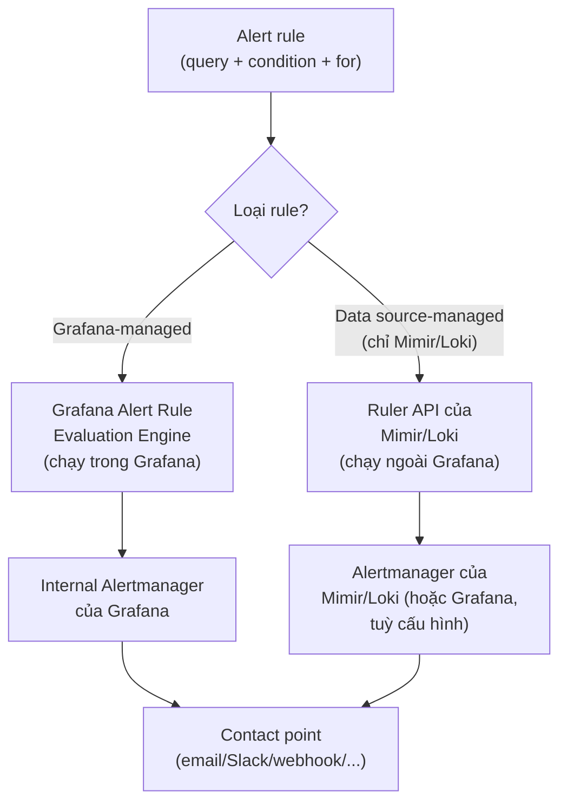

# Grafana — Unified Alerting

## What it does

> Grafana Alerting giống một tổ bảo vệ riêng của toà nhà Grafana — nó có "tổng đài cấp cứu" (Alertmanager) riêng, khác hẳn tổ bảo vệ của Prometheus ở toà nhà bên cạnh, dù mô hình hoạt động giống nhau (route/group/notify).

Unified Alerting là hệ thống alerting hiện tại của Grafana (thay cho legacy alerting cũ đã bị loại bỏ): đánh giá alert rule định kỳ trên dữ liệu từ data source, rồi đẩy qua một **Alertmanager nội bộ** (kiến trúc giống Prometheus Alertmanager) để route/group/dedupe/notify.

## Why it exists

Trước unified alerting, Grafana có hệ thống alerting cũ gắn chặt vào từng panel, không tách được lớp "đánh giá điều kiện" khỏi lớp "quyết định gửi thông báo cho ai" — mỗi panel alert độc lập, không group được, không có concept inhibition/silence chung. Unified alerting áp dụng lại mô hình đã chứng minh hiệu quả của Prometheus (rule evaluation tách khỏi Alertmanager) nhưng tích hợp ngay trong Grafana, cho phép evaluate rule trên **bất kỳ data source nào** Grafana hỗ trợ (không chỉ Prometheus).

## How it works

### Các lựa chọn — Loại alert rule

| Lựa chọn | Là gì | Khi nào dùng | Bẫy |
|---|---|---|---|
| **Grafana-managed** | Rule lưu + evaluate trong Grafana, query bất kỳ data source hỗ trợ alerting | Mặc định cho mọi rule mới, đơn giản nhất, đa số trường hợp | Toàn bộ rule evaluate dồn vào Grafana — nhiều rule nặng ảnh hưởng tải chung của Grafana instance |
| **Data source-managed** | Rule lưu + evaluate ngay trong Mimir/Loki qua Ruler API | Cần scale ngang số lượng rule lớn, tách tải evaluate khỏi Grafana | Chỉ hỗ trợ Grafana Mimir/Loki datasource có bật Ruler API, thêm độ phức tạp vận hành |

> [!tip] Mặc định dùng Grafana-managed, chỉ đổi khi thật sự cần scale
> Grafana khuyến nghị dùng Grafana-managed cho hầu hết trường hợp, chỉ chuyển sang data source-managed khi số lượng rule/tần suất evaluate đã vượt khả năng 1 Grafana instance xử lý.

### Ai thắng khi xung đột

Nguyên tắc chung: **notification policy con khớp trước thì dùng chính sách con**, giống mô hình routing tree của Prometheus Alertmanager — chi tiết đầy đủ ở [[prometheus--alertmanager#Ai thắng khi xung đột]], áp dụng tương tự cho Alertmanager nội bộ của Grafana.

| Bên A | Bên B | Kết quả | Im lặng hay báo lỗi? |
|---|---|---|---|
| Grafana Alertmanager nội bộ | Alertmanager của Prometheus (nếu có dùng song song) | Hai hệ thống **độc lập hoàn toàn**, không chia sẻ silence/notification state | Im lặng — dễ nhầm "tắt alert ở Alertmanager Prometheus" nhưng Grafana vẫn gửi notification riêng |
| `group_wait`/`group_interval`/`repeat_interval` ở notification policy Grafana | Default: `30s`/`5m`/`4h` | Giống hệt default của Prometheus Alertmanager — có thể override riêng theo policy | Im lặng |

## Config gotchas

| Config | Default | Khuyến nghị | Vì sao |
|---|---|---|---|
| Alert rule evaluation group interval | Theo cấu hình group, thường để mặc định vài chục giây tới phút tuỳ phiên bản UI | Set theo mức độ nhạy cần của alert, không set quá ngắn cho mọi rule | Evaluate quá thường xuyên tốn tài nguyên data source dù không ai đang nhìn dashboard |
| Contact point "protected" (built-in) | Có thể bị Editor xoá nếu version cũ chưa patch | Review RBAC/role cho phép xoá contact point | Liên quan CVE-2026-72585 — Editor xoá contact point không có quyền tương ứng trên bản ≤13.2.0, đã fix trước bản 13.3.0 đang pin |
| `[unified_alerting.ha]` (HA mode cho alerting) | Tắt (chỉ 1 instance evaluate) nếu chưa cấu hình | Bật + cấu hình memberlist khi chạy nhiều Grafana instance | Không bật HA mà chạy nhiều instance có thể dẫn tới mỗi instance tự evaluate rồi gửi trùng notification, xem [[grafana--ha-database]] |

## Hay nhầm lẫn

- **Grafana Alerting vs Prometheus Alertmanager** — hai Alertmanager hoàn toàn riêng biệt dù cùng mô hình thiết kế, xem bảng "Ai thắng khi xung đột" ở trên.
- **"Firing" state ở Grafana rule vs ở Prometheus rule** — cả hai dùng chung khái niệm Normal/Pending/Firing, nhưng dữ liệu nguồn khác nhau: Grafana-managed rule tự query lại data source mỗi evaluation cycle của riêng Grafana, không dùng chung evaluation cycle với recording/alerting rule đang chạy trong Prometheus server (nếu Prometheus đồng thời cũng có alerting rule riêng).

## Ops notes

- Trang **Alert rules** trong Grafana cho xem trạng thái hiện tại (Normal/Pending/Firing) của mọi rule, kèm lịch sử state transition — chỗ đầu tiên để debug "alert không tới".
- Metric `grafana_alerting_rule_evaluation_failures_total` và `grafana_alerting_notification_latency_seconds` (tên cụ thể có thể khác theo version, tham khảo `/metrics` thực tế) để theo dõi alerting engine của chính Grafana có đang gặp vấn đề không.

## Network

Port Alertmanager nội bộ của Grafana không mở port riêng cho client ngoài — toàn bộ qua `:3000` (API). Port gossip cho HA alerting nằm trong [[grafana--ha-database#Network]].

## Security notes

- Contact point lưu secret (webhook URL có token, SMTP password) — mã hoá trong DB bằng `secret_key` giống data source, cùng rủi ro nếu `secret_key` default chưa đổi.
- RBAC role cho phép sửa/xoá notification policy và contact point nên giới hạn chặt — alerting bị vô hiệu hoá âm thầm (xoá contact point, sửa policy route alert vào hố đen) là một cách "tắt cảnh báo" nguy hiểm nếu bị khai thác.

## Refs

- [[Grafana]] — note gốc.
- [[prometheus--alertmanager]] — mô hình route/group/inhibit/silence tương tự, dùng để đối chiếu khi debug Grafana Alertmanager.
- [[grafana--ha-database]] — cấu hình HA cho alerting khi chạy nhiều Grafana instance.
- Official docs: <https://grafana.com/docs/grafana/latest/alerting/>, <https://grafana.com/docs/grafana/latest/alerting/fundamentals/high-availability/>
