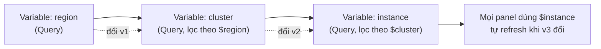

# Grafana — Dashboards, Panels & Variables

## What it does

> Dashboard giống một trang báo: panel là từng khung tin/ảnh trên trang, variable là cái hộp "chọn ngày/chọn khu vực" ở đầu trang mà độc giả tự bấm để tờ báo tự đổi nội dung theo lựa chọn đó — không cần ai in lại tờ báo mới.

Dashboard là một tài liệu JSON mô tả layout + query của nhiều panel. Panel là một đơn vị hiển thị dữ liệu (biểu đồ, bảng, số liệu...), mỗi panel gắn với 1 hoặc nhiều query tới data source. Variable (template variable) là biến có thể thay giá trị ngay trên UI, dùng để một dashboard phục vụ nhiều ngữ cảnh (nhiều server, nhiều môi trường...) mà không cần tạo dashboard riêng cho mỗi ngữ cảnh.

## Why it exists

Không có variable, muốn xem metric riêng cho từng server/namespace phải tạo một dashboard riêng cho mỗi giá trị — không scale khi số lượng tăng. Variable cho phép 1 dashboard + 1 dropdown chọn giá trị thay cho N dashboard gần giống nhau.

Panel tách biệt khỏi dashboard (dù lưu trong cùng JSON) để mỗi panel có thể có query, visualization type, và field config riêng — dashboard chỉ là "khung" sắp xếp các panel đó theo lưới (grid).

## How it works

### Các lựa chọn — Loại panel chính

| Lựa chọn | Là gì | Khi nào dùng | Bẫy |
|---|---|---|---|
| **Time series** | Line/area/bar chart theo thời gian, visualization mặc định và phổ biến nhất | Xem xu hướng metric theo thời gian — lựa chọn đầu tiên cho hầu hết use case | Quá nhiều series cùng lúc (ví dụ query không filter theo label) làm chart rối, khó đọc |
| **Stat** | Một số lớn + sparkline nhỏ tuỳ chọn | Hiển thị giá trị hiện tại/tổng hợp nhanh (uptime %, tổng request...) | Dễ gây hiểu nhầm nếu không thêm context (so với threshold, so với kỳ trước) |
| **Gauge** | Đồng hồ đo radial hoặc bar gauge | Giá trị có ngưỡng rõ ràng cần nhìn nhanh (disk usage %, CPU %) | Chọn range min/max sai làm gauge luôn full hoặc luôn trống |
| **Table** | Bảng dữ liệu dạng hàng/cột | Dữ liệu dạng danh sách, nhiều field, cần sort/filter | Query trả quá nhiều hàng làm bảng chậm render |
| **Heatmap** | Phân bố giá trị theo thời gian + bucket | Phân tích latency/histogram theo thời gian | Cần dữ liệu dạng histogram đúng format, dùng sai nguồn dữ liệu ra kết quả vô nghĩa |
| **State timeline** | Dải màu thể hiện trạng thái thay đổi theo thời gian | Theo dõi uptime/trạng thái rời rạc (up/down, pass/fail) | Dễ nhầm với time series nếu dữ liệu là số liên tục, không phải trạng thái |
| **Dashboard list / Alert list / Annotations list** | Panel liệt kê dashboard khác / alert đang active / annotation | Trang tổng quan (landing page) cho team | Không phải visualization dữ liệu — dễ bị hiểu nhầm là panel "bị lỗi không query được gì" |

### Các lựa chọn — Variable type

| Lựa chọn | Là gì | Khi nào dùng | Bẫy |
|---|---|---|---|
| **Query** | Giá trị lấy từ query tới data source (ví dụ `label_values(up, instance)`) | Danh sách giá trị động, tự cập nhật theo data source | Chỉ hỗ trợ tốt cho giá trị dạng string; mỗi lần refresh biến là 1 query thật tới datasource |
| **Custom** | Danh sách giá trị khai tay, cố định | Danh sách không đổi (region, environment name cố định) | Không tự cập nhật khi thực tế đổi — phải sửa tay |
| **Constant** | Giá trị cố định, ẩn khỏi người xem | Giá trị dùng lại nhiều nơi trong query, không cần ai đổi | Dễ bị quên nó tồn tại vì không hiện trên UI, debug dashboard khó hiểu query hơn |
| **Interval** | Cho người xem chọn khoảng group-by (`1m`, `5m`, `1h`...) | Query cần đổi độ phân giải theo zoom level | Chọn interval nhỏ hơn range dữ liệu thật có thể trả quá nhiều điểm, chậm query |
| **Datasource** | Cho người xem chọn giữa nhiều data source cùng loại | Dashboard dùng chung cho nhiều cluster/môi trường có datasource riêng | Panel phải tự tham chiếu đúng biến datasource, dễ quên khi copy panel từ dashboard khác |
| **Ad hoc filter** | Filter label thêm vào mọi query tự động, không cần sửa từng panel | Cho người xem tự lọc theo label mà không cần sửa dashboard | Chỉ hoạt động tốt với datasource hỗ trợ (Prometheus, Loki...), không phải mọi loại query |

### Chained variables

Chained variable (biến tham chiếu biến khác trong query của nó) tự động refresh theo thứ tự khi biến cha đổi. Dùng `Custom` cho biến không đổi (ví dụ `region`) ở đầu chain giúp giảm số query thật cần gọi so với dùng `Query` cho mọi tầng.

### Ai thắng khi xung đột

Nguyên tắc chung: **panel-level override thắng dashboard-level default**, và field override khớp theo thứ tự khai báo (rule sau khai báo sau có thể ghi đè rule trước nếu cùng field).

| Bên A | Bên B | Kết quả | Im lặng hay báo lỗi? |
|---|---|---|---|
| Dashboard-level time range | Panel-level time range override (relative time trong panel option) | Panel override thắng, chỉ panel đó dùng range khác dashboard | Im lặng — dễ gây hiểu nhầm "sao panel này không theo time picker chung" |
| Field config mặc định (Standard options) | Field override theo field name/regex cụ thể | Override khớp field cụ thể **thắng** default | Im lặng |
| Variable có giá trị `All` (chọn tất cả) | Query dùng biến đó trong label filter | Kết quả tuỳ cách format multi-value (`regex`, `pipe`, `csv`...) được chọn trong variable — format sai làm query cú pháp lỗi | Có thể báo lỗi query ở panel, hoặc im lặng trả về rỗng tuỳ datasource |

## Config gotchas

| Config | Default | Khuyến nghị | Vì sao |
|---|---|---|---|
| Dashboard `uid` | Tự sinh random nếu không khai | Khai rõ `uid` cố định khi provisioning qua file | Thiếu UID cố định → mỗi lần tạo lại từ file có thể sinh dashboard mới thay vì update dashboard cũ, xem [[grafana--provisioning]] |
| Variable `Refresh` option | `On Dashboard Load` | Set `On Time Range Change` nếu variable phụ thuộc time range (ví dụ `label_values` theo range đang xem) | Để default có thể hiện giá trị variable đã biến mất khỏi data source trong range mới |
| Panel query `Max data points` | Tự tính theo độ rộng panel | Giữ auto trừ khi cần ép giảm tải cho query nặng | Ép số quá thấp làm graph mất chi tiết; không set gì cho query rất nặng có thể kéo quá nhiều điểm không cần thiết |

## Hay nhầm lẫn

- **Variable `Query` vs Ad hoc filter** — cả hai đều lọc theo label, nhưng `Query` variable cần khai trong từng query bằng tay (`$myvar`), còn ad hoc filter tự áp vào **mọi** query tương thích trên dashboard mà không cần sửa panel.
- **Panel repeat (lặp panel theo variable multi-value) vs Row repeat** — panel repeat lặp 1 panel cho mỗi giá trị variable; row repeat lặp cả 1 hàng panel. Chọn nhầm cấp độ lặp ra layout khác hẳn dự kiến.

## Ops notes

- Dashboard nặng (nhiều panel, nhiều query) load chậm — kiểm tra qua tab Network của browser hoặc Grafana's query inspector (nút "Query inspector" trên mỗi panel) để biết panel nào tốn thời gian nhất.
- JSON Model (nút "..." → "Export" → "View JSON") là cách nhanh nhất để diff 2 phiên bản dashboard hoặc debug tại sao panel không hiển thị đúng.

## Refs

- [[Grafana]] — note gốc.
- [[grafana--datasources]] — mỗi panel/variable Query cuối cùng đều gọi tới một data source cụ thể.
- [[grafana--provisioning]] — cách đưa dashboard JSON vào Grafana qua file thay vì tạo tay trên UI.
- Official docs: <https://grafana.com/docs/grafana/latest/dashboards/>, <https://grafana.com/docs/grafana/latest/visualizations/dashboards/variables/>
