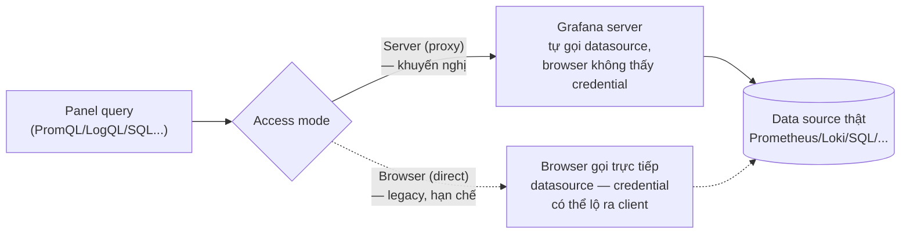

# Grafana — Data Sources

## What it does

> Data source giống một đường dây điện thoại riêng nối Grafana tới từng "tổng đài" dữ liệu (Prometheus, Loki, MySQL...) — mỗi đường dây có số điện thoại (URL), có mật khẩu truy cập riêng, và Grafana chỉ nói được "ngôn ngữ" mà đầu dây kia hiểu.

Data source là một cấu hình kết nối trong Grafana tới một hệ thống lưu trữ dữ liệu cụ thể — mỗi loại data source có query editor riêng (PromQL cho Prometheus, LogQL cho Loki, SQL cho MySQL/Postgres...) và cách xác thực riêng.

## Why it exists

Mỗi hệ thống dữ liệu có protocol/API khác nhau hoàn toàn. Data source là lớp adapter chuẩn hoá: Grafana core không cần biết chi tiết PromQL hay LogQL, nó chỉ gọi vào data source plugin tương ứng và nhận về định dạng chung (time series, table, logs...) để panel render.

## How it works

Sự khác biệt `Server (proxy)` vs `Browser (direct)` không chỉ là "ai gọi request" — nó quyết định **ai nhìn thấy credential**. Với `proxy`, token/password của datasource chỉ tồn tại ở backend Grafana; với `direct`, request đi thẳng từ browser nên bất cứ gì gắn vào header (API key, basic auth) đều lộ ra network tab của browser người xem.

### Các lựa chọn — Access mode

| Lựa chọn | Là gì | Khi nào dùng | Bẫy |
|---|---|---|---|
| **Server (proxy)** | Grafana backend gọi datasource, trả kết quả về browser | Luôn dùng mặc định cho mọi datasource có credential | Grafana server cần network reach tới datasource (không phải browser người xem) |
| **Browser (direct)** (legacy, nhiều datasource mới không còn hiển thị lựa chọn này) | Browser người xem gọi trực tiếp tới URL datasource | Chỉ hợp lý khi datasource public, không credential, và browser người xem có network reach trực tiếp | Lộ credential ra client — liên quan tới lỗ hổng CVE-2026-27877 ở [[Grafana#8. Security Considerations]] |

### Các lựa chọn — Authentication phổ biến cho data source

| Lựa chọn | Là gì | Khi nào dùng | Bẫy |
|---|---|---|---|
| **No Auth** | Không xác thực | Datasource nội bộ, network đã kiểm soát (ví dụ Prometheus chỉ nghe trên internal network) | Dễ bị lạm dụng nếu network boundary thật ra không chặt như tưởng |
| **Basic Auth** | Username/password HTTP Basic | Datasource có bật basic auth phía sau reverse proxy | Password lưu trong Grafana DB, mã hoá bằng `secret_key` — xem [[Grafana#Bẫy vận hành]] |
| **TLS Client Auth / CA Cert** | Chứng thực bằng certificate | Datasource yêu cầu mTLS | Cert hết hạn làm mọi query tới datasource đó fail cùng lúc, cần theo dõi expiry riêng |
| **OAuth2 / Bearer token / API key** (tuỳ loại datasource hỗ trợ) | Token-based auth | Datasource cloud (CloudWatch IAM role, Azure Monitor service principal...) | Token hết hạn/revoke âm thầm làm panel lỗi mà không rõ nguyên nhân ngay, cần check riêng ở phía provider |

## Config gotchas

| Config | Default | Khuyến nghị | Vì sao |
|---|---|---|---|
| Access mode datasource mới | `Server (proxy)` ở hầu hết loại datasource hiện tại | Giữ `proxy`, review lại datasource cũ còn ở `direct` | `direct` là nguồn gốc rủi ro lộ credential, xem CVE ở note gốc |
| `jsonData`/`secureJsonData` khi provisioning | Không mã hoá nếu để plaintext trong file provisioning | Dùng biến môi trường (`$ENV_VAR`) cho secret, không hardcode trong YAML commit vào Git | File provisioning thường nằm trong Git repo — hardcode secret vào đó là leak credential qua version control |
| Datasource UID khi provisioning | Tự sinh nếu không khai | Khai UID cố định | Dashboard JSON tham chiếu datasource theo UID — UID đổi làm panel "mất" datasource sau khi re-provision |

## Hay nhầm lẫn

- **Default datasource vs datasource được chọn trong panel** — mỗi org chỉ có 1 datasource đánh dấu "default", panel mới tạo tự dùng cái này; nhưng dashboard import từ nơi khác có thể tham chiếu UID datasource không tồn tại ở instance hiện tại, Grafana fallback về default **âm thầm**, dễ làm panel hiện data sai nguồn mà không có lỗi rõ ràng.
- **Mixed datasource** — 1 dashboard/panel có thể query nhiều datasource khác nhau cùng lúc (chọn `-- Mixed --` làm datasource), dễ nhầm với việc "1 panel chỉ query được 1 nguồn".

## Ops notes

- Nút "Save & Test" khi tạo/sửa datasource gọi test connection thật — luôn test lại sau khi đổi credential hoặc network.
- Query Inspector trên từng panel cho thấy request/response thật gửi tới datasource — chỗ đầu tiên để debug "panel không ra data" hay "ra data sai".

## Security notes

- Data source credential lưu trong Grafana backend DB, mã hoá bằng `[security] secret_key` của instance — đổi `secret_key` sau khi đã có datasource là **mất khả năng decrypt** credential cũ, cần nhập lại.
- Datasource proxy mode nghĩa là Grafana server trở thành điểm trung chuyển có quyền truy cập mọi datasource đã cấu hình — network/IAM nên giới hạn quyền datasource đó theo nguyên tắc least privilege, không cấp quyền admin toàn bộ chỉ vì Grafana cần đọc.

## Refs

- [[Grafana]] — note gốc, xem [[Grafana#8. Security Considerations]] cho CVE liên quan access mode.
- [[grafana--dashboards-panels-variables]] — panel/variable Query đều gọi qua datasource mô tả ở đây.
- [[Prometheus]] — datasource phổ biến nhất đi cùng Grafana trong stack monitoring.
- [[VictoriaMetrics]] — datasource tương thích PromQL khác, thường dùng datasource type "Prometheus" trỏ vào VictoriaMetrics (single-node `:8428` hoặc vmselect `:8481`), hoặc plugin datasource riêng của VictoriaMetrics; lưu ý khác biệt MetricsQL ở [[victoriametrics--metricsql]] khi port dashboard giữa 2 nguồn.
- Official docs: <https://grafana.com/docs/grafana/latest/datasources/>
