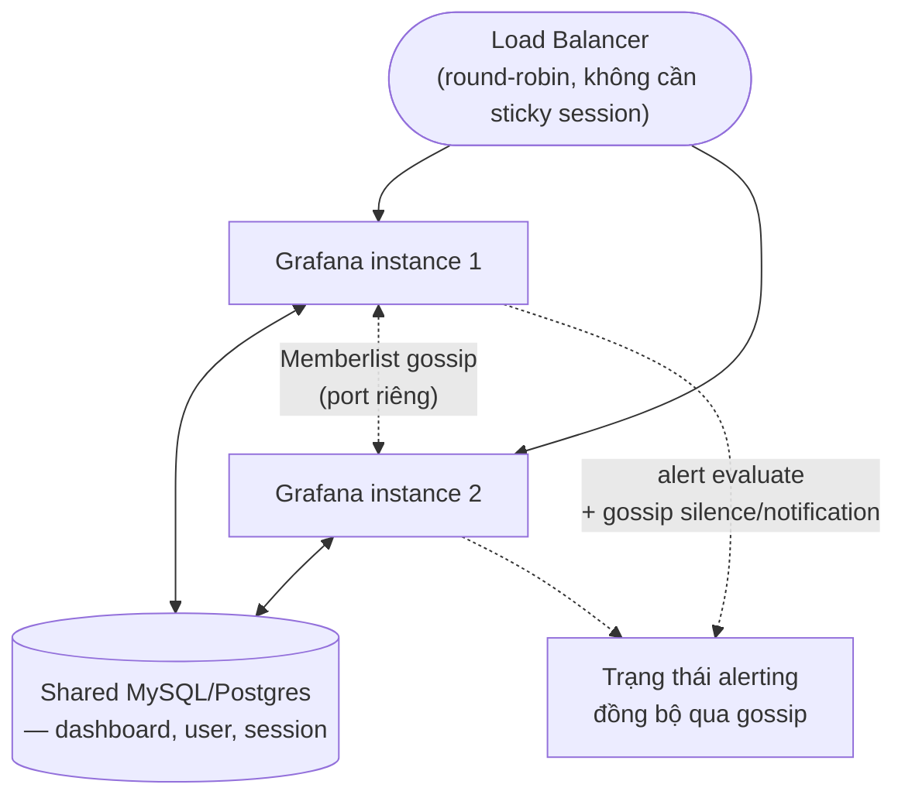

# Grafana — High Availability & Database Backend

## What it does

> SQLite giống cuốn sổ tay 1 người viết — nhanh, gọn, nhưng chỉ 1 người cầm được cùng lúc. MySQL/Postgres giống tủ hồ sơ chung của công ty — nhiều người (nhiều Grafana instance) cùng đọc/ghi được, vì vậy mới dựng được văn phòng có nhiều lễ tân (HA) chia nhau tiếp khách.

Database backend là nơi Grafana lưu toàn bộ **state** của chính nó (dashboard JSON tạo qua UI, user, org, team, alert rule, alert state) — khác hẳn nơi lưu metric/log thật (Prometheus/Loki). HA là mô hình chạy nhiều Grafana instance phía sau load balancer, chia sẻ cùng 1 database backend.

## Why it exists

SQLite (file-based, embedded) đủ cho 1 instance vì không ai khác cần đọc/ghi đồng thời. Nhưng ngay khi cần **2+ Grafana instance** (để tránh downtime khi 1 instance restart/crash), tất cả instance phải thấy cùng một state — SQLite không hỗ trợ nhiều process ghi đồng thời an toàn qua network, nên bắt buộc chuyển sang MySQL/Postgres.

HA giải quyết vấn đề uptime: Grafana server là service không lưu trạng thái tại tiến trình (stateless nếu dùng DB ngoài) — mất 1 instance không mất dữ liệu, load balancer chuyển hết traffic sang instance còn lại.

## How it works

Điểm quan trọng: **session cũng lưu ở shared DB**, nên load balancer **không cần session affinity** (sticky session) — user request lần sau có thể rơi vào instance khác mà vẫn giữ đăng nhập, vì session đọc từ DB chung, không từ memory của 1 instance cụ thể.

### Các lựa chọn — Database backend

| Lựa chọn | Là gì | Khi nào dùng | Bẫy |
|---|---|---|---|
| **SQLite3** | Embedded, file-based, không cần service riêng | Dev, lab, single-instance nhỏ | Không hỗ trợ nhiều Grafana instance cùng truy cập — không dùng được cho HA |
| **MySQL** | RDBMS phổ biến, Grafana hỗ trợ native | Production, đã có hạ tầng MySQL sẵn | Cần version MySQL đủ mới theo yêu cầu compatibility của Grafana — kiểm tra release notes trước khi chọn version |
| **PostgreSQL** | RDBMS phổ biến khác, Grafana hỗ trợ native | Production, đã có hạ tầng Postgres sẵn | Tương tự MySQL — version quá cũ có thể thiếu feature Grafana cần |

### HA cho Unified Alerting — Memberlist vs Redis

| Lựa chọn | Là gì | Khi nào dùng | Bẫy |
|---|---|---|---|
| **Memberlist** | Gossip protocol P2P giữa các Grafana instance, không cần service ngoài | Lựa chọn khuyến nghị cho HA alerting | Cần mở port gossip giữa mọi instance, firewall thiếu rule này làm state không đồng bộ |
| **Redis** | Dùng Redis làm nơi chia sẻ state alerting thay cho gossip | Khi hạ tầng đã có Redis sẵn, muốn tránh thêm gossip traffic | Thêm Redis là thêm một dependency/điểm lỗi mới cần giám sát riêng |

### Ai thắng khi xung đột

Nguyên tắc chung: **mọi instance trong HA đều tự evaluate alert rule độc lập**, Alertmanager nội bộ mới là nơi dedupe — không có "instance nào thắng" ở bước evaluate.

| Bên A | Bên B | Kết quả | Im lặng hay báo lỗi? |
|---|---|---|---|
| Nhiều Grafana instance cùng evaluate 1 alert rule | HA alerting (memberlist/Redis) chưa cấu hình | Mỗi instance tự gửi notification riêng — **gửi trùng** | Im lặng — không có cảnh báo "đang gửi trùng" |
| HA alerting đã cấu hình đúng | Gossip port bị firewall chặn giữa 2 instance | Giống như chưa có HA — mỗi instance hoạt động độc lập, state không đồng bộ | Im lặng ở tầng notification, nhưng log Grafana có thể ghi nhận lỗi gossip nếu bật log cấp debug |

## Config gotchas

| Config | Default | Khuyến nghị | Vì sao |
|---|---|---|---|
| `[database] type` | `sqlite3` | `mysql`/`postgres` cho production/HA | Xem bảng lựa chọn ở trên |
| `[database] max_open_conn` / `max_idle_conn` | Giá trị mặc định tương đối thấp, theo bản cụ thể | Tăng theo số lượng instance × tải thực tế, theo dõi connection pool DB | Pool quá nhỏ làm request chờ connection, Grafana chậm dưới tải cao dù DB server còn dư tài nguyên |
| `[unified_alerting.ha] peers` | Rỗng (chưa cấu hình HA) | Khai danh sách address của mọi instance khi chạy HA | Thiếu khai, mỗi instance tự coi mình là standalone — xem bẫy gửi trùng notification ở trên |

## Hay nhầm lẫn

- **HA của web/dashboard (shared DB) vs HA của alerting (gossip/Redis)** — đây là 2 cơ chế **tách biệt**, cấu hình đúng cái đầu không tự động làm alerting HA đúng theo, phải cấu hình `[unified_alerting.ha]` riêng.
- **Session ở shared DB vs session ở Redis/cache riêng** — mặc định Grafana dùng chính backend DB (MySQL/Postgres) để lưu session khi HA, không nhất thiết cần thêm Redis chỉ để làm session store (Redis ở HA alerting là cho mục đích khác — đồng bộ state alerting).

## Ops notes

- Theo dõi connection pool DB (`grafana_database_conn_open`, tên cụ thể theo version) khi tăng số Grafana instance — mỗi instance thêm vào là thêm connection tới DB chung.
- Khi thêm instance mới vào HA, luôn kiểm tra ngay 2 việc: (1) instance mới join đúng vào shared DB (xem `/api/health`), (2) instance mới join đúng gossip cluster alerting (xem log hoặc metric liên quan memberlist).
- Downtime khi restart: trong HA đúng cấu hình, restart 1 instance tại 1 thời điểm, theo dõi load balancer health check đã route traffic sang instance còn lại trước khi restart.

## Network

| Nguồn → Đích | Port/Proto | Mục đích | Default? | Triệu chứng khi bị chặn |
|---|---|---|---|---|
| Grafana instance → Backend DB | `3306/tcp` (MySQL) / `5432/tcp` (Postgres) | Đọc/ghi state (dashboard, user, session, alert) | tuỳ `[database]` | Grafana không start, hoặc mọi request trả lỗi 500 liên quan DB |
| Grafana instance ↔ Grafana instance (HA alerting, memberlist) | Port tự chọn qua `[unified_alerting.ha]`, thường dạng TCP+UDP tương tự memberlist chuẩn | Gossip đồng bộ silence/notification state | cần cấu hình khi bật HA | Mỗi instance evaluate alert độc lập, gửi notification trùng cho cùng 1 alert |
| Grafana instance ↔ Redis (nếu chọn Redis cho HA alerting) | `6379/tcp` (default Redis) | Lưu state alerting chia sẻ thay cho gossip | tuỳ lựa chọn backend | Alerting HA không đồng bộ, hành vi giống chưa bật HA |

## Security notes

- Backend DB chứa toàn bộ secret datasource/contact point đã mã hoá — network tới DB nên giới hạn chỉ Grafana instance được kết nối, không mở rộng hơn cần thiết.
- Redis dùng cho HA alerting (nếu chọn) nên có auth (requirepass) và không expose public — Redis không auth mặc định là một điểm yếu quen thuộc nếu lỡ tay mở port ra ngoài.

## Refs

- [[Grafana]] — note gốc, xem [[Grafana#4. Where — Architecture & Deployment]] cho mô hình triển khai tổng.
- [[grafana--alerting]] — HA alerting phụ thuộc trực tiếp vào cấu hình ở note này.
- Official docs: <https://grafana.com/docs/grafana/latest/setup-grafana/set-up-for-high-availability/>, <https://grafana.com/docs/grafana/latest/alerting/fundamentals/high-availability/>
