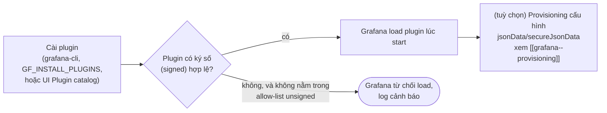

# Grafana — Plugin System

## What it does

> Plugin giống app cài thêm trên điện thoại: core Grafana ra sẵn một số "app hệ thống" (panel, data source cơ bản), còn lại tải thêm từ "app store" riêng — mỗi app thêm có thể hữu ích, nhưng cũng là một cánh cửa cài code lạ vào máy.

Plugin là cách mở rộng Grafana ngoài core: thêm loại data source mới, thêm loại panel/visualization mới, hoặc thêm cả tính năng app hoàn chỉnh (trang riêng trong Grafana).

## Why it exists

Grafana core không thể (và không nên) tự hỗ trợ mọi hệ thống dữ liệu hay mọi kiểu visualization tồn tại trên đời. Plugin system cho phép cộng đồng/Grafana Labs/vendor bên thứ 3 tự viết phần hỗ trợ riêng, cài thêm theo nhu cầu, mà không phình to core binary cho tất cả mọi người.

## How it works

### Các lựa chọn — Loại plugin

| Lựa chọn | Là gì | Khi nào dùng | Bẫy |
|---|---|---|---|
| **Panel plugin** | Thêm loại visualization mới ngoài panel built-in | Cần biểu đồ đặc thù không có sẵn (ví dụ sơ đồ mạng, bản đồ địa lý) | Panel plugin custom không maintain tốt có thể lỗi khi upgrade Grafana major version |
| **Data source plugin** | Thêm khả năng query tới hệ thống mới | Hệ thống dữ liệu không có data source built-in (ví dụ SaaS monitoring riêng) | Chất lượng/tốc độ update tuỳ hoàn toàn vào tác giả plugin, không phải Grafana Labs |
| **App plugin** | Gói hoàn chỉnh gồm nhiều panel/page, có thể có backend riêng | Tính năng lớn, phức tạp (ví dụ nguyên một bộ Incident Response UI) | Có thể chạy backend process riêng trong Grafana server — bề mặt tấn công lớn hơn panel/datasource plugin thường |

### Luồng cài & chạy plugin

Grafana yêu cầu plugin phải **ký số (signed)** để load theo default — plugin tự biên dịch hoặc tải từ nguồn không chính thức mà chưa ký sẽ bị từ chối load, trừ khi được thêm vào allow-list unsigned plugin (cấu hình riêng, nên tránh trừ khi thật sự cần cho dev/test nội bộ).

## Config gotchas

| Config | Default | Khuyến nghị | Vì sao |
|---|---|---|---|
| `[plugins] allow_loading_unsigned_plugins` | Rỗng (không cho phép plugin unsigned nào) | Giữ rỗng; chỉ thêm tên plugin cụ thể khi thật sự cần, không dùng wildcard | Cho phép unsigned plugin là mở cửa cho code không qua kiểm duyệt chạy trong tiến trình Grafana |
| `[plugins] plugin_admin_enabled` | Theo bản cụ thể, thường cho phép Admin cài plugin qua UI | Giới hạn chỉ Admin tin cậy, tắt hẳn (`false`) nếu muốn kiểm soát cài plugin 100% qua provisioning/CI | Cho phép cài qua UI tự do nghĩa là bất kỳ Admin nào (có thể là Org Admin, không phải Grafana Server Admin tuỳ cấu hình) đều thêm được code mới vào instance |
| `GF_INSTALL_PLUGINS` (env var, phổ biến khi chạy container) | Rỗng | Khai rõ version cụ thể (`plugin-id@version`), không để trống version | Không khai version → luôn kéo bản mới nhất lúc container start, dễ gặp breaking change ngoài ý muốn giữa các lần deploy |

## Hay nhầm lẫn

- **Cài plugin vs Provisioning plugin config** — cài (`grafana-cli plugins install`/`GF_INSTALL_PLUGINS`) là đưa code plugin vào hệ thống; provisioning phần `plugins/` chỉ cấu hình plugin **đã cài**, không tự tải code. Nhầm hai bước này làm provisioning "chạy xong không báo lỗi" nhưng plugin không hoạt động vì chưa thật sự được cài.
- **Plugin signed "Grafana Labs" vs "Community" vs "Private"** — cấp độ ký số khác nhau ảnh hưởng mức tin cậy; không phải mọi plugin "signed" đều do Grafana Labs viết, chỉ là đã qua quy trình ký, nên vẫn cần tự đánh giá nguồn trước khi cài cho production.

## Security notes

- Plugin chạy **trong cùng tiến trình/quyền** với Grafana server (đặc biệt app plugin có backend riêng) — một plugin độc hại hoặc có lỗ hổng có thể truy cập được mọi thứ Grafana server truy cập được (datasource credential, DB...).
- Trước khi cài plugin bên thứ 3 cho production, kiểm tra: nguồn (chính thức trên Grafana plugin catalog hay tự build), lịch sử update gần nhất, và số lượng download/review nếu có.

## Refs

- [[Grafana]] — note gốc, xem [[Grafana#Hardening checklist tối thiểu]].
- [[grafana--datasources]] — data source plugin là một loại plugin phổ biến nhất trong thực tế.
- Official docs: <https://grafana.com/docs/grafana/latest/administration/plugin-management/>
