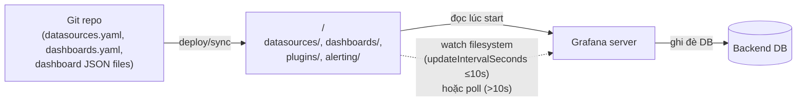

# Grafana — Provisioning as Code

## What it does

> Provisioning giống việc dán sẵn một bản nội quy in sẵn lên tường, thay vì để từng người tự viết tay rồi dán chồng lên nhau — mỗi lần Grafana "mở cửa" (start/reload), nó đọc lại bản nội quy đó và áp dụng, bản viết tay trước đó bị thay thế.

Provisioning là cơ chế nạp cấu hình (data source, dashboard, alert rule, plugin) từ file YAML/JSON vào Grafana lúc startup hoặc reload, thay vì tạo tay qua UI. Đây là nền tảng để quản lý Grafana theo GitOps — config nằm trong Git, không nằm trong database.

## Why it exists

Tạo dashboard/data source qua UI không version-control được, không review được qua pull request, và không tái tạo được giống nhau giữa nhiều môi trường (dev/staging/production). Provisioning giải quyết việc đó: file trong Git là nguồn sự thật duy nhất, Grafana chỉ là nơi "thi hành" lại nguồn sự thật đó.

## How it works

Có 2 cơ chế cập nhật khác nhau tuỳ `updateIntervalSeconds`: nếu ≤10s, Grafana **watch filesystem** (nhận event ngay khi file đổi); nếu >10s, Grafana **poll theo chu kỳ**. Trên network mount hoặc Docker bind mount, watch filesystem có thể không nhận event đáng tin cậy — nên set `updateIntervalSeconds` lớn hơn 10 để ép Grafana dùng polling.

### Ai thắng khi xung đột

Nguyên tắc chung: **file provisioning luôn thắng** mỗi khi Grafana đọc lại nó — chỉnh sửa UI chỉ là tạm thời, không phải nguồn sự thật.

| Bên A | Bên B | Kết quả | Im lặng hay báo lỗi? |
|---|---|---|---|
| Dashboard provisioned, `allowUiUpdates: false` | User sửa & bấm Save trên UI | Nút Save bị chặn/báo lỗi ngay trên UI | Báo lỗi rõ cho user |
| Dashboard provisioned, `allowUiUpdates: true` | User sửa & Save trên UI | Lưu được tạm vào DB, nhưng **lần reload provisioning kế tiếp sẽ ghi đè lại** bằng bản trong file | Im lặng — không cảnh báo gì khi bị ghi đè lại |
| Datasource provisioning không có `version` tăng dần | Nhiều Grafana instance cùng provisioning từ các bản file khác thời điểm | Instance chạy sau có thể ghi đè bằng config **cũ hơn** nếu không đồng bộ version | Im lặng — dễ nhầm là "đổi config không có tác dụng" |
| `prune: true` trong datasource provisioning | Datasource bị xoá khỏi file config | Grafana **tự xoá luôn** datasource đó khỏi DB | Im lặng — xoá thật, không có bước xác nhận |

## Config gotchas

| Config | Default | Khuyến nghị | Vì sao |
|---|---|---|---|
| Dashboard `uid` trong file JSON | Không khai → tự sinh | Luôn khai UID cố định | Thiếu UID, Grafana match theo cách khác kém tin cậy hơn — dễ tạo dashboard trùng lặp khi re-provision |
| `allowUiUpdates` | `false` | Giữ `false` cho dashboard quản lý qua Git hoàn toàn; chỉ `true` nếu có quy trình rõ ràng cho phép sửa tạm | `true` tạo cảm giác sai là "sửa UI là final", trong khi thực chất sẽ bị đè lại |
| `disableDeletion` | `false` | Set `true` nếu không muốn ai xoá dashboard provisioned qua UI | Thiếu flag này, user có quyền vẫn xoá được dashboard dù nó "thuộc về" provisioning |
| `foldersFromFilesStructure` | `false` | Bật khi muốn cấu trúc folder trong Grafana khớp cấu trúc thư mục file | Độ sâu nested folder bị giới hạn 4 cấp — cấu trúc Git quá sâu sẽ không map hết |
| Secret trong `secureJsonData` khi provisioning | Không mã hoá nếu hardcode plaintext trong file | Dùng biến môi trường `$ENV_VAR_NAME`/`${ENV_VAR_NAME}` | Hardcode secret vào file provisioning commit vào Git là leak credential qua version control, xem [[Grafana#Hardening checklist tối thiểu]] |

## Hay nhầm lẫn

- **`$` trong password cần escape `$$`** — ký tự `$` trong giá trị provisioning được hiểu là bắt đầu biến môi trường; password chứa `$` thật (ví dụ `Pa$sw0rd`) phải viết `Pa$$sw0rd` để Grafana không cố resolve nó như biến.
- **Provisioning plugin vs cài plugin** — provisioning phần `plugins/` chỉ **cấu hình** plugin đã cài (jsonData/secureJsonData), nó không tự tải/cài plugin mới — cài plugin vẫn phải qua `grafana-cli`/`GF_INSTALL_PLUGINS` hoặc UI, xem [[grafana--plugins]].

## Ops notes

- Luôn kiểm tra log Grafana sau khi deploy file provisioning mới — lỗi YAML/JSON syntax chỉ hiện ở log, UI không báo gì nếu provisioning fail lúc start.
- Khi debug "dashboard không update dù đã sửa file", kiểm tra `updateIntervalSeconds` và việc file có đang nằm trên network mount/bind mount hay không trước khi nghi ngờ nội dung file.

## Refs

- [[Grafana]] — note gốc, xem [[Grafana#Bẫy vận hành]] cho case thực tế bị đè mất chỉnh sửa UI.
- [[grafana--datasources]] — datasource cũng provisioning theo cùng cơ chế này.
- [[grafana--dashboards-panels-variables]] — dashboard JSON là nội dung chính được provisioning.
- Official docs: <https://grafana.com/docs/grafana/latest/administration/provisioning/>
