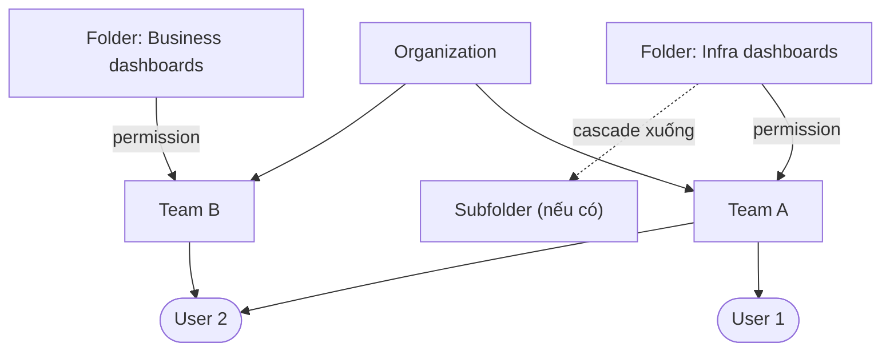

# Grafana — RBAC, Teams & Organizations

## What it does

> Hình dung một tòa cao ốc nhiều công ty thuê: **Organization** là từng công ty thuê riêng một tầng (dữ liệu tách biệt hoàn toàn); **Team** là phòng ban trong công ty đó; **Folder permission** là khoá riêng cho từng phòng họp — ai được vào phòng nào do cả 3 lớp này cộng lại quyết định.

Grafana có 3 lớp phân quyền chồng lên nhau: **Organization** (đơn vị cách ly dữ liệu cao nhất trong 1 instance — dashboard/datasource/user thuộc về 1 org cụ thể), **Team** (nhóm user trong 1 org, dùng để gán quyền hàng loạt), và **Folder/resource permission** (quyền cụ thể trên 1 folder/dashboard, có thể cấp riêng cho user/team/role).

## Why it exists

Không có org, một Grafana instance chỉ phục vụ được 1 "khách hàng" — mọi user thấy chung mọi dashboard/datasource. Org giải quyết multi-tenancy ở mức cơ bản (self-hosted, không cần Enterprise). Team giải quyết vấn đề khác: gán quyền cho từng user một tốn công khi team có hàng chục người — gán quyền cho Team một lần, thêm/bớt user khỏi Team là đủ.

## How it works

### Các lựa chọn — Basic role (org-level)

| Lựa chọn | Là gì | Khi nào dùng | Bẫy |
|---|---|---|---|
| **Viewer** | Chỉ xem dashboard, không sửa | User chỉ cần theo dõi, không chỉnh sửa gì | Viewer vẫn có thể tự chạy Explore/query trực tiếp datasource (nếu được cấp quyền datasource đó) — không chỉ giới hạn ở dashboard đã curate sẵn |
| **Editor** | Tạo/sửa dashboard, không quản lý user/datasource tổ chức | Người xây dashboard hàng ngày | Editor theo default **chưa chắc** bị chặn khỏi hành động nhạy cảm như xoá contact point — xem CVE-2026-72585 ở [[Grafana#Misconfiguration gây breach]] |
| **Admin** (org-level, khác Grafana Server Admin) | Quản lý user/datasource/team trong 1 org | Người quản trị riêng của 1 org | Org Admin **không** phải Grafana Server Admin — không tự có quyền trên org khác hoặc cấu hình toàn instance |
| **Grafana Server Admin** | Quyền cao nhất, quản lý toàn instance (tất cả org, user, server setting) | Chỉ 1 nhóm nhỏ quản trị hạ tầng | Dễ nhầm với Org Admin vì cùng chữ "Admin" trên UI — quyền thật khác hẳn phạm vi |

### Custom RBAC role (mở rộng basic role)

RBAC cho phép thêm/bớt permission theo từng **action** cụ thể (ví dụ `datasources:read`, `alert.rules:write`) vào basic role có sẵn, hoặc tạo custom role riêng khi basic role/fixed role không đủ chi tiết. RBAC là tính năng có sẵn trong **OSS** (mở rộng basic role đã có), nhưng tạo **custom role mới hoàn toàn** và một số fixed role nâng cao là **(Enterprise/Cloud)**.

Permission gán trên folder **cascade xuống subfolder** nằm dưới nó. Folder mới tạo qua UI mặc định: org Admin role → Admin permission, Editor role → Edit permission, Viewer role → View permission trên folder đó.

### Ai thắng khi xung đột

Nguyên tắc chung: **permission cụ thể hơn (resource-level) thắng permission chung (org role)** khi được cấp riêng.

| Bên A | Bên B | Kết quả | Im lặng hay báo lỗi? |
|---|---|---|---|
| Org role = Viewer | Folder permission riêng cấp "Edit" cho user đó trên 1 folder cụ thể | User sửa được dashboard **trong folder đó**, vẫn chỉ xem được mọi thứ khác | Im lặng — không có thông báo override |
| User thuộc nhiều Team, mỗi Team có permission khác nhau trên cùng 1 folder | — | User nhận permission **cao nhất** trong số các Team mà user thuộc về áp dụng lên folder đó | Im lặng |
| RBAC custom role cấp thêm action cụ thể | Basic role gốc không có action đó | User có thêm đúng action đã cấp, không ảnh hưởng action khác ngoài phạm vi custom role | Im lặng |

## Config gotchas

| Config | Default | Khuyến nghị | Vì sao |
|---|---|---|---|
| `[users] auto_assign_org_role` | `Viewer` | Giữ `Viewer` hoặc thấp nhất phù hợp | User mới tự đăng ký (nếu bật self sign-up) không nên tự có quyền Editor/Admin |
| `[users] viewers_can_edit` | `false` | Giữ `false` trừ khi có lý do rõ ràng | Bật `true` cho Viewer khả năng sửa tạm trên UI (không lưu) — dễ gây hiểu nhầm về ranh giới quyền thật |
| Folder permission mới tạo | Theo mapping org role → folder role (Admin/Edit/View) | Review lại khi tạo folder chứa dashboard nhạy cảm, không mặc định mọi Editor đều Edit được | Mapping default áp dụng rộng hơn cần thiết nếu không review |

## Hay nhầm lẫn

- **Org Admin vs Grafana Server Admin** — như đã nói ở bảng Basic role, đây là cặp dễ nhầm nhất, ảnh hưởng trực tiếp tới việc đánh giá "ai có quyền gì" khi audit.
- **Basic role (mutable) vs Fixed role vs Custom role** — Basic role có thể **thêm/bớt permission ngay trên chính nó** (Viewer/Editor/Admin) mà không cần tạo role mới; Fixed role là tập permission định nghĩa sẵn bởi Grafana cho một mục đích cụ thể; Custom role là role tự định nghĩa hoàn toàn theo action — ba khái niệm nghe giống nhau nhưng cách chỉnh sửa khác nhau.

## Ops notes

- Trang **Server Admin → Users** (chỉ Grafana Server Admin thấy) khác với trang **Administration → Users** trong từng org — nhầm chỗ xem sẽ không thấy đủ user nếu instance có nhiều org.
- Khi audit quyền, luôn kiểm tra theo thứ tự: org role của user → team user thuộc về → permission riêng trên folder/dashboard cụ thể, vì kết quả cuối là tổng hợp cả 3 lớp.

## Security notes

- Instance có nhiều org nhưng share chung user — review kỹ user nào thuộc org nào, tránh user vô tình được add vào org không liên quan và thấy data không nên thấy.
- Permission cascade từ folder xuống subfolder nghĩa là đặt sai permission ở folder gốc ảnh hưởng toàn bộ cây con — kiểm tra từ folder cấp cao nhất trước khi audit subfolder.

## Refs

- [[Grafana]] — note gốc.
- [[grafana--dashboards-panels-variables]] — dashboard/folder là đối tượng chính được áp permission mô tả ở đây.
- Official docs: <https://grafana.com/docs/grafana/latest/administration/roles-and-permissions/>, <https://grafana.com/docs/grafana/latest/administration/team-management/>
