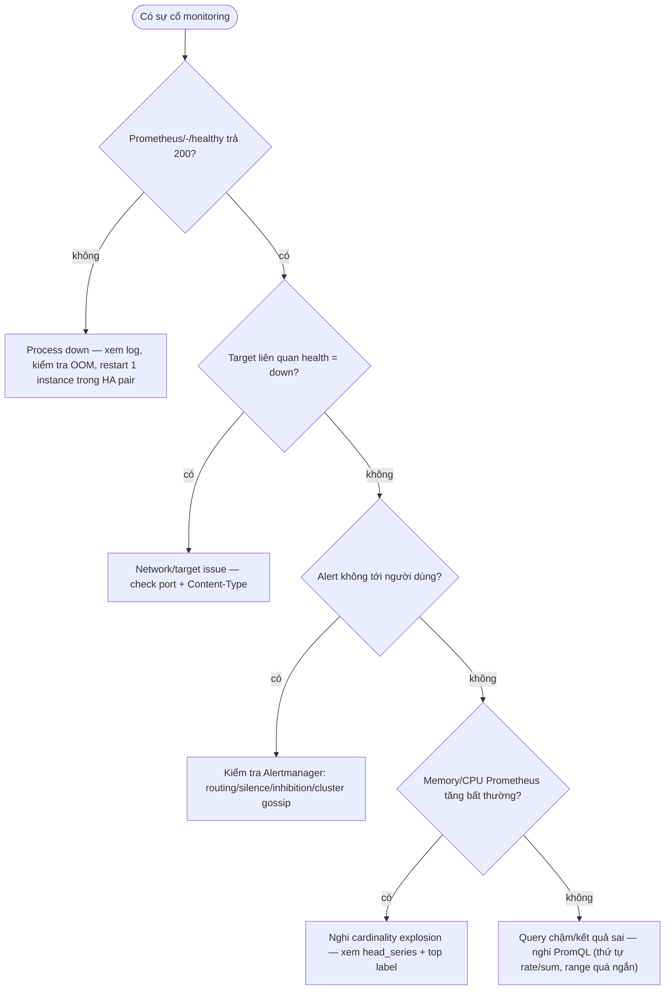

# Monitor — Runbook vận hành

> [!important] Đọc file này đầu tiên khi có sự cố
> Đang cháy → nhảy thẳng [[#3. Triage — gặp lỗi thì xem ở đây]], dò theo triệu chứng.
> Ngày thường → làm [[#1. Checklist hằng ngày]] (~10 phút).
> Lý do đằng sau từng bước nằm ở note được link; file này chỉ giữ phần "làm gì".

## 0. Thông tin môi trường

| Thành phần | Host / URL | Owner / ghi chú |
|---|---|---|
| Prometheus | `<prometheus-host>:9090` | `<team/owner>` |
| Alertmanager (cluster) | `<am-host-1>:9093`, `<am-host-2>:9093`, `<am-host-3>:9093` | `<team/owner>` |
| Grafana | `<grafana-host>:3000` | `<team/owner>` |
| Grafana backend DB (MySQL/Postgres) | `<grafana-db-host>:3306/5432` | `<team/owner>` |
| VictoriaMetrics (single-node hoặc vmselect nếu cluster) | `<vm-host>:8428` (single-node) / `<vm-host>:8481` (cluster vmselect) | `<team/owner>` |
| TSDB data dir (Prometheus) | `<storage.tsdb.path>` | `<disk mount, cảnh báo dung lượng ở đâu>` |
| VictoriaMetrics storageDataPath | `<vm-storage-data-path>` | `<disk mount, cảnh báo dung lượng ở đâu>` |

> [!todo] Điền thông tin môi trường
> Thay các giá trị `<...>` trong bảng trên và trong các lệnh bên dưới bằng giá trị thật.

## 1. Checklist hằng ngày

- [ ] **Prometheus process sống** — kết quả đúng: HTTP 200 → [[Prometheus#9. Ops Runbook — Production Notes]]
  ```bash
  curl -s -o /dev/null -w "%{http_code}\n" http://<prometheus-host>:9090/-/healthy
  curl -s -o /dev/null -w "%{http_code}\n" http://<prometheus-host>:9090/-/ready
  ```
- [ ] **Không target nào down bất thường** — kết quả đúng: `health: "up"` cho toàn bộ job quan trọng → [[prometheus--service-discovery-relabeling#Ops notes]]
  ```bash
  curl -s http://<prometheus-host>:9090/api/v1/targets | jq '.data.activeTargets[] | select(.health!="up") | {job: .labels.job, instance: .labels.instance, lastError: .lastError}'
  ```
- [ ] **Head series không tăng bất thường** — kết quả đúng: số gần bằng hôm trước, không tăng vọt → [[prometheus--exporters-cardinality#Bẫy vận hành]]
  ```bash
  curl -s http://<prometheus-host>:9090/api/v1/query --data-urlencode 'query=prometheus_tsdb_head_series' | jq '.data.result[0].value[1]'
  ```
- [ ] **Alertmanager cluster đủ node, không fail notification** — kết quả đúng: `alertmanager_cluster_members` = số node kỳ vọng, `alertmanager_notifications_failed_total` không tăng → [[prometheus--alertmanager#Ops notes]]
  ```bash
  curl -s http://<am-host-1>:9093/-/healthy
  curl -s http://<am-host-1>:9093/api/v2/status | jq '.cluster.peers | length'
  ```
- [ ] **Disk TSDB còn đủ chỗ** — kết quả đúng: dưới 80% usage → [[prometheus--storage-tsdb#Config gotchas]]
  ```bash
  df -h <storage.tsdb.path>
  ```
- [ ] **Rule evaluation không fail** — kết quả đúng: `prometheus_rule_evaluation_failures_total` không tăng → [[prometheus--promql-recording-rules#Ops notes]]
  ```bash
  curl -s http://<prometheus-host>:9090/api/v1/query --data-urlencode 'query=increase(prometheus_rule_evaluation_failures_total[1h])' | jq '.data.result'
  ```
- [ ] **Remote write (nếu có) không fail** — kết quả đúng: `prometheus_remote_storage_samples_failed_total` không tăng → [[prometheus--storage-tsdb#Hay nhầm lẫn]]
  ```bash
  curl -s http://<prometheus-host>:9090/api/v1/query --data-urlencode 'query=increase(prometheus_remote_storage_samples_failed_total[1h])' | jq '.data.result'
  ```
- [ ] **Grafana process + DB connection sống** — kết quả đúng: `"database": "ok"` → [[Grafana#9. Ops Runbook — Production Notes]]
  ```bash
  curl -s http://<grafana-host>:3000/api/health
  ```
- [ ] **Grafana alerting không fail evaluation** — kết quả đúng: không tăng đột biến → [[grafana--alerting#Ops notes]]
  ```bash
  curl -s http://<grafana-host>:3000/metrics | grep -E "grafana_alerting_rule_evaluation_failures_total"
  ```
- [ ] **VictoriaMetrics không ở read-only mode** — kết quả đúng: `vm_storage_is_read_only` = `0` → [[VictoriaMetrics#Bẫy vận hành]]
  ```bash
  curl -s http://<vm-host>:8428/health
  curl -s http://<vm-host>:8428/metrics | grep vm_storage_is_read_only
  ```

## 2. Checklist định kỳ

### Hằng tuần

- [ ] Review silence đang active ở Alertmanager — xoá silence quá hạn mục đích, không còn cần → [[prometheus--alertmanager#Ops notes]]
  ```bash
  curl -s http://<am-host-1>:9093/api/v2/silences | jq '.[] | {id, comment, endsAt}'
  ```
- [ ] Review `/api/v1/status/tsdb` tìm metric/label cardinality cao bất thường mới xuất hiện → [[prometheus--exporters-cardinality#Ops notes]]
  ```bash
  curl -s http://<prometheus-host>:9090/api/v1/status/tsdb | jq '.data.seriesCountByMetricName[:10]'
  ```
- [ ] Review danh sách public dashboard đang active ở Grafana, đặc biệt nếu còn datasource access mode `direct` → [[grafana--datasources#Các lựa chọn — Access mode]]
- [ ] Review dung lượng `data`/`indexdb` của VictoriaMetrics, phát hiện sớm churn rate cao bất thường → [[victoriametrics--ingestion-dedup#Hay nhầm lẫn]]

### Hằng tháng

- [ ] Review compaction có chạy đều không, không có backlog bất thường → [[prometheus--storage-tsdb#Ops notes]]
- [ ] Review danh sách recording rule/alerting rule còn dùng, dọn rule lỗi thời → [[prometheus--promql-recording-rules#Ops notes]]
- [ ] Kiểm tra security advisory mới của Prometheus/Alertmanager → [[Prometheus#8. Security Considerations]]
- [ ] Kiểm tra security advisory mới của Grafana → [[Grafana#8. Security Considerations]]
- [ ] Review plugin Grafana đang cài (nguồn, version, còn cần không) → [[grafana--plugins#Security notes]]
- [ ] Kiểm tra security advisory mới của VictoriaMetrics, đặc biệt liên quan vmauth → [[victoriametrics--security-vmauth#Security notes]]

### Hằng quý / hằng năm

- [ ] Restore-test snapshot TSDB backup — chưa restore-test coi như chưa có backup → [[Prometheus#9. Ops Runbook — Production Notes]]
- [ ] Diễn tập playbook khẩn cấp (cardinality explosion, Alertmanager cluster split) ở phần 5
- [ ] Review version hiện tại so với latest/EOL, lập kế hoạch upgrade nếu cần → [[Prometheus#Thay đổi lớn từ 2.x lên 3.x]]
- [ ] Restore-test backup Grafana backend DB (MySQL/Postgres dump) → [[grafana--ha-database#Ops notes]]
- [ ] Review toàn bộ user/team/org permission trên Grafana, đặc biệt Org Admin vs Grafana Server Admin → [[grafana--rbac-teams-orgs#Ops notes]]
- [ ] Restore-test backup VictoriaMetrics (vmbackup/vmrestore) trên môi trường tách biệt → [[victoriametrics--backup-restore#Ops notes]]

## 3. Triage — gặp lỗi thì xem ở đây



| Triệu chứng | Check đầu tiên | Nguyên nhân hay gặp | Chi tiết |
|---|---|---|---|
| `curl /-/healthy` không phản hồi, hoặc timeout | `nc -vz <host> 9090` | Process crash/OOM, hoặc firewall rule mất | [[Prometheus#7. Network — Port & Firewall Rules]] |
| Target hiện `up == 0` sau khi upgrade lên 3.x | `curl /api/v1/targets`, xem `lastError` | Content-Type header sai/thiếu — v3.x strict hơn v2.x | [[Prometheus#Thay đổi lớn từ 2.x lên 3.x]] |
| Target "biến mất" khỏi target list (không phải `down`, mà không có luôn) | Xem `prometheus_sd_discovered_targets`, review `relabel_configs` | SD mất quyền truy cập API, hoặc relabel `action: drop`/`keep` loại nhầm | [[prometheus--service-discovery-relabeling#Ai thắng khi xung đột]] |
| Rule firing (`ALERTS` metric có data) nhưng không ai nhận notification | Check silence + inhibition rule đang active ở Alertmanager | Silence quên xoá, hoặc inhibition rule match nhầm | [[prometheus--alertmanager#Ai thắng khi xung đột]] |
| Notification gửi trùng 2 lần cho cùng alert | Check routing tree có `continue: true` ở route cha | Route cha + route con cùng match, cả 2 đều xử lý | [[prometheus--alertmanager#Ai thắng khi xung đột]] |
| Memory Prometheus tăng dần không rõ nguyên nhân, cuối cùng OOM-kill | `curl /api/v1/status/tsdb`, xem top metric/label theo cardinality | Label unbounded (user ID, path, request ID...) | [[prometheus--exporters-cardinality#Bẫy vận hành]] |
| `rate()`/alert trả về trống hoặc giá trị lạ, lúc có lúc không | Xem range query đang dùng so với `scrape_interval` | Range quá ngắn (gần bằng `scrape_interval`), 1 scrape fail là mất data | [[prometheus--promql-recording-rules#Config gotchas]] |
| Sau khi thêm Prometheus replica thứ 2, dashboard tổng tăng gấp đôi | Check query có `sum()`/`count()` trực tiếp không filter replica | HA pair không dedupe ở tầng remote storage | [[prometheus--ha-federation-scaling#Ai thắng khi xung đột]] |
| Disk TSDB full, Prometheus crash hoặc refuse ghi | `df -h <storage.tsdb.path>` | `retention.size` không set, chỉ có `retention.time` | [[prometheus--storage-tsdb#Config gotchas]] |
| 2+ Alertmanager gửi trùng notification, hoặc silence chỉ áp dụng 1 phần cluster | `curl /api/v2/status` xem `cluster.peers` | Port 9094 gossip bị chặn, hoặc đặt LB round-robin trước Alertmanager | [[prometheus--alertmanager#Network]] |
| Grafana không load được, báo lỗi 500 liên quan database | `curl /api/health` xem field `database` | Backend DB (MySQL/Postgres) down hoặc connection pool cạn | [[grafana--ha-database#Network]] |
| Dashboard sửa trên UI, Save báo thành công nhưng vài phút sau tự quay lại bản cũ | Kiểm tra dashboard có đang được provisioning từ file không | Provisioning reload đè lại bản DB bằng bản file, `allowUiUpdates` không ngăn hẳn việc này | [[grafana--provisioning#Ai thắng khi xung đột]] |
| Grafana alert rule "Firing" nhưng không ai nhận notification | Kiểm tra contact point + notification policy trong Grafana (khác Alertmanager của Prometheus) | Grafana có Alertmanager nội bộ riêng, không chia sẻ silence với Alertmanager của Prometheus | [[grafana--alerting#Hay nhầm lẫn]] |
| Nhiều Grafana instance (HA) gửi trùng alert notification | Kiểm tra `[unified_alerting.ha]` đã cấu hình memberlist/Redis chưa | HA alerting chưa cấu hình, mỗi instance tự evaluate + gửi độc lập | [[grafana--ha-database#Ai thắng khi xung đột]] |
| Panel hiện `Bad Gateway`/datasource error | Query Inspector trên panel đó, test connection lại datasource | Network tới datasource bị chặn, hoặc credential datasource hết hạn/revoke | [[grafana--datasources#Ops notes]] |
| VictoriaMetrics không nhận sample mới, log báo "switching the storage to read-only mode" | `curl /metrics \| grep vm_storage_is_read_only` | Disk free space chạm `-storage.minFreeDiskSpaceBytes` | [[VictoriaMetrics#Bẫy vận hành]] |
| Disk VictoriaMetrics tăng nhanh, `indexdb` lớn hơn cả `data` | So sánh dung lượng 2 thư mục `data`/`indexdb` | High churn rate — label đổi giá trị liên tục | [[VictoriaMetrics#Bẫy vận hành]] |
| Sau khi remote write từ HA Prometheus pair vào VictoriaMetrics, disk/series tăng gần gấp đôi | Kiểm tra `-dedup.minScrapeInterval` đã set đúng `scrape_interval` chưa | Dedup chưa cấu hình hoặc `external_labels` không khớp giữa 2 replica | [[victoriametrics--ingestion-dedup#Ai thắng khi xung đột]] |
| Query VictoriaMetrics cluster trả thiếu data dù vmstorage vẫn sống | So `-replicationFactor` giữa vminsert và vmselect | Giá trị không đồng bộ giữa 2 component | [[victoriametrics--architecture-cluster#Ai thắng khi xung đột]] |

## 4. Network quick check

```bash
# Chạy từ host Prometheus/Alertmanager hoặc host có quyền truy cập tương đương
# timeout = firewall drop, refused = service không listen
for target in <prometheus-host>:9090 <am-host-1>:9093 <am-host-1>:9094 <am-host-2>:9093 <grafana-host>:3000 <vm-host>:8428; do
  nc -vz -w 3 "${target%%:*}" "${target##*:}"
done

# Check target cụ thể có bị chặn network hay chỉ là service không listen
curl -v http://<target-host>:<target-port>/metrics 2>&1 | head -20
```

![[Prometheus#^ports]]

![[Grafana#^ports]]

![[VictoriaMetrics#^ports]]

## 5. Playbook khẩn cấp

### Cardinality explosion — Prometheus sắp/đang OOM

**Khi nào dùng:** `prometheus_tsdb_head_series` tăng vọt bất thường, memory usage gần/đã chạm limit.

1. Xác nhận cardinality thật đang nổ, không phải churn thường: `curl http://<prometheus-host>:9090/api/v1/status/tsdb | jq '.data.seriesCountByMetricName[:10]'`
2. Xác định metric/job gây ra, tìm label nghi ngờ qua `labelValueCountByLabelName` trong cùng response.
3. Chặn tạm ngay bằng relabel drop target/metric đó (sửa `scrape_configs`, thêm `metric_relabel_configs` action `drop`), reload config:
   ```bash
   curl -X POST http://<prometheus-host>:9090/-/reload
   ```
4. Nếu Prometheus đã sắp OOM, set tạm `sample_limit` thấp cho job đó để chặn tăng tiếp trong lúc chờ fix tận gốc ở exporter/app.
5. Báo team sở hữu metric đó sửa thiết kế label (bỏ unbounded value) trước khi gỡ relabel drop tạm thời.

**Verify:** `prometheus_tsdb_head_series` ngừng tăng, memory ổn định lại.
**Chi tiết:** [[prometheus--exporters-cardinality#Bẫy vận hành]]

### Alertmanager cluster split — gửi trùng hoặc thiếu notification

**Khi nào dùng:** `cluster.peers` không đủ số node kỳ vọng, hoặc nhận báo notification trùng/thiếu bất thường.

1. Check port gossip 9094 giữa các node: `nc -vz -w 3 <am-host> 9094`.
2. Xác nhận không có load balancer round-robin đặt trước Alertmanager — Prometheus phải gửi tới **tất cả** replica trực tiếp.
3. Nếu network đã thông nhưng vẫn không join cluster, restart node bị split 1 node tại 1 thời điểm, theo dõi `cluster.peers` tăng dần trở lại.
4. Trong lúc cluster chưa ổn, cân nhắc tạm silence alert noise do trùng lặp, **không** silence alert thật.

**Verify:** `curl http://<am-host>:9093/api/v2/status | jq '.cluster.peers | length'` bằng số node kỳ vọng.
**Chi tiết:** [[prometheus--alertmanager#Network]]

### Disk TSDB gần full

**Khi nào dùng:** `df -h <storage.tsdb.path>` trên 85-90%.

1. Set ngay `retention.size` (nếu chưa set) qua flag + restart có kiểm soát, hoặc giảm `retention.time` tạm thời.
2. Kiểm tra có job nào mới gây cardinality tăng bất thường trùng thời điểm disk tăng nhanh (xem playbook cardinality ở trên).
3. Nếu cần giải phóng ngay, xoá series không cần qua Admin API (chỉ nếu `--web.enable-admin-api` đã bật và biết chắc series nào an toàn xoá):
   ```bash
   curl -X POST -g 'http://<prometheus-host>:9090/api/v1/admin/tsdb/delete_series?match[]=<metric_name>{<label_selector>}'
   ```
4. Theo dõi disk usage giảm sau compaction chạy (tombstone chỉ dọn thật khi compact).

**Verify:** disk usage giảm xuống dưới ngưỡng cảnh báo, không tăng trở lại bất thường.
**Chi tiết:** [[prometheus--storage-tsdb#Config gotchas]]

### Nghi lộ credential datasource qua public dashboard Grafana

**Khi nào dùng:** phát hiện public dashboard đang active kèm datasource access mode `direct`, hoặc nghi secret đã bị lộ (audit, báo cáo bên thứ 3).

1. Vô hiệu hoá ngay public dashboard nghi vấn (tắt share hoặc xoá public URL) trong Grafana UI.
2. Review toàn bộ datasource trong org, chuyển hết access mode từ `Browser (direct)` sang `Server (proxy)`.
3. Xoay (rotate) credential của mọi datasource đã từng gắn với public dashboard đó — coi như đã lộ.
4. Đổi `[security] secret_key` nếu nghi database backup cũng đã bị lộ, sau đó nhập lại toàn bộ secret datasource/contact point.
5. Upgrade Grafana lên bản đã patch nếu đang ở version cũ dính CVE liên quan (xem [[Grafana#Misconfiguration gây breach]]).

**Verify:** không còn datasource `direct` mode, credential cũ đã bị revoke ở hệ thống gốc (Prometheus/CloudWatch/...).
**Chi tiết:** [[Grafana#Bẫy vận hành]]

### Grafana HA gửi trùng alert notification

**Khi nào dùng:** nhiều Grafana instance đang chạy HA, nhận báo notification trùng cho cùng 1 alert.

1. Kiểm tra `[unified_alerting.ha]` đã cấu hình `peers` cho mọi instance chưa.
2. Check port gossip giữa các instance (memberlist) có bị firewall chặn không.
3. Nếu dùng Redis cho HA alerting, kiểm tra Redis còn sống và network tới nó thông.
4. Trong lúc chưa fix xong, cân nhắc tạm trỏ notification policy về 1 contact point duy nhất để dễ nhận diện trùng lặp, không tắt alert thật.

**Verify:** mỗi alert chỉ còn 1 notification gửi tới contact point, không lặp theo số instance.
**Chi tiết:** [[grafana--ha-database#Ai thắng khi xung đột]]

### VictoriaMetrics storage chuyển read-only, drop sample mới

**Khi nào dùng:** `vm_storage_is_read_only` = `1`, log báo thiếu free disk space.

1. Kiểm tra disk free thật: `df -h <vm-storage-data-path>`.
2. So sánh dung lượng `data`/`indexdb` — nếu `indexdb` bất thường lớn, nghi high churn rate (xem playbook/gotcha liên quan).
3. Giải phóng disk ngay (xoá log cũ không liên quan, tăng disk nếu có thể) hoặc giảm `-retentionPeriod` tạm thời.
4. Sau khi disk đủ trống trở lại, xác nhận `vm_storage_is_read_only` về `0` và sample mới được ghi tiếp.
5. Nếu nguyên nhân là churn rate, tìm label gây churn qua cardinality explorer, xử lý tận gốc ở nguồn remote write.

**Verify:** `vm_storage_is_read_only` = `0`, `vm_rows_inserted_total` tiếp tục tăng bình thường.
**Chi tiết:** [[VictoriaMetrics#Bẫy vận hành]]

## 6. Lịch hết hạn & mốc quan trọng

| Cái gì | Hết hạn / mốc | Ai lo | Bắt đầu xử lý trước |
|---|---|---|---|
| Prometheus EOL version hiện tại | `<theo dõi endoflife.date/prometheus>` | `<owner>` | 90 ngày |
| Alertmanager EOL version hiện tại | `<theo dõi release notes>` | `<owner>` | 90 ngày |
| Grafana EOL version hiện tại | `<theo dõi endoflife.date/grafana>` | `<owner>` | 90 ngày |
| VictoriaMetrics EOL version hiện tại (hoặc đang dùng LTS 1.148.0) | `<theo dõi GitHub releases VictoriaMetrics>` | `<owner>` | 90 ngày |
| Restore-test TSDB snapshot | `<lịch quý>` | `<owner>` | Trước mỗi quý |
| Restore-test Grafana backend DB backup | `<lịch quý>` | `<owner>` | Trước mỗi quý |
| Restore-test VictoriaMetrics backup (vmbackup/vmrestore) | `<lịch quý>` | `<owner>` | Trước mỗi quý |
| Review CVE/security advisory (Prometheus + Grafana + VictoriaMetrics) | `<lịch tháng>` | `<owner>` | Hằng tháng |

## 7. Escalation & liên hệ

| Tình huống | Gọi ai | Kênh |
|---|---|---|
| Mất toàn bộ alerting (cả HA pair + Alertmanager cluster down) | `<team on-call chính>` | `<kênh escalation>` |
| Nghi leak data do port Prometheus/exporter public không auth | `<security team>` | `<kênh security incident>` |
| Vendor/community support cho CVE mới | `<theo dõi GitHub security advisories prometheus/prometheus, grafana/grafana, VictoriaMetrics/VictoriaMetrics>` | `<kênh>` |
| Nghi lộ credential datasource qua public dashboard Grafana | `<security team>` | `<kênh security incident>` |
| VictoriaMetrics mất data do disk hỏng, chưa restore-test được | `<team on-call chính>` | `<kênh escalation>` |

## 8. Nhật ký sự cố

- [[Prometheus#Lesson learned thực tế]]
- [[Grafana#Lesson learned thực tế]]
- [[VictoriaMetrics#Lesson learned thực tế]]
