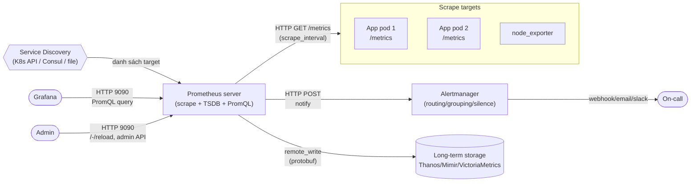
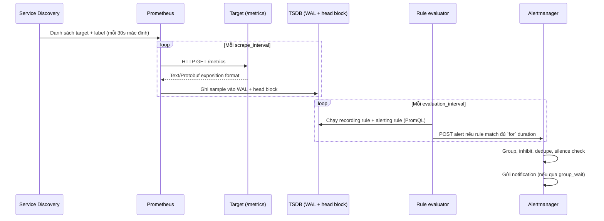

# Prometheus — Hệ thống monitoring & TSDB dạng pull

> [!info] Phạm vi version
> Note áp dụng cho **Prometheus 3.15.1** (latest stable tại ngày 2026-11-01, xem [release note](https://github.com/prometheus/prometheus/releases/tag/v3.15.1)).
> Alertmanager đi kèm note này là **0.34.2**. Khác biệt với bản 2.x được đánh dấu inline: `(trước v3.0)`.

> [!warning] Prometheus 3.0 là major upgrade, không chỉ bump số
> Nếu bạn còn nhớ Prometheus theo kiểu 2.x thì đọc kỹ phần [[#Thay đổi lớn từ 2.x lên 3.x]] trước khi áp dụng note này vào production — vài hành vi default đã đổi âm thầm (regex PromQL, scrape Content-Type, remote write HTTP/2...).

## 1. What — Nó là cái gì?

> Hình dung Prometheus như một **máy đo huyết áp tự động đi vòng quanh phòng bệnh**: nó không đợi bệnh nhân (service) báo cáo, mà tự đi tới từng người, đo (scrape) theo chu kỳ cố định, rồi ghi vào sổ riêng của nó.

Prometheus là hệ thống monitoring + time-series database (TSDB) mã nguồn mở, thu thập metrics bằng cách **pull** (tự đi scrape HTTP endpoint `/metrics`) theo chu kỳ, lưu local trên disk, và cho query bằng ngôn ngữ riêng là PromQL. Ra đời ở SoundCloud 2012, hiện là CNCF graduated project và gần như là chuẩn de-facto cho metrics trong giới cloud-native.

## 2. Why — Tại sao tồn tại / Vấn đề nó giải quyết?

Trước Prometheus, mô hình phổ biến là **push**: app tự gửi metric tới collector (statsd, Graphite). Vấn đề là app phải biết địa chỉ collector, collector dễ bị ngập khi traffic tăng, và khi app die thì không ai biết — vì chẳng còn gì gửi tới nữa.

Prometheus lật ngược mô hình: Prometheus đi hỏi target, nên **nếu target không trả lời (scrape fail) → đó chính là alert `up == 0`**, không cần thêm logic riêng để phát hiện "service biến mất". Target chỉ cần expose một HTTP endpoint tĩnh, không cần biết Prometheus đang chạy ở đâu — cực kỳ hợp với môi trường pod/instance sinh ra rồi chết liên tục như Kubernetes, vì Prometheus tự dùng service discovery để tìm ra target mới, không cần app tự đăng ký.

## 3. When — Dùng khi nào / KHÔNG dùng khi nào?

**Dùng khi:**
- Cần metrics time-series cho infra/app trong môi trường có service discovery (K8s, Consul, cloud).
- Cần alerting dựa trên ngưỡng/rate theo thời gian thực (giây tới phút).
- Hệ thống tương đối ổn định về network — Prometheus cần "nhìn thấy" target để scrape được.

**KHÔNG dùng / cân nhắc thay thế khi:**
- Cần lưu metrics **nhiều năm** hoặc **multi-tenant global view** — local TSDB của Prometheus không phải là long-term/clustered storage, cần ghép thêm [[prometheus--ha-federation-scaling]] (Thanos/Mimir/VictoriaMetrics).
- Target ở sau NAT, mobile, hoặc network ngắt quãng không cho Prometheus chủ động kết nối tới — mô hình pull không hợp, nên dùng Pushgateway (chỉ cho batch job ngắn hạn) hoặc OTLP/push-based (Prometheus 3.x có nhận OTLP qua `--web.enable-otlp-receiver`, nhưng đó vẫn khác bản chất với pull-based scrape).
- Cần logs hoặc traces — Prometheus chỉ làm metrics; logs dùng Loki, traces dùng Tempo/Jaeger.
- High cardinality theo bản chất (per-user, per-request ID) — PromQL/TSDB không được thiết kế cho chuyện này, xem [[prometheus--exporters-cardinality]].

## 4. Where — Architecture & Deployment



Điểm cần nhìn trong diagram: Prometheus là **trung tâm chủ động** — nó tự đi scrape (mũi tên từ `prom` ra `targets`), còn hướng ra ngoài (Alertmanager, Grafana, remote storage) thì Prometheus mới là bên "phục vụ" hoặc "đẩy đi". Mất `sd` thì Prometheus vẫn chạy nhưng không biết target mới sinh ra ở đâu.

- **Vị trí trong hệ thống:** tầng thu thập + lưu trữ + query metrics, nằm giữa app/infra và lớp alerting/visualization.
- **Component chính:**
  - Scrape manager — gọi HTTP tới target theo `scrape_interval`.
  - TSDB — lưu local trên disk, xem [[prometheus--storage-tsdb]].
  - PromQL engine — xử lý query, xem [[prometheus--promql-recording-rules]].
  - Rule evaluator — chạy recording rules + alerting rules, gửi alert sang Alertmanager.
  - Service discovery manager — xem [[prometheus--service-discovery-relabeling]].
- **Traffic/data flow:** target → (scrape) → TSDB → (PromQL) → Grafana/API; TSDB → (alerting rule match) → Alertmanager → notification.
- **Dependency:** DNS (để resolve target/SD API), đồng hồ hệ thống chính xác (NTP — lệch giờ làm sai rate/alert timing), disk đủ nhanh & đủ dung lượng cho WAL + block (xem [[prometheus--storage-tsdb]]). Prometheus **không cần database ngoài** để chạy — đây vừa là điểm mạnh (ít dependency) vừa là điểm yếu (không tự nhân bản được dữ liệu).

### Mô hình triển khai

| Mô hình | Khi nào chọn | Số node tối thiểu | Không bảo vệ được |
|---|---|---|---|
| Single node | Lab, dev, hệ thống nhỏ không cần SLA cao | 1 | Mất node = mất toàn bộ data + mù alert trong lúc down |
| HA pair (2 instance giống nhau, cùng scrape) | Production thường gặp — tăng độ sẵn sàng của alerting | 2 | Không tự dedupe data ở query layer (xem [[prometheus--ha-federation-scaling]]), tốn gấp đôi resource |
| Prometheus Agent mode (`--agent`) + remote write | Chỉ cần thu thập & đẩy đi, không cần query/alert tại local | 1+ (thường nhiều, mỗi cluster 1) | Không query/alert được tại chỗ — phải trông chờ hoàn toàn vào backend nhận remote write |
| Sharding theo chức năng/team (nhiều Prometheus độc lập + federation hoặc remote write) | Khi 1 instance quá tải (quá nhiều target/series) | 2+ | Cross-shard alerting/query phức tạp, cần thêm Thanos/Mimir cho global view |

## 5. How — Cơ chế hoạt động

Core concepts cần nắm:

- **Data model** — mọi thứ trong Prometheus là **time series**: 1 metric name + 1 tập label (key=value) + 1 dãy (timestamp, value). Ví dụ `http_requests_total{method="GET", status="200"}` là MỘT series riêng, khác với `{method="POST"}`. Đây là lý do label không kiểm soát được → cardinality nổ, xem [[prometheus--exporters-cardinality]].
- **4 loại metric** — `Counter` (chỉ tăng, reset về 0 khi app restart, luôn đi với `rate()`/`increase()`), `Gauge` (lên xuống tự do, đọc giá trị trực tiếp), `Histogram` (đếm số sample rơi vào từng bucket, tính percentile qua `histogram_quantile()`), `Summary` (percentile tính sẵn ở client, không aggregate được qua nhiều instance). Prometheus 3.x còn có **Native Histogram** (ổn định từ khoảng v3.8) — nén hiệu quả hơn classic histogram và tự chọn độ phân giải bucket.
- **Scraping** — Prometheus tự gọi HTTP GET tới `/metrics` của từng target theo `scrape_interval` (default `1m`), timeout `scrape_timeout` (default `10s`, không được vượt `scrape_interval`). Từ v3.x, Prometheus **strict hơn về Content-Type**: target trả response thiếu/sai Content-Type header sẽ bị fail scrape thẳng (trước đây v2.x mặc định coi là text format) — set `fallback_scrape_protocol` nếu cần giữ hành vi cũ.
- **Service Discovery & Relabeling** — cách Prometheus tự tìm target và lọc/sửa label trước và sau khi scrape. → [[prometheus--service-discovery-relabeling]]
- **PromQL & Recording rules** — ngôn ngữ truy vấn + cách pre-compute query nặng. → [[prometheus--promql-recording-rules]]
- **Storage/TSDB & Remote write** — cách lưu local và đẩy đi xa. → [[prometheus--storage-tsdb]]
- **Alerting & Alertmanager** — cách Prometheus đánh giá alerting rule rồi đẩy alert, và Alertmanager xử lý route/group/silence. → [[prometheus--alertmanager]]
- **Federation & HA/scaling** — cách nhiều Prometheus phối hợp, và vì sao bản thân Prometheus không tự HA được. → [[prometheus--ha-federation-scaling]]
- **Exporters & cardinality** — hệ sinh thái expose metric cho hệ thống không tự có `/metrics`, và quản lý cardinality. → [[prometheus--exporters-cardinality]]

### Ai thắng khi xung đột

Nguyên tắc chung: **cấu hình ở layer gần thời điểm xử lý hơn thắng**, nhưng tốn chi phí khác nhau — biết layer nào thắng chưa đủ, phải biết layer nào "rẻ" hơn.

| Bên A | Bên B | Kết quả | Im lặng hay báo lỗi? |
|---|---|---|---|
| `relabel_configs` action `drop` (trước scrape) | `metric_relabel_configs` action `drop` (sau scrape) | Cả hai đều loại được series khỏi storage, nhưng `relabel_configs` tránh được cả network/CPU scrape; `metric_relabel_configs` vẫn tốn tài nguyên scrape target đó rồi mới vứt | Im lặng — series biến mất, không log cảnh báo |
| `scrape_timeout` > `scrape_interval` | Prometheus validate config | Prometheus từ chối load config | Báo lỗi ngay khi reload/start |
| Global `scrape_interval` | Per-job `scrape_interval` trong `scrape_configs` | Per-job thắng, chỉ áp dụng cho job đó | Im lặng, không cảnh báo |
| Counter đổi tên sang UTF-8 metric name (v3.x cho phép) | Client/exporter cũ dùng charset legacy | Nếu `metric_name_validation_scheme` để `utf8` nhưng downstream (Grafana cũ, remote storage cũ) không hỗ trợ UTF-8 label | Có thể lỗi parse ở downstream, không lỗi ở Prometheus |



Vài điểm cần để ý: scrape và rule evaluation là **hai loop độc lập**, chạy theo 2 interval khác nhau (`scrape_interval` vs `evaluation_interval`) — nếu 2 số này lệch nhiều, alert có thể delay so với lúc sample thật sự xuất hiện. Alert chỉ được gửi tới Alertmanager sau khi đã pending đủ thời gian `for:` trong rule — đây là lý do alert luôn "chậm" hơn sự cố thật một khoảng cố định, không phải bug.

## 6. Key Config — Cấu hình cần nhớ

| Config | Default | Khuyến nghị | Vì sao |
|---|---|---|---|
| `global.scrape_interval` | `1m` | `15s`–`30s` cho infra quan trọng | Interval dài → alert chậm phát hiện; quá ngắn → tốn CPU/disk, risk quá tải target |
| `global.scrape_timeout` | `10s` | ≤ 1/2 `scrape_interval` | Để `scrape_timeout` ≈ `scrape_interval` thì 1 target chậm làm trễ cả round scrape kế tiếp |
| `global.evaluation_interval` | `1m` | Bằng hoặc gần `scrape_interval` | Lệch nhiều làm alert "nhìn thấy" dữ liệu cũ hơn thực tế |
| `storage.tsdb.retention.time` | `15d` | Theo nhu cầu, set rõ ràng kèm `retention.size` | Không set gì thì mặc định chỉ giữ 15 ngày — dễ mất data điều tra incident cũ hơn |
| `storage.tsdb.retention.size` | `0` (không giới hạn) | Set khi disk có hạn, để tránh disk full làm Prometheus crash | Không set → disk full → Prometheus die, không ghi được WAL mới |
| `scrape_config.honor_labels` | `false` | Giữ `false` trừ khi chắc chắn (federation/relay) | `true` cho phép label từ target đè label discovery, dễ tạo conflict label âm thầm |
| `scrape_config.sample_limit` | `0` (không giới hạn) | Set một ngưỡng hợp lý (vài nghìn) cho job rủi ro cardinality cao | Không set → 1 target lỗi expose quá nhiều series có thể kéo sập cả Prometheus |
| `--web.enable-admin-api` | `false` | Giữ `false`, hoặc chỉ bật kèm auth/network restriction | Bật ra là cho phép xoá toàn bộ TSDB qua API không cần xác nhận |
| `--web.enable-lifecycle` | `false` | Bật có kiểm soát nếu cần `/-/reload` qua API | Cho phép reload/shutdown server qua HTTP — rủi ro nếu không hạn chế network |
| `remote_write.queue_config.capacity` | `10000` | 3–10× `max_samples_per_send` | Capacity thấp làm shard block ngược lại việc đọc WAL khi remote endpoint chậm |
| `remote_write.queue_config.max_shards` | `50` | Thường không cần tăng trừ remote endpoint rất chậm | Tăng `max_shards` vô tội vạ dễ làm Prometheus tốn RAM hơn là nhanh hơn |

## 7. Network — Port & Firewall Rules

| Nguồn → Đích | Port/Proto | Mục đích | Default? | Triệu chứng khi bị chặn |
|---|---|---|---|---|
| Admin/Grafana → Prometheus | `9090/tcp` | Web UI, HTTP API, PromQL query | có (`--web.listen-address`) | Grafana datasource báo `connection refused`/timeout; `curl` tới `/-/healthy` không phản hồi |
| Prometheus → Scrape target | `<port cấu hình job>` (thường port riêng của app, ví dụ `9100` cho node_exporter) | Scrape `/metrics` | tuỳ exporter, xem [[prometheus--exporters-cardinality]] | Target hiện `up == 0` trong Prometheus, không có data cho job đó |
| Prometheus → Alertmanager | `9093/tcp` | Gửi alert đã evaluate | có | Alert "biến mất" — Prometheus vẫn thấy rule firing (`ALERTS` metric) nhưng Alertmanager không nhận được gì, không ai được notify |
| Alertmanager ↔ Alertmanager (cluster) | `9094/tcp+udp` | Gossip protocol — đồng bộ silence/notification state | có (`--cluster.listen-address`) | Cluster split — 2 node gửi trùng notification, hoặc silence áp dụng ở node A nhưng không ở node B |
| Prometheus → Kubernetes API / Consul / cloud API | `443/tcp` (K8s API), `8500/tcp` (Consul) hoặc theo SD | Service discovery | tuỳ SD | Target list không update — service mới scale ra không được scrape, service cũ bị xoá vẫn hiện `up == 0` dai dẳng tới khi stale (5 phút) |
| Prometheus → NTP | `123/udp` | Đồng bộ giờ hệ thống | có | Không lỗi ngay; về sau `rate()`/alert timing bị lệch khó hiểu, log timestamp sai thứ tự |
| Prometheus → remote_write endpoint | `443/tcp` (hoặc theo config) | Đẩy sample sang long-term storage (Thanos/Mimir/VictoriaMetrics) | tuỳ config | `prometheus_remote_storage_samples_failed_total` tăng; WAL phình to vì chưa flush được |
| Client → Prometheus (OTLP receiver) | `9090/tcp` path `/api/v1/otlp/v1/metrics` | Nhận metric đẩy từ OpenTelemetry Collector | cần bật `--web.enable-otlp-receiver` | Nếu không bật flag, nhận `404`/`not found` dù port 9090 vẫn thông |

^ports

**Kiểm tra nhanh khi nghi rule bị xoá:**

```bash
# TCP: "succeeded" = thông; "Connection refused" = thông mạng nhưng service không listen; timeout = bị firewall drop
nc -vz -w 3 <prometheus-host> 9090
nc -vz -w 3 <alertmanager-host> 9093
nc -vz -w 3 <alertmanager-host> 9094

# Kiểm tra target có scrape được không (health, status, last scrape error)
curl -s http://<prometheus-host>:9090/api/v1/targets | jq '.data.activeTargets[] | {job: .labels.job, health: .health, lastError: .lastError}'
```

> [!tip] Timeout vs refused
> `Connection timed out` gần như luôn là firewall/security group drop packet. `Connection refused` là mạng đã thông nhưng không có process listen (service chết hoặc bind sai interface). Phân biệt được hai cái này là biết nên gọi network team hay tự xem lại service.

## 8. Security Considerations

### Attack surface

- **HTTP API `:9090`** — không có auth/TLS mặc định. Ai chạm được port này là đọc được **toàn bộ** metrics (có thể lộ business data nhạy cảm nếu label chứa thông tin đó), và nếu `--web.enable-admin-api` bật thì còn xoá được data.
- **`/metrics` của target** — mọi exporter cũng không tự có auth, ai chạm network tới đó là đọc được metric của host/app đó (CPU, memory, thậm chí custom business metric).
- **Alertmanager API/webhook** — ai gọi được API Alertmanager có thể tạo silence giả để **im lặng** alert thật trong lúc có incident, hoặc trigger notification giả.

### Misconfiguration gây breach

| Misconfiguration | Hậu quả |
|---|---|
| Expose port 9090/9100/9093... ra internet không firewall | Scanner tự động tìm thấy, đọc toàn bộ metrics — [[prometheus--exporters-cardinality#Bẫy vận hành|một dạng data leak thực tế đã xảy ra nhiều lần với Prometheus/Grafana public]] |
| Bật `--web.enable-admin-api` không kèm network restriction | Ai gọi `DELETE /api/v1/admin/tsdb/delete_series` là xoá sạch data, không cần auth |
| Azure AD/OAuth client secret trong `remote_write` config để lộ qua config API | CVE-2026-42151 — client secret bị đọc plaintext qua config API, đã fix ở 3.5.3 LTS / 3.11.3 |
| Remote write endpoint bị redirect (3xx) sang host khác do attacker kiểm soát | CVE-2026-119566 — Prometheus replay luôn Azure AD/Google IAM bearer token sang host redirect, lộ token cho attacker. **Ảnh hưởng tới bản 3.15.1 đang pin trong note này** — chưa thấy version fix công khai lúc viết note, theo dõi advisory |

### Hardening checklist tối thiểu

- [ ] Không bao giờ bind Prometheus/Alertmanager/exporter vào `0.0.0.0` khi có public IP — chỉ bind internal interface hoặc đặt sau reverse proxy.
- [ ] Đặt TLS + basic auth (hoặc OAuth2 proxy) ở tầng reverse proxy — Prometheus/Alertmanager **không tự làm TLS/auth** cho web UI theo default.
- [ ] Giữ `--web.enable-admin-api` tắt trừ khi thật sự cần, và nếu bật thì giới hạn network (VPN/internal only).
- [ ] Review `remote_write` config không chứa secret dạng plaintext trong file — dùng `*_file` variant (`bearer_token_file`, `password_file`) khi có thể.
- [ ] Theo dõi Prometheus security advisories (GitHub `prometheus/prometheus/security/advisories`) định kỳ — hệ sinh thái đang có vài CVE liên quan XSS UI cũ và leak credential remote write.
- [ ] Không bật `--enable-feature=old-ui` (legacy UI) trừ khi cần tương thích ngược — dính CVE-2026-44903 (stored XSS qua histogram bucket label).

## 9. Ops Runbook — Production Notes

> [!tip] Checklist hằng ngày & triage sự cố
> Phần này giải thích *vì sao*. Làm gì mỗi ngày và xử lý sự cố theo triệu chứng: [[Monitor--Runbook]].

- **Health check:** `curl http://<host>:9090/-/healthy` (process còn sống) và `curl http://<host>:9090/-/ready` (TSDB đã load xong, sẵn sàng nhận query/serve traffic).
- **Log quan trọng:** stdout/stderr của process (package: `/var/log/prometheus/`, container: `docker logs`/`kubectl logs`). Grep `wal corrupt`, `level=error`, `out of memory`, `context deadline exceeded` (thường là scrape timeout).
- **Metric cần alert:** `up == 0` (target chết), `prometheus_tsdb_head_series` (tăng bất thường = cardinality nổ), `prometheus_tsdb_wal_corruptions_total` (WAL hỏng), `prometheus_rule_evaluation_failures_total` (rule lỗi), `prometheus_notifications_queue_length` so với `prometheus_notifications_dropped_total` (Alertmanager không theo kịp).
- **Restart / rollback:** restart 1 instance trong HA pair tại 1 thời điểm, không bao giờ restart cả cặp cùng lúc (mất toàn bộ alerting trong lúc WAL replay). WAL replay khi start có thể mất vài phút nếu WAL lớn — đây là lý do downtime restart không phải "tức thì".
- **Backup / restore:** dùng `POST /api/v1/admin/tsdb/snapshot` (cần `--web.enable-admin-api`) để tạo snapshot block, hoặc backup toàn bộ `storage.tsdb.path`. Chưa test restore thì coi như chưa có backup.
- **Upgrade:** đọc kỹ [[#Thay đổi lớn từ 2.x lên 3.x]] nếu đang ở 2.x. Khuyến nghị lên `v2.55` trước, verify ổn, rồi mới lên `v3.x` — TSDB format của v3 chỉ đọc được ngược bởi v2.55+, downgrade về v2 cũ hơn có thể mất data.

## 10. Gotchas & Lessons Learned

### Thay đổi lớn từ 2.x lên 3.x

> [!warning] Đọc trước khi upgrade
> Đây không phải danh sách đầy đủ, chỉ là những điểm hay gây sự cố thật khi upgrade.

| Thay đổi | Trước (2.x) | Giờ (3.x) | Hậu quả nếu không biết |
|---|---|---|---|
| Regex PromQL: `.` match newline | `.` không match `\n` | `.*` match cả string chứa `\n` | Query/alert có thể match nhiều hơn dự kiến — regex tưởng chặt hoá ra lỏng |
| Range selector | Left-closed | Left-open, right-closed | Subquery/alert có thể trả về ít sample hơn kỳ vọng ở biên thời gian |
| Scrape Content-Type | Không có header → coi là text format | Không có/sai header → **fail scrape thẳng** | Target cũ không set Content-Type đúng sẽ tự dưng `up == 0` sau upgrade, dùng `fallback_scrape_protocol` để giữ hành vi cũ |
| Remote write HTTP/2 | Default `true` | Default `false` | Remote write có thể chậm/lỗi khác đi nếu endpoint tối ưu cho HTTP/2 |
| `le`/`quantile` label | Giá trị nguyên `"1"` | Normalize về float `"1.0"` | Query filter theo `le="1"` cứng không còn match, phải dùng `le="1.0"` hoặc regex |
| Logging | go-kit/log, `ts=` | log/slog, `time=` | Script parse log cũ theo `ts=` không còn match |
| Alertmanager API | Hỗ trợ v1 + v2 | Chỉ hỗ trợ **v2 API**, yêu cầu Alertmanager ≥ 0.16.0 | Alertmanager quá cũ sẽ không nhận alert từ Prometheus 3.x nữa |

### Hay nhầm lẫn

| Dễ nhầm | Thực tế | Hậu quả khi nhầm |
|---|---|---|
| `relabel_configs` vs `metric_relabel_configs` | Cái đầu chạy **trước** scrape (lọc target), cái sau chạy **sau** scrape (lọc/sửa sample) | Dùng `drop` ở `metric_relabel_configs` để "tiết kiệm" vẫn tốn network/CPU scrape, chỉ `relabel_configs` mới tránh được chi phí đó |
| `rate()` vs `irate()` | `rate()` lấy trung bình cả range (mượt, hợp alert); `irate()` chỉ lấy 2 sample cuối (nhạy, dễ noise) | Dùng `irate()` cho alert dễ bị trigger giả do 1 điểm nhiễu; dùng `rate()` cho graph biến động nhanh thì mượt quá mất chi tiết |
| Federation vs Remote Write | Federation là **pull** định kỳ qua `/federate` (tốn resource mỗi lần pull toàn bộ match set); Remote Write là **push** stream liên tục | Dùng federation cho scale lớn dễ quá tải Prometheus trung tâm — xem [[prometheus--ha-federation-scaling]] |
| Counter vs Gauge | Counter chỉ tăng (trừ khi app restart reset về 0, Prometheus tự detect reset này trong `rate()`); Gauge lên xuống tự nhiên | Dùng `rate()` trên Gauge → kết quả vô nghĩa vì Prometheus tưởng mọi lần giảm là "reset" |

### Bẫy vận hành

#### Cardinality explosion làm Prometheus OOM

- **Triệu chứng:** memory tăng dần không rõ nguyên nhân (có case tăng từ 8GB lên 32GB qua một đêm), `prometheus_tsdb_head_series` tăng vọt, process bị kernel OOM-kill, restart xong phải replay WAL rất lâu.
- **Nguyên nhân:** một label có cardinality không chặn (user ID, raw URL path, request ID...) được gắn vào metric — mỗi giá trị unique tạo ra một series mới.
- **Cách tránh / xử lý:** không gắn label unbounded; dùng `sample_limit`/`label_limit` trong scrape config làm lưới an toàn; monitor `prometheus_tsdb_head_series` và alert sớm trước khi chạm RAM limit. Chi tiết: [[prometheus--exporters-cardinality#Bẫy vận hành]].
- **Nguồn:** [Why Does Prometheus Keep Running Out of Memory? (Medium)](https://medium.com/@sreThoughts/why-does-prometheus-keep-running-out-of-memory-5cdeba2b5a54), [token.place production postmortem 2026-09-02](https://github.com/futuroptimist/token.place/pull/1761)

#### `rate()` với range quá ngắn trả về trống hoặc sai

- **Triệu chứng:** `rate(my_counter[1m])` lúc có data lúc không, dù counter vẫn đang tăng đều.
- **Nguyên nhân:** `rate()` cần ít nhất 2 sample trong range để tính; nếu range gần bằng `scrape_interval`, một lần scrape fail (network glitch) là range chỉ còn 1 sample → không trả kết quả.
- **Cách tránh / xử lý:** dùng range tối thiểu **4× scrape_interval** (scrape 15s thì dùng `[1m]` trở lên), không dùng đúng `[scrape_interval]`.
- **Nguồn:** [What range should I use with rate()? — Robust Perception](https://www.robustperception.io/what-range-should-i-use-with-rate/)

#### HA pair tự nhân đôi số liệu khi remote write

- **Triệu chứng:** sau khi thêm Prometheus replica thứ 2 cho HA, dashboard/alert tổng (sum/count) tự nhiên tăng gấp đôi.
- **Nguyên nhân:** cả 2 replica cùng scrape và cùng remote write cùng một series — bên nhận (Thanos/Mimir/Cortex) coi đó là 2 series riêng nếu không có cấu hình dedupe.
- **Cách tránh / xử lý:** gắn external label riêng (`__replica__` cho Mimir, `replica` cho Thanos query) và cấu hình dedupe ở tầng nhận; không bao giờ `sum()` trực tiếp dữ liệu từ 2 Prometheus replica mà không filter về 1 replica hoặc dedupe trước. Chi tiết: [[prometheus--ha-federation-scaling#Ai thắng khi xung đột]].
- **Nguồn:** [Grafana Mimir — configure HA deduplication](https://grafana.com/docs/mimir/latest/configure/configure-high-availability-deduplication/)

#### Disk full vì không set retention → Prometheus die

- **Triệu chứng:** Prometheus bất ngờ crash hoặc refuse ghi WAL, disk báo `100%` used.
- **Nguyên nhân:** `storage.tsdb.retention.size` default là `0` (không giới hạn) — nếu chỉ set `retention.time` mà traffic/cardinality tăng ngoài dự tính, data có thể phình to hơn disk trước khi tới hạn thời gian retention.
- **Cách tránh / xử lý:** luôn set `retention.size` làm lưới an toàn song song với `retention.time`; alert sớm trên disk usage của `storage.tsdb.path`, không chỉ trông vào retention time.
- **Nguồn:** [Prometheus storage docs](https://prometheus.io/docs/prometheus/latest/storage/)

### Lesson learned thực tế

> [!todo] Bổ sung khi có sự cố hoặc kinh nghiệm thực tế
> Format: `YYYY-MM-DD — <chuyện gì xảy ra> — <impact> — <root cause> — <bài học>` + link `[[incident note]]` nếu có.

## 11. Resources

- **Official docs (3.15.1):** <https://prometheus.io/docs/prometheus/latest/>
- **Migration guide 2.x → 3.x:** <https://prometheus.io/docs/prometheus/latest/migration/>
- **Release notes:** <https://github.com/prometheus/prometheus/releases/tag/v3.15.1>
- **Announcing Prometheus 3.0 (blog):** <https://prometheus.io/blog/2024/11/14/prometheus-3-0/>
- **Security advisories:** <https://github.com/prometheus/prometheus/security/advisories>
- **Bài viết thực tế:** [Why Does Prometheus Keep Running Out of Memory?](https://medium.com/@sreThoughts/why-does-prometheus-keep-running-out-of-memory-5cdeba2b5a54), [Prometheus Long-Term Storage in 2026: The Options Compared](https://greptime.com/tech-content/2026-06-17-prometheus-long-term-storage-options)
- **Note liên quan:** [[prometheus--promql-recording-rules]], [[prometheus--service-discovery-relabeling]], [[prometheus--storage-tsdb]], [[prometheus--alertmanager]], [[prometheus--ha-federation-scaling]], [[prometheus--exporters-cardinality]]

---

## Glossary

| Term | Nghĩa ngắn gọn |
|---|---|
| **Scrape** | Hành động Prometheus tự gọi HTTP GET tới `/metrics` của target |
| **Target** | Một endpoint cụ thể mà Prometheus scrape (1 instance/pod/process) |
| **Series (time series)** | 1 metric name + 1 tổ hợp label cụ thể + dãy (timestamp, value) theo thời gian |
| **Cardinality** | Số lượng series riêng biệt sinh ra từ một metric — xem [[prometheus--exporters-cardinality]] |
| **WAL** | Write-Ahead Log — bảo vệ data chưa persist khi Prometheus restart, xem [[prometheus--storage-tsdb]] |
| **Head block** | Block dữ liệu 2 giờ gần nhất, còn nằm trong memory/WAL, chưa được compact |
| **Scrape Config / Job** | Một nhóm target + cách scrape chúng, định nghĩa trong `scrape_configs` |
| **Exporter** | Process expose `/metrics` cho một hệ thống không tự support Prometheus format, xem [[prometheus--exporters-cardinality]] |
