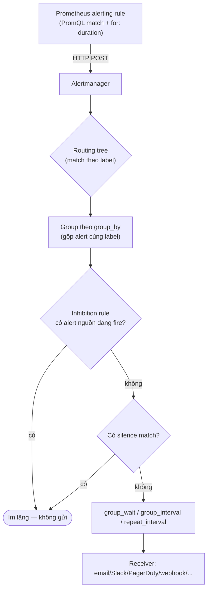

# Prometheus — Alertmanager

## What it does

> Prometheus là bác sĩ phát hiện bệnh (rule firing), Alertmanager là tổng đài cấp cứu: nó không tự chẩn đoán gì thêm, chỉ lo việc **ai cần được gọi, gọi lúc nào, và đừng gọi trùng 10 lần cho cùng 1 ca bệnh**.

Alertmanager là service độc lập nhận alert đã được Prometheus evaluate (rule match + đủ `for:` duration), rồi xử lý **routing** (alert nào đi tới ai), **grouping** (gộp nhiều alert liên quan thành 1 notification), **inhibition** (im lặng alert phụ khi alert chính đang nổ), và **silencing** (tắt tạm thời theo yêu cầu người vận hành) trước khi gửi notification thật ra ngoài (email, Slack, PagerDuty...).

## Why it exists

Nếu Prometheus tự gửi notification trực tiếp, mỗi rule fire sẽ bắn 1 message riêng — một incident lớn ảnh hưởng 50 service sẽ tạo ra 50 notification riêng biệt, không nói lên bức tranh tổng. Alertmanager tách lớp "quyết định logic alerting" (ở Prometheus, qua PromQL) khỏi lớp "quyết định cách thông báo cho người" (routing/grouping/dedupe) — hai việc khác nhau, cần thay đổi độc lập (đổi kênh Slack không cần sửa rule PromQL).

## How it works

Bước `group_wait`/`group_interval`/`repeat_interval` là nơi hay bị hiểu nhầm nhất: notification **không gửi ngay** khi alert đầu tiên trong group fire, mà đợi `group_wait` (default `30s`) để xem có alert khác cùng group gộp vào không; các thay đổi sau đó trong group gửi cách nhau tối thiểu `group_interval` (default `5m`); nếu không có gì thay đổi, notification lặp lại sau mỗi `repeat_interval` (default `4h`) để nhắc "vẫn còn đang fire".

### Các lựa chọn — Receiver type

| Lựa chọn | Là gì | Khi nào dùng | Bẫy |
|---|---|---|---|
| `webhook` | POST JSON tới URL tự định nghĩa | Tích hợp hệ thống nội bộ, ChatOps tự build | Phải tự xử lý retry/idempotency ở phía nhận |
| `email` | SMTP | Thông báo không khẩn, báo cáo định kỳ | Dễ bị lọc vào spam, không phù hợp cho alert cần phản ứng nhanh |
| `slack` / `discord` / `msteams` | Webhook tích hợp sẵn | Thông báo team, kênh chat chung | Không có escalation/ack native — chỉ là hiển thị |
| `pagerduty` / `opsgenie` / `victorops` | Tích hợp on-call, có escalation policy | Alert cần đánh thức người lúc nửa đêm | Cấu hình sai routing key dễ gửi alert vào service PagerDuty sai, không ai nhận |
| `pushover` / `telegram` / `webex` / `sns` | Các kênh notification khác | Theo nhu cầu hạ tầng sẵn có | Mỗi kênh có rate limit riêng của nhà cung cấp, cần biết trước khi route alert lượng lớn qua đó |

### Ai thắng khi xung đột

Nguyên tắc chung: **route con (child route) khớp trước thì dùng route con**, trừ khi route cha đặt `continue: true`.

| Bên A | Bên B | Kết quả | Im lặng hay báo lỗi? |
|---|---|---|---|
| Route cha match alert, không có `continue: true` | Route con cũng match | Chỉ route cha xử lý, route con **không** được thử | Im lặng — alert vẫn gửi, chỉ đi route "không mong muốn" |
| Route cha match + `continue: true` | Route con match | Cả 2 route xử lý — có thể gửi **2 notification** cho cùng 1 alert | Im lặng — dễ nhầm là bug "gửi trùng" |
| Inhibition rule match (source alert đang fire) | Alert target cũng match điều kiện gửi | Alert target bị **im lặng hoàn toàn**, không vào hàng chờ | Im lặng — đây là tính năng, nhưng dễ bị hiểu nhầm là "alert bị mất" nếu không biết có inhibition rule |
| Silence đang active match alert | Route/receiver đã cấu hình đúng | Alert vẫn "fire" ở Prometheus (`ALERTS` metric vẫn có) nhưng Alertmanager không gửi gì | Im lặng theo đúng thiết kế — nhưng là nguồn gây confusion #1 khi debug "sao alert không tới" |

## Config gotchas

| Config | Default | Khuyến nghị | Vì sao |
|---|---|---|---|
| `route.group_wait` | `30s` | Giữ default cho hầu hết case, tăng nếu muốn gộp alert rộng hơn | Quá ngắn → gửi nhiều notification rời rạc cho 1 incident đang lan rộng |
| `route.group_interval` | `5m` | Giữ default | Quá ngắn → spam notification khi alert trong group liên tục thay đổi |
| `route.repeat_interval` | `4h` | Rút ngắn cho alert nghiêm trọng (vài chục phút), giữ dài cho alert warning | Quá dài → quên mất alert vẫn đang fire; quá ngắn → notification fatigue |
| `--cluster.listen-address` | `0.0.0.0:9094` | Bind đúng interface nội bộ, mở port này giữa các node Alertmanager | Thiếu port này giữa node → cluster không đồng bộ silence/notification state, dễ gửi trùng |
| `--silences.max-silences` | Có giới hạn (xem docs bản cụ thể) | Theo dõi số silence đang active, dọn silence hết hạn | Silence tích tụ không dọn làm khó audit "ai đang tắt alert gì" |

## Hay nhầm lẫn

| Dễ nhầm | Thực tế | Hậu quả khi nhầm |
|---|---|---|
| Alertmanager cluster (gossip, port 9094) vs load balancer trước Alertmanager | Alertmanager **không** nên đặt sau load balancer round-robin — Prometheus phải gửi alert tới **tất cả** Alertmanager replica, để cluster tự dedupe qua gossip | Đặt LB round-robin trước Alertmanager → mỗi replica chỉ thấy một phần alert, cluster dedupe sai, có thể gửi trùng hoặc thiếu |
| Inhibition vs Silence | Inhibition tự động (theo rule, do alert khác đang fire); Silence là người vận hành tự tay tạo, có thời hạn | Tưởng alert "im lặng" là do ai đó silence, thực ra có thể do inhibition rule — đi tìm sai chỗ khi debug |
| Alertmanager API v1 vs v2 | Prometheus 3.x **chỉ** gửi qua API v2, yêu cầu Alertmanager ≥ 0.16.0 | Alertmanager version cũ (trước 0.16.0) sẽ không nhận được alert gì từ Prometheus 3.x, không có lỗi rõ ràng ở phía Prometheus ngoài log |

## Ops notes

- Health check: `curl http://<am-host>:9093/-/healthy` và `/-/ready`.
- Log quan trọng: grep `level=error`, `cluster` (gossip issue), `notify` (lỗi gửi receiver cụ thể, ví dụ SMTP timeout, webhook 4xx/5xx).
- Metric cần alert: `alertmanager_notifications_failed_total` (gửi notification lỗi — đây là "alert về việc alert không gửi được", cực kỳ quan trọng), `alertmanager_cluster_members` (số node thấy nhau trong cluster, tụt bất thường là dấu hiệu gossip bị chặn), `alertmanager_silences` (số silence active, theo dõi để tránh quên tắt).
- HA tối thiểu **3 node lẻ** để gossip có quorum rõ ràng khi 1 node mất kết nối (2 node không có khái niệm quorum, dễ split-brain).

## Network

| Nguồn → Đích | Port/Proto | Mục đích | Default? | Triệu chứng khi bị chặn |
|---|---|---|---|---|
| Prometheus → mọi Alertmanager replica | `9093/tcp` | Nhận alert (API v2) | có | Alert fire ở Prometheus (`ALERTS` metric) nhưng không replica nào nhận — không notification nào được gửi |
| Admin/CLI (`amtool`) → Alertmanager | `9093/tcp` | Quản lý silence, xem alert đang active | có | `amtool silence add` timeout, không tạo được silence trong lúc cần gấp |
| Alertmanager ↔ Alertmanager | `9094/tcp+udp` | Gossip — đồng bộ alert dedupe + silence state | có (`--cluster.listen-address`) | Cluster split: 2+ node không đồng bộ, có thể gửi trùng notification hoặc silence chỉ áp dụng một phần cluster |
| Alertmanager → SMTP/Slack/PagerDuty API... | `25`/`587`/`443/tcp` tuỳ receiver | Gửi notification thật | tuỳ receiver | `alertmanager_notifications_failed_total` tăng, log `notify` báo timeout/connection refused tới receiver cụ thể |

## Security notes

- Alertmanager API không có auth mặc định — ai gọi được `9093` có thể tạo silence giả để che alert thật trong lúc có incident, hoặc đọc toàn bộ alert history (có thể chứa thông tin nhạy cảm trong label/annotation).
- Đặt reverse proxy với auth trước UI/API Alertmanager, đặc biệt nếu có quyền tạo silence — đây là một trong những cách "im lặng hệ thống cảnh báo" nguy hiểm nhất nếu bị khai thác.
- Secret của receiver (SMTP password, webhook token, PagerDuty routing key) nên dùng biến `*_file` khi Alertmanager hỗ trợ, tránh lưu plaintext trong config.

## Refs

- [[Prometheus]] — note gốc, xem [[Prometheus#9. Ops Runbook — Production Notes]].
- [[prometheus--promql-recording-rules]] — alerting rule dùng cùng cú pháp PromQL với recording rule, khác ở `for:` + annotation + gửi sang Alertmanager.
- Official docs: <https://prometheus.io/docs/alerting/latest/alertmanager/>, <https://prometheus.io/docs/alerting/latest/configuration/>
