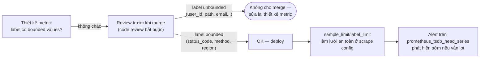

# Prometheus — Exporters & Cardinality Management

## What it does

> Exporter giống thông dịch viên đứng giữa Prometheus và một hệ thống chỉ nói "tiếng địa phương" (MySQL, Redis, hardware sensor...) — nó dịch số liệu của hệ thống đó ra format `/metrics` mà Prometheus hiểu được. Cardinality là số "câu" mà thông dịch viên đó tạo ra — dịch quá chi tiết (mỗi request một câu riêng) là cách nhanh nhất để làm sập cả phòng họp.

Exporter là một process/sidecar expose metric ở dạng Prometheus exposition format (text hoặc protobuf) cho hệ thống không tự có khả năng đó. Cardinality là tổng số **tổ hợp label unique** mà một hoặc nhiều metric tạo ra — đây là biến số quan trọng nhất quyết định Prometheus có chịu tải được hay không.

## Why it exists

Không phải hệ thống nào cũng tự implement Prometheus client library (database, hardware, hệ thống legacy). Exporter giải quyết vấn đề đó bằng cách đứng ngoài, tự lấy số liệu (query DB, đọc `/proc`, gọi API khác) rồi expose lại theo chuẩn Prometheus — không cần sửa code hệ thống gốc.

Hiểu cardinality quan trọng vì bản chất TSDB của Prometheus: **mỗi tổ hợp label khác nhau là một series vật lý riêng**, tốn index + chunk riêng trong memory. Không giống SQL database nơi thêm 1 cột không làm "nổ" số dòng, thêm 1 label có giá trị không chặn trong Prometheus tạo ra bùng nổ số series theo cấp số nhân.

## How it works

### Các lựa chọn — Exporter phổ biến

| Lựa chọn | Là gì | Khi nào dùng | Bẫy |
|---|---|---|---|
| `node_exporter` | Metric hệ thống (CPU, memory, disk, network) của host/VM | Mọi host cần monitor hạ tầng cơ bản | Một số collector (ví dụ filesystem, netdev) có thể tạo nhiều series nếu host có nhiều mount/interface — bật/tắt collector qua flag theo nhu cầu |
| `blackbox_exporter` | Probe từ ngoài vào (HTTP/TCP/ICMP/DNS check) — giống uptime check | Kiểm tra endpoint từ góc nhìn bên ngoài, SLA uptime | Mỗi probe target là 1 scrape riêng tới blackbox_exporter (dùng param `target=`) — dễ nhầm với scrape trực tiếp target đó |
| `cadvisor` | Metric container (CPU/memory/network theo container ID) | Môi trường container không dùng K8s metrics-server | Label `container_id`/`pod_name` đổi liên tục khi container restart — cần relabel để tránh cardinality tăng vô hạn theo thời gian |
| `mysqld_exporter` / `redis_exporter`/ ... | Metric riêng cho từng loại database/service | Theo nhu cầu stack cụ thể | Một số query nội bộ exporter dùng để lấy metric (ví dụ `SHOW GLOBAL STATUS`) có thể tốn tài nguyên DB nếu scrape quá thường xuyên |
| Custom exporter (viết bằng client library: Go/Python/Java...) | Tự expose metric nghiệp vụ riêng của app | App tự viết, cần business metric cụ thể | Dev tự thêm label tuỳ ý (user_id, request_id...) mà không biết hậu quả cardinality — nguồn gốc phổ biến nhất của OOM Prometheus |
| **Textfile collector** (của node_exporter) | Đọc file `.prom` tĩnh do cron/script khác ghi ra | Metric từ batch job, cron job không chạy liên tục | File ghi không atomic (ghi đè giữa chừng) làm node_exporter đọc file lỗi tạm thời |

### Luồng kiểm soát cardinality

Điểm quan trọng: kiểm soát cardinality **hiệu quả nhất ở bước thiết kế** (không tạo label unbounded từ đầu) — mọi biện pháp sau đó (`sample_limit`, relabel drop, alert) chỉ là lưới an toàn chặn hậu quả, không phải giải pháp gốc.

## Config gotchas

| Config | Default | Khuyến nghị | Vì sao |
|---|---|---|---|
| `scrape_config.sample_limit` | `0` (không giới hạn) | Set một ngưỡng hợp lý (ví dụ vài nghìn) cho job có rủi ro | Target lỗi/bị compromise expose quá nhiều series có thể kéo sập cả Prometheus, không chỉ job đó |
| `scrape_config.label_limit` / `label_name_length_limit` / `label_value_length_limit` | `0` (không giới hạn) ở hầu hết bản | Set khi có exporter bên thứ 3 không kiểm soát được | Label value dài bất thường (ví dụ raw JSON nhồi vào 1 label) tốn index bất thường |
| `relabel_configs` để drop target rủi ro cardinality cao trước khi scrape | — | Áp dụng sớm nhất trong pipeline SD → relabel, xem [[prometheus--service-discovery-relabeling]] | Drop sau khi đã scrape (`metric_relabel_configs`) vẫn tốn network/CPU |

## Hay nhầm lẫn

- **Cardinality tăng do "nhiều series mới" (growth) vs do "series liên tục đổi" (churn)** — head series tăng dần đều là cardinality thật đang lớn lên (ví dụ scale thêm instance); head series tăng nhanh nhưng tổng số không tăng tương ứng, kèm số lượng series tạo mới cao, thường là **churn** (label value đổi liên tục, ví dụ pod name/container ID restart liên tục) — hai nguyên nhân cần hai cách xử lý khác nhau (growth cần review thiết kế metric, churn cần ổn định label hoặc relabel bỏ label không ổn định).
- **Label nhiều vs cardinality cao** — một metric có 10 label nhưng mỗi label chỉ có 2-3 giá trị cố định là cardinality thấp (tối đa vài chục series); một metric chỉ có 1 label nhưng giá trị là user ID là cardinality vô hạn. Số lượng label không nói lên cardinality, **số giá trị khả dĩ của từng label** mới quyết định.

## Bẫy vận hành

#### Cardinality explosion làm Prometheus OOM

- **Triệu chứng:** memory Prometheus tăng dần bất thường (một case thực tế ghi nhận tăng từ 8GB lên 32GB qua một đêm), `prometheus_tsdb_head_series` tăng vọt không tương ứng với số lượng target/instance thật, process bị kernel OOM-kill, restart xong replay WAL rất lâu.
- **Nguyên nhân:** một label có giá trị không chặn (user ID, raw URL path, request ID, email, container ID không stable) được gắn vào metric — case thực tế: thêm label `request_path` vào HTTP metric, với 50,000 unique path tạo ra 500,000 series mới chỉ từ một label.
- **Cách tránh / xử lý:** review metric design trước khi merge code (không gắn label unbounded); `sample_limit`/`label_limit` làm lưới an toàn; alert sớm trên `prometheus_tsdb_head_series` trước khi chạm giới hạn RAM thật; khi đã xảy ra, tìm label gây nổ qua TSDB status page (`/tsdb-status`, mục "Label value count") hoặc `topk` trên cardinality API, rồi fix tại nguồn (sửa exporter/relabel drop label đó).
- **Nguồn:** [Why Does Prometheus Keep Running Out of Memory? (Medium)](https://medium.com/@sreThoughts/why-does-prometheus-keep-running-out-of-memory-5cdeba2b5a54), [token.place production postmortem 2026-09-02](https://github.com/futuroptimist/token.place/pull/1761)

#### Scrape target public internet không firewall → data leak

- **Triệu chứng:** metric/business data bị lộ ra ngoài, phát hiện qua scanner hoặc báo cáo bên thứ 3, không phải do Prometheus bị hack mà do endpoint `/metrics` mở public không auth.
- **Nguyên nhân:** exporter/Prometheus port bind `0.0.0.0` và expose ra internet (thường do thiếu security group/firewall rule khi deploy cloud), không có auth mặc định ở tầng Prometheus/exporter.
- **Cách tránh / xử lý:** không bao giờ bind exporter/Prometheus ra interface public; dùng network policy/security group giới hạn chỉ Prometheus server mới scrape được; nếu buộc phải expose qua internet (hiếm khi cần), đặt sau reverse proxy có TLS + auth.
- **Nguồn:** [Securing Exposed Prometheus & Grafana (scansearch.net)](https://scansearch.net/en/articles/detecting-and-securing-exposed-prometheus-and-grafana-instances-preventing-infrastructure-monitoring-data-exfiltration/)

#### Textfile collector đọc file nửa-ghi gây giá trị metric sai/thiếu

- **Triệu chứng:** metric từ batch job thỉnh thoảng biến mất hoặc có giá trị không hợp lệ trong vài giây.
- **Nguyên nhân:** script ghi file `.prom` không atomic (ghi trực tiếp vào file đích), node_exporter đọc đúng lúc file đang được ghi nửa chừng.
- **Cách tránh / xử lý:** luôn ghi ra file tạm rồi `mv` (atomic rename) vào đúng path textfile collector đang watch.
- **Nguồn:** [node_exporter README — textfile collector](https://github.com/prometheus/node_exporter)

## Ops notes

- API `/api/v1/status/tsdb` trả về top metric theo cardinality (`seriesCountByMetricName`) và top label theo số giá trị (`labelValueCountByLabelName`) — chỗ đầu tiên cần xem khi nghi cardinality nổ.
- Theo dõi theo cặp: `prometheus_tsdb_head_series` (tổng hiện tại) và `rate(prometheus_tsdb_head_series_created_total[5m])` (tốc độ tạo mới) để phân biệt growth thật vs churn, xem phần "Hay nhầm lẫn" ở trên.

## Security notes

- Exporter/metric endpoint mặc định không auth — coi `/metrics` như một API nội bộ cần network restriction, không phải "chỉ là số liệu nên không nhạy cảm".
- Metric nghiệp vụ tự thêm label đôi khi vô tình lộ thông tin nhạy cảm (ví dụ nhúng tên khách hàng, email vào label để debug nhanh) — vừa là lỗi cardinality vừa là lỗi bảo mật, cần review cùng lúc.

## Refs

- [[Prometheus]] — note gốc, xem [[Prometheus#Bẫy vận hành]] cho tóm tắt ngắn.
- [[prometheus--service-discovery-relabeling]] — relabeling là công cụ chính để chặn cardinality trước khi vào TSDB.
- [[prometheus--storage-tsdb]] — cardinality cao trực tiếp ảnh hưởng dung lượng memory/WAL mô tả ở note đó.
- Official docs: <https://prometheus.io/docs/practices/naming/>
