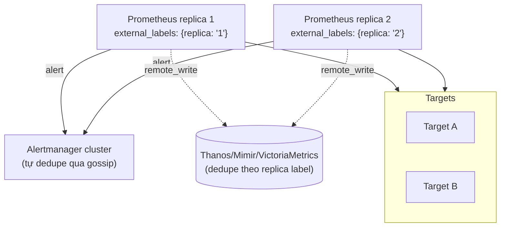
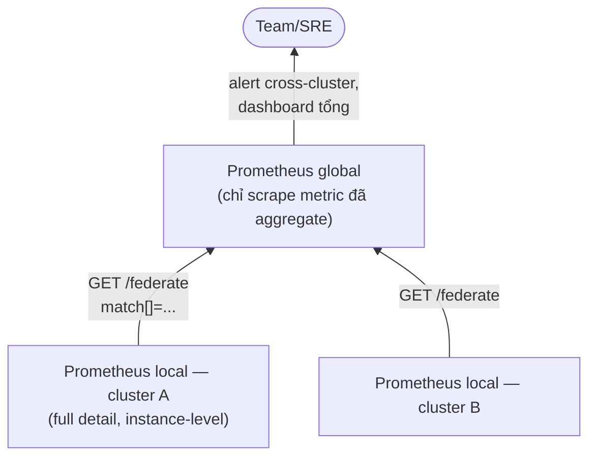

# Prometheus — High Availability, Federation & Scaling

## What it does

> Prometheus một mình giống một người ghi chép tay trong một căn phòng — ghi nhanh, chính xác, nhưng sổ ghi chỉ có 1 bản, phòng cháy là mất hết. HA/federation/long-term storage là cách thêm "nhân viên dự phòng" và "kho lưu trữ trung tâm" chứ không phải Prometheus tự học cách tự nhân bản.

Đây là tập hợp các kỹ thuật/kiến trúc để Prometheus vượt qua giới hạn vốn có: **local storage không clustered, không replicate**. Bao gồm chạy HA pair (2 instance giống nhau), federation (một Prometheus pull dữ liệu đã aggregate từ Prometheus khác), và ghép thêm hệ thống long-term storage (Thanos/Mimir/Cortex/VictoriaMetrics) qua remote write.

## Why it exists

Một Prometheus instance là single point of failure cho cả data lẫn alerting — nó restart (upgrade, OOM, node reboot) là có một khoảng thời gian **mù hoàn toàn**, không scrape, không evaluate rule, không gửi alert. HA pair giải quyết vấn đề sẵn sàng (availability) cho alerting. Nhưng HA pair **không** giải quyết vấn đề dung lượng lưu trữ lâu dài hay query xuyên nhiều cluster — đó là vai trò của federation (cho global view nhỏ) hoặc Thanos/Mimir/VictoriaMetrics (cho scale lớn + long-term + global query thật sự).

## How it works

### Mô hình 1: HA pair

2 replica scrape **cùng target, cùng config**, chỉ khác `external_labels` (ví dụ `replica: "1"` / `replica: "2"`). Alerting tự nhiên "HA" vì Alertmanager cluster tự dedupe 2 nguồn giống nhau qua gossip. Nhưng **query/remote write thì không tự dedupe** — đây là lý do cần Thanos/Mimir ở bước sau.

### Mô hình 2: Federation (hierarchical)

Prometheus global **pull** định kỳ từ endpoint `/federate` của các Prometheus local, với `honor_labels: true` để giữ nguyên label gốc, và bắt buộc có `match[]` (không thể federate "tất cả" — dễ kéo sập Prometheus global nếu quên giới hạn). Phù hợp cho mô hình nhỏ/trung: vài chục cluster, mỗi cluster chỉ đẩy lên vài trăm series đã aggregate.

### Ai thắng khi xung đột

Nguyên tắc chung: **không có cơ chế dedupe built-in ở tầng Prometheus/PromQL** — dedupe luôn phải làm ở tầng nhận (Thanos Querier, Mimir, Cortex) hoặc ở tầng người viết query (tự filter 1 replica).

| Bên A | Bên B | Kết quả | Im lặng hay báo lỗi? |
|---|---|---|---|
| 2 Prometheus replica cùng remote write 1 series | Backend không cấu hình HA dedupe | Backend lưu **2 series riêng** (khác label `replica`) | Im lặng — `sum()` không filter theo replica sẽ ra gấp đôi số thật |
| Thanos Querier có `--query.replica-label=replica` | 2 series chỉ khác label `replica` | Thanos tự dedupe, trả về 1 kết quả | Im lặng — đúng hành vi mong đợi |
| Mimir nhận 2 replica, `ha_tracker` enable | Label `__replica__`/`cluster` đúng convention | Mimir chỉ ingest từ 1 replica "đang thắng" tại một thời điểm, failover sang replica khác nếu replica đang active ngừng gửi | Im lặng — chuyển đổi tự động, nhưng có độ trễ failover (vài chục giây tới vài phút tuỳ cấu hình) |
| Federation `/federate` không có `match[]` | Prometheus local có hàng chục nghìn series | Request kéo **toàn bộ** series về global — có thể quá tải cả 2 bên | Không lỗi ngay, nhưng dễ timeout/OOM khi cluster lớn dần theo thời gian |

### Các lựa chọn — Long-term storage / scaling backend

| Lựa chọn | Là gì | Khi nào dùng | Bẫy |
|---|---|---|---|
| **Federation** | Pull định kỳ qua `/federate`, Prometheus-only, không cần thêm component | Quy mô nhỏ, chỉ cần global view của vài metric đã aggregate | Không scale tốt, không phải long-term storage thật (vẫn bị giới hạn bởi retention của Prometheus global) |
| **Thanos** | Giữ nguyên Prometheus hiện có, thêm sidecar đẩy block lên object storage (S3/GCS), Querier hợp nhất query xuyên nhiều Prometheus | Đã có nhiều Prometheus server rải rác, muốn thêm global view + long-term mà rủi ro migrate thấp nhất | Thêm nhiều component (sidecar, store gateway, compactor, querier) — vận hành phức tạp hơn vanilla Prometheus đáng kể |
| **Grafana Mimir** (kế thừa Cortex) | Backend nhận remote write tập trung, multi-tenant, tự quản lý storage (object storage) | Platform lớn, nhiều team/tenant, cần SRE team riêng vận hành | Kiến trúc microservices nhiều thành phần (ingester, distributor, querier...) — chi phí vận hành cao nếu team nhỏ |
| **Cortex** | Tiền thân của Mimir, vẫn được maintain | Đã vận hành Cortex từ trước, chưa có nhu cầu migrate | Phần lớn phát triển mới tập trung ở Mimir — tính năng mới ra ở Cortex chậm hơn |
| **VictoriaMetrics** | Database riêng (không phải Prometheus fork), nhận qua remote write, tự claim ít RAM/storage hơn đáng kể so với Thanos/Cortex — xem chi tiết đầy đủ ở [[VictoriaMetrics]] | Team nhỏ/trung, muốn long-term storage đơn giản hoá vận hành, không cần kiến trúc nhiều component | Không phải PromQL 100% — có PromQL-compatible layer (MetricsQL mở rộng) nhưng vẫn là engine khác, cần test kỹ các query phức tạp, xem [[victoriametrics--metricsql]] |

## Config gotchas

| Config | Default | Khuyến nghị | Vì sao |
|---|---|---|---|
| `global.external_labels` | Rỗng | Luôn set, đặc biệt `replica` khi chạy HA, `cluster`/`region` khi có nhiều Prometheus | Thiếu label phân biệt → không backend nào (Thanos/Mimir) dedupe/phân biệt được nguồn |
| `/federate` `match[]` | Không có default — bắt buộc khai | Luôn giới hạn rõ, không để trống | Thiếu `match[]` kéo toàn bộ series, dễ quá tải cả 2 phía |
| `/federate` `honor_labels` | `false` (global default), nhưng khuyến nghị `true` cho federation | Set `true` riêng cho job federation | Không set `true` → label gốc từ local Prometheus bị `job`/`instance` của job federation đè lên, mất thông tin nguồn |

## Hay nhầm lẫn

- **HA pair vs Cluster** — Prometheus **không có khái niệm cluster** (không giống Elasticsearch/Consul). "HA" ở đây là 2 instance độc lập hoàn toàn, không biết sự tồn tại của nhau, không chia sẻ state — khác hẳn với cluster thật có quorum/consensus.
- **Federation vs Remote Write** — cả 2 đều "đẩy data sang nơi khác", nhưng federation là pull theo chu kỳ dài (phù hợp lượng nhỏ, đã aggregate), remote write là push liên tục từng sample (phù hợp toàn bộ raw data, quy mô lớn).
- **Thanos sidecar vs Thanos receive** — sidecar đọc block có sẵn từ Prometheus local (không đổi gì ở Prometheus ngoài thêm sidecar); receive nhận remote write trực tiếp (giống Mimir/Cortex) — chọn nhầm kiến trúc ảnh hưởng lớn tới cách Prometheus local được cấu hình.

## Ops notes

- Khi thêm replica thứ 2 cho HA, luôn kiểm tra dashboard/alert dùng `sum()`/`count()` trực tiếp trên raw metric — những query này sẽ tự nhân đôi nếu backend chưa dedupe (xem [[Prometheus#Bẫy vận hành]]).
- Theo dõi `prometheus_remote_storage_samples_failed_total` và `prometheus_remote_storage_samples_pending` ở Prometheus nguồn để biết remote write có đang theo kịp backend hay không.
- Nếu dùng Thanos, theo dõi riêng `thanos_sidecar_prometheus_up`, compactor backlog (`thanos_compact_group_compactions_total`), và store gateway cache hit rate — mỗi component thêm là một bề mặt lỗi mới cần giám sát riêng.

## Security notes

- Object storage (S3/GCS) phía sau Thanos/Mimir/Cortex cần IAM scope tối thiểu (chỉ bucket cần thiết) — bucket chứa toàn bộ metric history của hệ thống, rủi ro leak lớn hơn 1 Prometheus instance đơn lẻ.
- Multi-tenant backend (Mimir/Cortex) cần đảm bảo tenant isolation đúng ở tầng API gateway — cấu hình sai routing tenant ID có thể để tenant A đọc được metric của tenant B.

## Refs

- [[Prometheus]] — note gốc.
- [[prometheus--storage-tsdb]] — remote write là nền tảng kỹ thuật cho mọi lựa chọn scaling ở note này.
- [[VictoriaMetrics]] — note đầy đủ về 1 trong các lựa chọn long-term storage ở bảng trên.
- Official docs: <https://prometheus.io/docs/prometheus/latest/federation/>
- Bài viết thực tế: [Prometheus Long-Term Storage in 2026: The Options Compared](https://greptime.com/tech-content/2026-06-17-prometheus-long-term-storage-options), [Grafana Mimir — HA deduplication](https://grafana.com/docs/mimir/latest/configure/configure-high-availability-deduplication/)
