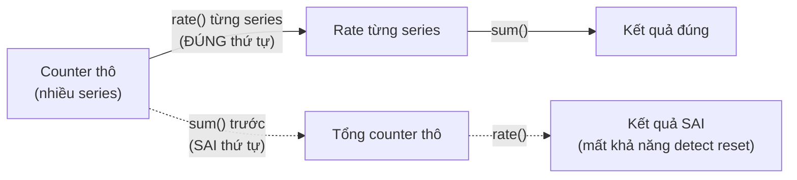

# Prometheus — PromQL & Recording Rules

## What it does

> PromQL giống như công thức nấu ăn còn metric thô là nguyên liệu trong tủ lạnh: nguyên liệu (`http_requests_total`) chỉ là số đếm, PromQL là công thức biến nó thành món ăn đọc được (`request rate per second`, `error ratio %`).

PromQL (Prometheus Query Language) là ngôn ngữ truy vấn dùng để đọc, tính toán, và tổng hợp dữ liệu time-series trong TSDB của Prometheus. Recording rule là cách lưu sẵn kết quả của một PromQL expression chạy định kỳ thành một metric mới, để không phải tính lại query nặng mỗi lần dashboard/alert cần nó.

## Why it exists

Nếu không có PromQL, Prometheus chỉ là chỗ lưu số thô — không tính được rate, không tính được percentile, không aggregate được theo label. PromQL cho phép biến đổi dữ liệu thô thành insight ngay tại thời điểm query.

Recording rule giải quyết vấn đề khác: một query phức tạp (nhiều `rate()` + `histogram_quantile()` + aggregation lồng nhau) chạy trên dashboard mở liên tục hoặc alert rule evaluate mỗi phút sẽ rất tốn CPU nếu tính lại từ đầu mỗi lần. Recording rule tính một lần, lưu kết quả thành series mới — dashboard/alert sau đó chỉ đọc số đã tính sẵn.

## How it works

### 4 kiểu dữ liệu PromQL trả về

| Kiểu | Là gì | Ví dụ |
|---|---|---|
| Instant vector | Tập series, mỗi series 1 sample tại cùng 1 timestamp | `http_requests_total` |
| Range vector | Tập series, mỗi series nhiều sample trong 1 khoảng thời gian | `http_requests_total[5m]` |
| Scalar | Một số float đơn | `42` |
| String | String đơn (hiện gần như không dùng tới) | `"foo"` |

### Counter vs Gauge functions — chọn sai là sai kết quả

- `rate(counter[range])` — tốc độ tăng trung bình/giây, tự detect & bù counter reset (app restart). Dùng cho alert và counter biến động nhanh.
- `irate(counter[range])` — chỉ lấy 2 sample cuối trong range, tức thời hơn nhưng nhạy noise. Chỉ dùng cho graph counter biến động rất nhanh, **không dùng cho alert**.
- `increase(counter[range])` — tổng lượng tăng trong range (xấp xỉ, có extrapolate ở biên) — hữu ích để biết "bao nhiêu request trong 1h" hơn là tốc độ.
- `histogram_quantile(0.95, rate(bucket[5m]))` — tính percentile từ classic histogram buckets; luôn phải `rate()` buckets trước khi đưa vào `histogram_quantile()`.

> [!warning] Thứ tự aggregate vs rate() quyết định đúng/sai
> Luôn `rate()`/`irate()` **trước**, aggregate (`sum`, `avg`...) **sau**. Nếu aggregate trước rồi mới rate, Prometheus không còn nhìn thấy counter reset của từng series riêng lẻ nữa → kết quả sai mà không báo lỗi gì cả.



### Ai thắng khi xung đột

| Bên A | Bên B | Kết quả | Im lặng hay báo lỗi? |
|---|---|---|---|
| `rate()` áp dụng trước `sum()` | `sum()` áp dụng trước `rate()` | Ra 2 kết quả khác nhau, chỉ có vế đầu đúng khi có counter reset | Im lặng — cả 2 đều "chạy được", không có lỗi |
| Range `[1m]` với `scrape_interval: 1m` | Range `[5m]` với `scrape_interval: 1m` | Range ngắn dễ bị rỗng/sai khi mất 1 sample; range dài ổn định hơn nhưng làm mượt (ẩn spike ngắn) | Im lặng — không lỗi, chỉ ra số khác |
| Recording rule group A đọc metric của group B trong cùng evaluation cycle | Rule groups trong Prometheus chạy **tuần tự theo thứ tự khai báo trong file, các file khác nhau chạy độc lập/song song** | Nếu rule B cần kết quả mới nhất của rule A nhưng A nằm ở group/file khác, B có thể đọc giá trị evaluation cycle **trước** | Im lặng — không có lỗi, chỉ là data "chậm" 1 cycle |

### Recording rule naming convention

Format chuẩn: **`level:metric:operations`**

- `level` — mức aggregation + label còn lại sau khi tính (ví dụ `job`, `instance`).
- `metric` — giữ nguyên tên gốc, bỏ `_total` nếu đã `rate()`/`irate()`.
- `operations` — các phép áp dụng, viết theo thứ tự từ **mới nhất tới cũ nhất** (ngược với thứ tự code).

```yaml
# /etc/prometheus/rules/recording.yml
groups:
  - name: http_requests
    rules:
      - record: job:http_requests:rate5m
        expr: sum by (job) (rate(http_requests_total[5m]))
```

> [!tip] Ratio = aggregate tử/mẫu riêng rồi mới chia
> Không bao giờ lấy trung bình của ratio (`avg(error_ratio)` qua nhiều instance là **không có ý nghĩa thống kê**). Luôn `sum(errors) / sum(total)` — aggregate tử số và mẫu số riêng, chia ở bước cuối.

## Config gotchas

| Config | Default | Khuyến nghị | Vì sao |
|---|---|---|---|
| Rule group `interval` | Bằng `global.evaluation_interval` (`1m`) | Set riêng nếu rule group có query nặng, không cần chạy mỗi phút | Rule nặng chạy quá thường xuyên tốn CPU vô ích |
| Range trong `rate()`/`irate()` | Không có default, người viết tự chọn | Tối thiểu 4× `scrape_interval` | Range gần bằng scrape_interval dễ rỗng data khi mất 1 sample (xem [[Prometheus#Bẫy vận hành]]) |
| `histogram_quantile()` trên Summary | Không áp dụng — Summary không có buckets | Dùng field `_count`/`_sum` với `rate()` cho mean, không tính quantile qua PromQL | Summary percentile tính sẵn ở client, không aggregate/quantile lại được qua nhiều instance |

## Hay nhầm lẫn

- **`rate()` vs `increase()`** — `rate()` ra đơn vị /giây, `increase()` ra tổng lượng tăng trong range (có extrapolate). Dùng sai đơn vị khi báo cáo ("request trong 1 giờ") dễ lệch số vì nhầm giữa 2 hàm.
- **Histogram (classic) vs Native Histogram** — classic cần định nghĩa bucket boundary trước (`le` label cố định), native histogram tự động chọn độ phân giải và nén hiệu quả hơn, ổn định từ khoảng v3.8. Dùng `histogram_quantile()` vẫn chạy được trên cả 2 nhưng cách lưu trữ dưới TSDB khác hẳn.

## Ops notes

- Rule evaluation lỗi (syntax, hoặc query timeout) tăng metric `prometheus_rule_evaluation_failures_total` — alert trên metric này, vì rule lỗi âm thầm không raise alert gì khác ngoài con số này.
- Dùng `promtool check rules <file>` trước khi deploy rule file mới — bắt lỗi syntax và cảnh báo style (ví dụ thiếu `without`/`by` clause) trước khi apply.

## Refs

- [[Prometheus]] — note gốc.
- [[prometheus--storage-tsdb]] — recording rule ghi kết quả vào TSDB giống mọi metric khác.
- [[prometheus--alertmanager]] — alerting rule dùng cùng cú pháp PromQL, khác recording rule ở chỗ kèm `for:` + gửi notification thay vì chỉ lưu metric.
- Official docs: <https://prometheus.io/docs/prometheus/latest/querying/basics/>, <https://prometheus.io/docs/practices/rules/>
