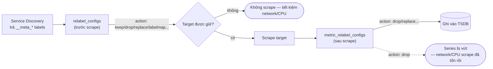

# Prometheus — Service Discovery & Relabeling

## What it does

> Service discovery giống nhân viên lễ tân cầm sổ danh sách khách trong khách sạn, cập nhật liên tục ai mới check-in, ai đã check-out — Prometheus không cần tự đi gõ từng cửa phòng dò xem ai còn ở đó.

Service discovery (SD) là cơ chế Prometheus tự động tìm ra danh sách target cần scrape, thay vì phải khai tay từng địa chỉ IP/port. Relabeling là bước xử lý label của target (trước scrape) hoặc của sample (sau scrape) để lọc, đổi tên, hoặc thêm label.

## Why it exists

Trong môi trường tĩnh, khai tay địa chỉ target trong `static_configs` là đủ. Nhưng trong Kubernetes/cloud, pod/instance sinh ra và chết liên tục — khai tay là bất khả thi. SD giải quyết việc "tìm ai đang sống ở đâu"; relabeling giải quyết việc "label mà SD trả về (thường rất kỹ thuật, dạng `__meta_*`) không phải là label mình muốn lưu vào TSDB" — cần một bước dịch/lọc ở giữa.

## How it works

### Các lựa chọn — Service Discovery mechanism

| Lựa chọn | Là gì | Khi nào dùng | Bẫy |
|---|---|---|---|
| `kubernetes_sd_configs` | Query K8s API lấy pod/service/endpoint/node theo `role` | Cluster K8s — lựa chọn mặc định gần như luôn dùng | Cần RBAC đủ quyền `list`/`watch` pod, service, endpoint; thiếu quyền thì SD âm thầm trả về danh sách rỗng, không lỗi rõ ràng |
| `consul_sd_configs` | Query Consul catalog | Hệ thống dùng Consul làm service registry | Target tag trong Consul phải đồng bộ kỷ luật, tag sai là scrape nhầm hoặc miss target |
| `file_sd_configs` | Đọc danh sách target từ file JSON/YAML, Prometheus tự watch file đổi | Môi trường tự viết script sinh target (CMDB, Ansible inventory) | File update không atomic (ghi đè giữa chừng) có thể làm Prometheus đọc file rỗng/lỗi tạm thời |
| `dns_sd_configs` | Query DNS SRV/A/AAAA record | Hệ thống dùng DNS-based discovery đơn giản | TTL DNS cache có thể làm Prometheus scrape chậm nhận target mới/cũ |
| `ec2_sd_configs` / `azure_sd_configs` / `gce_sd_configs` | Query API cloud provider theo tag/label | Chạy trên cloud, muốn auto-discover theo tag instance | Rate limit API cloud provider nếu discovery interval quá ngắn trên tài khoản nhiều instance |
| `static_configs` | Khai tay IP:port cố định | Lab, target cố định không bao giờ đổi, hoặc test | Không tự cập nhật khi target đổi IP — phải sửa config tay + reload |
| `http_sd_configs` | Prometheus gọi HTTP endpoint tự viết, trả JSON danh sách target | Khi không có SD built-in phù hợp, tự build registry riêng | Endpoint đó trở thành single point of failure cho discovery — nó chết thì Prometheus không thấy target mới |

### Luồng relabeling

Điểm quan trọng nằm ở nhánh dưới cùng: `metric_relabel_configs` chạy **sau** khi đã scrape xong — nên dùng nó để `drop` metric không cần vẫn tốn chi phí network/CPU scrape target đó. Muốn tránh chi phí đó hoàn toàn, phải `drop` ngay ở `relabel_configs` (trước khi scrape).

### Ai thắng khi xung đột

Nguyên tắc chung: **relabel_configs chạy trước scrape, metric_relabel_configs chạy sau scrape** — không có chuyện cái sau "đè" được quyết định của cái trước vì chúng xử lý ở 2 thời điểm khác nhau trên 2 loại label khác nhau (target label vs sample label).

| Bên A | Bên B | Kết quả | Im lặng hay báo lỗi? |
|---|---|---|---|
| `relabel_configs` action `drop` loại target | `metric_relabel_configs` giữ nguyên | Target không được scrape — `metric_relabel_configs` không có cơ hội chạy vì không có gì để scrape | Im lặng |
| Nhiều `relabel_configs` rule nối tiếp trong cùng 1 `scrape_config` | — | Chạy **tuần tự theo thứ tự khai báo**, rule sau thấy label đã bị rule trước sửa | Im lặng — rule sau "thắng" nếu ghi đè cùng label |
| `action: keep` với regex không match gì | Mọi target | **Toàn bộ target trong job đó bị loại** | Im lặng — job chạy "thành công" nhưng 0 target, dễ bị bỏ qua khi review |

## Config gotchas

| Config | Default | Khuyến nghị | Vì sao |
|---|---|---|---|
| `relabel_configs[].action` | `replace` | Dùng `keep`/`drop` sớm nhất có thể trong chain để giảm việc xử lý rule sau | Đặt `drop` cuối chain vẫn đúng logic nhưng tốn CPU chạy hết các rule phía trước trước khi loại |
| `__meta_kubernetes_pod_annotation_*` dùng để opt-in scrape (ví dụ `prometheus.io/scrape: "true"`) | Không có default built-in — tự quy ước | Thống nhất annotation convention toàn cluster, document rõ | Thiếu annotation convention → mỗi team tự đặt khác nhau, SD rule không cover hết, target bị miss mà không ai biết |
| `honor_labels` | `false` | Giữ `false` trừ federation/relay | `true` cho phép label từ target đè `job`/`instance` gốc — dễ nhầm lẫn target nào ra metric nào |

## Hay nhầm lẫn

- **`relabel_configs` vs `metric_relabel_configs`** — nhầm cái này là lý do số 1 khiến optimize scrape cost không hiệu quả: tưởng dùng `drop` ở `metric_relabel_configs` là tiết kiệm, thực ra chi phí network/CPU đã mất rồi.
- **`action: keep` vs `action: drop`** — `keep` giữ lại những gì **match** regex, `drop` loại bỏ những gì match. Viết ngược logic (dùng `drop` khi ý định là "chỉ giữ cái match") loại nhầm toàn bộ target mong muốn giữ.

## Ops notes

- Dùng `curl http://<prometheus>:9090/api/v1/targets` để xem target nào bị drop ở discovery, target nào scrape fail — phân biệt "không có trong danh sách" (bị relabel_configs loại hoặc SD không thấy) với "có nhưng `health: down`" (scrape fail).
- `prometheus_sd_discovered_targets` theo dõi số target mỗi SD mechanism tìm thấy — tụt về 0 bất thường là dấu hiệu SD mất quyền truy cập API (RBAC, Consul ACL...) chứ không phải do target thật sự biến mất.

## Refs

- [[Prometheus]] — note gốc, xem [[Prometheus#4. Where — Architecture & Deployment]] cho vị trí SD trong luồng tổng.
- [[prometheus--exporters-cardinality]] — relabeling là công cụ chính để kiểm soát cardinality trước khi nó vào TSDB.
- Official docs: <https://prometheus.io/docs/prometheus/latest/configuration/configuration/>
