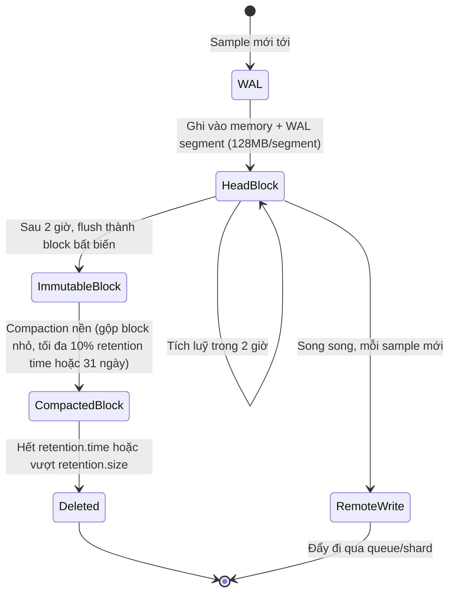

# Prometheus — Storage (TSDB), WAL & Remote Write

## What it does

> TSDB của Prometheus giống cuốn sổ ghi chép viết tay rồi đóng tập theo tháng: trang đang viết (head block) để ngay trên bàn cho dễ sửa, nhưng mỗi tháng (2 giờ) lại đóng thành 1 tập riêng, không sửa được nữa — chỉ còn cách đọc.

TSDB (Time Series Database) là engine lưu trữ local của Prometheus, tối ưu cho việc ghi liên tục (append-only) và đọc theo khoảng thời gian. WAL (Write-Ahead Log) bảo vệ dữ liệu đang ghi khỏi mất khi crash. Remote write là cơ chế đẩy sample sang hệ thống lưu trữ khác (thường để lưu lâu hơn hoặc tập trung nhiều Prometheus vào một chỗ).

## Why it exists

Time series có đặc tính riêng: ghi liên tục, gần như không update dữ liệu cũ, đọc theo range thời gian. Dùng database tổng quát (SQL thường) cho việc này tốn tài nguyên hơn nhiều so với một engine chuyên biệt — đây là lý do Prometheus tự viết TSDB riêng thay vì dùng SQLite/Postgres.

WAL giải quyết vấn đề: head block (2 giờ dữ liệu gần nhất) nằm chủ yếu trong memory để ghi nhanh — nhưng nếu Prometheus crash giữa lúc đó thì sao? WAL ghi tuần tự mọi thay đổi ra disk trước, để khi restart có thể replay lại đúng trạng thái.

Remote write giải quyết vấn đề khác: **local storage không clustered, không replicate** — một node chết là mất data (hoặc ít nhất mất quyền truy cập trong lúc đó). Remote write cho phép đẩy liên tục sang nơi có khả năng lưu lâu/nhân bản tốt hơn.

## How it works



Vài điểm cần để ý: block 2 giờ ban đầu **bất biến** sau khi đóng — xoá dữ liệu qua Admin API không xoá ngay trong chunk file mà ghi "tombstone", chỉ dọn thật khi compaction chạy qua. Remote write đọc trực tiếp từ WAL (không phải từ block đã compact), nên WAL bị giữ tối thiểu 3 segment để remote write backend chậm vẫn có dữ liệu để catch up.

### Capacity planning — công thức ước lượng

```
disk cần = retention_time_seconds × ingested_samples_per_second × bytes_per_sample
```

Prometheus thường chỉ tốn **1-2 byte/sample** trên disk sau compression — rất hiệu quả. Nhưng **memory** thì tốn hơn nhiều vì head block giữ index + chunk đang mở: ước lượng phổ biến là **~3KB/series** trong head (một số nguồn khuyến nghị dùng 7.5–10KB/series để có buffer an toàn, đặc biệt khi label dài hoặc query nặng). Ví dụ 1 triệu series active cần tối thiểu ~3GB RAM chỉ cho phần data, chưa tính buffer query/OS.

### Remote Write — queue config

| Config | Default | Khuyến nghị | Vì sao |
|---|---|---|---|
| `queue_config.capacity` | `10000` | 3–10× `max_samples_per_send` | Capacity thấp hơn mức này làm shard đầy nhanh, block việc đọc tiếp từ WAL khi endpoint chậm |
| `queue_config.max_shards` | `50` | Thường không cần tăng, trừ remote endpoint cực chậm | Tăng `max_shards` tốn thêm RAM tỉ lệ `shards × (capacity + max_samples_per_send)`, không chắc nhanh hơn |
| `queue_config.min_shards` | `1` | Giữ default | Prometheus tự scale shard lên dựa trên rate/backlog/thời gian gửi |

### Remote Write 1.0 vs 2.0

> [!info] Remote Write 2.0 vẫn đang ở trạng thái experimental theo spec chính thức tại thời điểm viết note
> Spec 2.0 (`io.prometheus.write.v2.Request`) thêm string interning (giảm size đáng kể), metadata (type/help/unit) gắn trực tiếp vào từng series, exemplar, và native histogram support native — nhưng tài liệu chính thức vẫn đánh dấu `[EXPERIMENTAL]`. 1.0 vẫn là protocol mặc định/ổn định khi viết note này.

### Federation vs Remote Write — khi nào dùng cái nào

Chi tiết đầy đủ nằm ở [[prometheus--ha-federation-scaling]], nhưng điểm khác biệt cốt lõi: federation là Prometheus trung tâm **pull** định kỳ qua `/federate` (toàn bộ `match[]` set mỗi lần, tốn resource phía nguồn mỗi lần pull); remote write là **push liên tục** theo stream, mỗi sample gửi đi ngay khi có — hiệu quả hơn ở quy mô lớn nhưng cần endpoint nhận hỗ trợ (Thanos receive, Mimir, Cortex, VictoriaMetrics...).

## Config gotchas

| Config | Default | Khuyến nghị | Vì sao |
|---|---|---|---|
| `storage.tsdb.retention.time` | `15d` | Set theo nhu cầu thực tế | Không set gì → chỉ giữ 15 ngày, mất data điều tra incident cũ hơn mà không ai cảnh báo trước |
| `storage.tsdb.retention.size` | `0` (không giới hạn) | Set song song với `retention.time` | Chỉ set thời gian mà traffic/cardinality tăng ngoài dự tính → disk full trước khi tới hạn thời gian, Prometheus crash |
| `storage.tsdb.wal-compression` | Mặc định bật ở bản hiện tại | Giữ bật | WAL compress giảm disk I/O và dung lượng, trade-off nhỏ về CPU |
| `--storage.tsdb.min-block-duration` / `--storage.tsdb.max-block-duration` | `2h` | Thường không cần đổi | Đổi sai có thể ảnh hưởng tần suất compaction và hiệu năng query range dài |

## Hay nhầm lẫn

- **WAL vs block storage** — WAL là log tuần tự cho dữ liệu *chưa persist* (phục vụ crash recovery), block là dữ liệu đã đóng, bất biến, được query trực tiếp. Tưởng WAL là nơi lưu lâu dài là sai — WAL chỉ giữ tối thiểu 3 segment rồi được dọn.
- **Xoá series qua Admin API vs retention tự động** — xoá qua API chỉ đánh tombstone, không giải phóng disk ngay; retention hết hạn thì block cũ bị xoá thật khi compaction/cleanup chạy. Cả hai đều không "ngay lập tức" như người mới dùng hay tưởng.

## Ops notes

- Metric cần theo dõi: `prometheus_tsdb_head_series` (cardinality hiện tại), `prometheus_tsdb_wal_corruptions_total` (WAL hỏng — nếu > 0 cần điều tra ngay, có thể do disk lỗi hoặc crash giữa lúc ghi), `prometheus_tsdb_compactions_total`/`prometheus_tsdb_compaction_duration_seconds` (compaction chạy có đều không), `prometheus_remote_storage_samples_failed_total` (remote write đang fail).
- WAL corrupt: Prometheus có thể tự truncate phần hỏng khi replay (mất một ít data gần nhất) — nếu WAL hỏng nặng, cách cuối là xoá WAL dir và chấp nhận mất head block hiện tại (phần đã compact thành block cũ không bị ảnh hưởng).
- Snapshot/backup: `POST /api/v1/admin/tsdb/snapshot` (cần `--web.enable-admin-api`) tạo snapshot của block hiện có vào `<data-dir>/snapshots/`, dùng để backup định kỳ.

## Network

Không áp dụng — các port liên quan (9090 cho API, port remote_write endpoint) đã nằm trong bảng network của [[Prometheus#7. Network — Port & Firewall Rules]].

## Security notes

- Remote write endpoint thường mang theo credential (bearer token, OAuth2 client secret, basic auth) — ưu tiên dùng biến `*_file` để không lưu secret dạng plaintext trong YAML.
- CVE-2026-119566: Prometheus (qua bản 3.15.1) có thể bị dụ replay bearer token Azure AD/Google IAM nếu remote write endpoint trả redirect (3xx) sang host khác do attacker kiểm soát — review kỹ endpoint remote write có đáng tin và không đi qua load balancer có thể bị redirect injection.
- Admin API (`/api/v1/admin/tsdb/*`) cho phép xoá toàn bộ series — chỉ bật kèm network restriction nghiêm ngặt.

## Refs

- [[Prometheus]] — note gốc.
- [[prometheus--ha-federation-scaling]] — remote write là nền tảng để ghép Thanos/Mimir/VictoriaMetrics cho long-term storage + HA.
- [[prometheus--exporters-cardinality]] — cardinality cao trực tiếp làm phình head block, ảnh hưởng dung lượng WAL/memory ở note này.
- Official docs: <https://prometheus.io/docs/prometheus/latest/storage/>, <https://prometheus.io/docs/specs/prw/remote_write_spec_2_0/>
