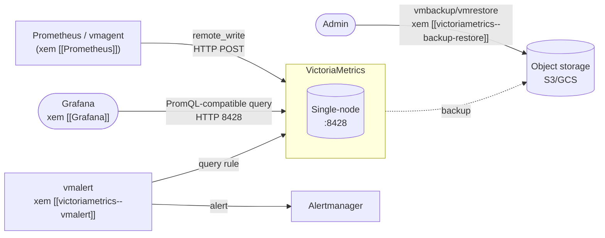
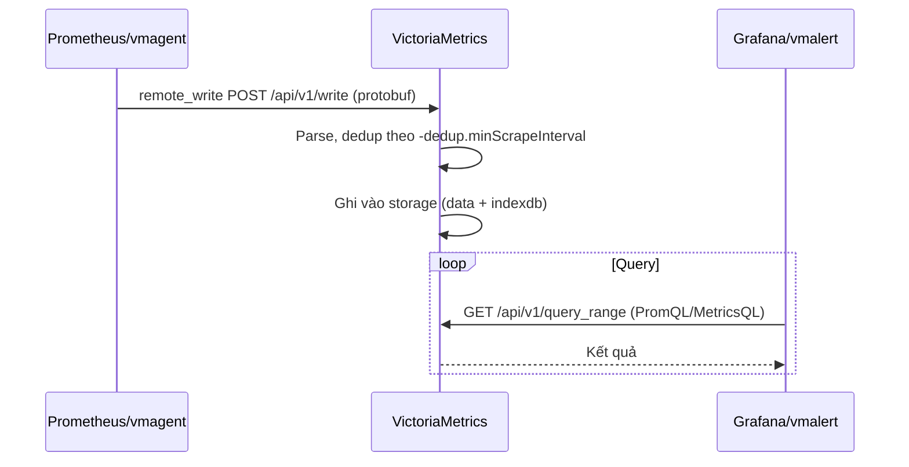

# VictoriaMetrics — Time-series database hiệu quả cao

> [!info] Phạm vi version
> Note áp dụng cho **VictoriaMetrics Community (OSS) 1.154.1** (latest tại ngày 2026-11-02, xem [GitHub releases](https://github.com/VictoriaMetrics/VictoriaMetrics/releases)). VictoriaMetrics còn có dòng **LTS riêng, hiện là 1.148.0** (phát hành 2026-07) — nếu bạn cần bản ít thay đổi hơn để chạy lâu dài, dùng LTS, note này vẫn áp dụng được cho cả hai vì phần core không đổi nhiều. Tính năng chỉ có ở **Enterprise** (downsampling, retention filter theo label, mTLS giữa component, vmanomaly...) được đánh dấu inline `(Enterprise)`.

## 1. What — Nó là cái gì?

> Nếu Prometheus là cuốn sổ tay cá nhân ghi nhanh gọn, thì VictoriaMetrics là cái tủ hồ sơ công ty: chứa được nhiều hơn, nhiều người cùng lục hồ sơ được, và nén hồ sơ chặt hơn nhiều nên tốn ít chỗ hơn — đổi lại phải lắp đặt tủ, không đơn giản như quyển sổ.

VictoriaMetrics là time-series database (TSDB) mã nguồn mở, tương thích PromQL/remote write của Prometheus, viết lại từ đầu để tối ưu về **nén dữ liệu** và **tốc độ** — thường dùng làm **long-term storage** nhận remote write từ Prometheus/vmagent, hoặc dùng độc lập thay thế hoàn toàn Prometheus.

## 2. Why — Tại sao tồn tại / Vấn đề nó giải quyết?

Prometheus local storage không clustered, không replicate, và retention dài làm RAM/disk tăng nhanh (xem [[Prometheus#Bẫy vận hành]]). Muốn lưu lâu + nhiều Prometheus server gộp lại 1 nơi, cần thêm tầng long-term storage — [[prometheus--ha-federation-scaling]] đã liệt kê Thanos/Mimir/Cortex/VictoriaMetrics là các lựa chọn.

VictoriaMetrics giải quyết đúng khoảng trống đó, nhưng khác Thanos/Mimir (vốn vẫn dựa trên code Prometheus mở rộng) — VictoriaMetrics là **engine lưu trữ hoàn toàn riêng**, không fork từ Prometheus, nên tự do tối ưu cấu trúc dữ liệu/compression theo cách khác, đổi lại phải tự maintain toàn bộ query engine (MetricsQL) tương thích PromQL thay vì dùng lại code gốc.

## 3. When — Dùng khi nào / KHÔNG dùng khi nào?

**Dùng khi:**
- Cần long-term storage cho Prometheus, muốn vận hành đơn giản hơn Thanos/Mimir (ít component hơn ở bản single-node).
- Chi phí RAM/disk là vấn đề thật — compression ratio tốt hơn Prometheus đáng kể (claim tới 10x tuỳ dataset).
- Cần ingest rate rất cao mà vẫn muốn 1 process duy nhất dễ vận hành (single-node scale tốt theo chiều dọc tới hàng triệu sample/s).

**KHÔNG dùng / cân nhắc thay thế khi:**
- Cần PromQL 100% chuẩn không sai khác — MetricsQL tương thích ngược nhưng có vài khác biệt hành vi tinh vi (NaN, rate/increase), xem [[victoriametrics--metricsql]].
- Team đã đầu tư sâu vào ecosystem Thanos/Mimir (sidecar, Ruler API...) — chuyển sang VictoriaMetrics là đổi hẳn kiến trúc, không phải thay thế 1-1.
- Cần tính năng multi-tenancy/downsampling/retention-per-label phức tạp mà không muốn trả phí Enterprise — các tính năng này ở OSS không có.

## 4. Where — Architecture & Deployment



Điểm cần nhìn: VictoriaMetrics **nhận push** (remote write) từ Prometheus/vmagent — ngược hướng với cách Prometheus tự scrape target. Query (PromQL/MetricsQL) đi theo hướng ngược lại, từ Grafana/vmalert vào VictoriaMetrics — giống hệt cách Grafana query Prometheus.

- **Vị trí trong hệ thống:** tầng lưu trữ dài hạn + query backend, nằm sau Prometheus/vmagent, trước Grafana/vmalert.
- **Component chính:** single-node binary (mọi thứ trong 1 process) hoặc cluster gồm vminsert/vmstorage/vmselect — xem [[victoriametrics--architecture-cluster]].
- **Traffic/data flow:** Prometheus/vmagent → remote write → VictoriaMetrics storage → PromQL/MetricsQL query → Grafana/vmalert.
- **Dependency:** disk (I/O nhanh quan trọng với ingest rate cao), object storage (S3/GCS) nếu dùng vmbackup; không cần database ngoài nào khác để chạy.

### Mô hình triển khai

| Mô hình | Khi nào chọn | Số node tối thiểu | Không bảo vệ được |
|---|---|---|---|
| **Single-node** | Ingest rate dưới ~1 triệu data point/s, muốn đơn giản — khuyến nghị mặc định | 1 | Mất node = mất data trong lúc down; không scale ngang được, chỉ scale theo chiều dọc (thêm CPU/RAM/disk cho 1 máy) |
| **Cluster** (vminsert + vmstorage + vmselect, shared-nothing) | Ingest rate cao, cần scale ngang độc lập từng layer (insert/storage/query) | 1 vminsert + 2×N-1 vmstorage (N = replication factor) + 1 vmselect, thực tế nên ≥2 mỗi loại cho HA | Vẫn cần tự cấu hình `-replicationFactor` đúng để chịu được mất node vmstorage — không tự động HA nếu để `replicationFactor=1` |

## 5. How — Cơ chế hoạt động

Core concepts cần nắm:

- **Single-node vs Cluster architecture** — khi nào cần tách vminsert/vmstorage/vmselect, replication factor. → [[victoriametrics--architecture-cluster]]
- **MetricsQL** — ngôn ngữ query tương thích PromQL nhưng có khác biệt hành vi cần biết. → [[victoriametrics--metricsql]]
- **Ingestion & Deduplication** — nhận remote write, vmagent, và dedup cho HA Prometheus pairs. → [[victoriametrics--ingestion-dedup]]
- **vmalert** — component evaluate alerting/recording rule trên VictoriaMetrics, tách biệt khỏi storage. → [[victoriametrics--vmalert]]
- **Retention & Downsampling** — retention period, downsampling/retention filter (Enterprise). → [[victoriametrics--retention-downsampling]]
- **Backup & Restore** — vmbackup/vmrestore/vmbackupmanager. → [[victoriametrics--backup-restore]]
- **vmauth & Security** — reverse proxy auth gateway và cân nhắc bảo mật. → [[victoriametrics--security-vmauth]]

### Ai thắng khi xung đột

Nguyên tắc chung: **dedup xảy ra ở storage layer theo `-dedup.minScrapeInterval`**, giá trị này phải khớp với scrape interval phía nguồn, không tự đoán được.

| Bên A | Bên B | Kết quả | Im lặng hay báo lỗi? |
|---|---|---|---|
| `-dedup.minScrapeInterval` set đúng = `scrape_interval` của Prometheus | 2 Prometheus replica cùng `external_labels` gửi remote write | Giữ 1 sample duy nhất mỗi interval (sample lớn nhất nếu trùng timestamp), coi như đã dedupe HA pair | Im lặng — đúng hành vi mong đợi |
| `-dedup.minScrapeInterval` không set hoặc sai giá trị | HA pair gửi trùng data | Lưu **cả 2 bản** như series riêng hoặc dedupe sai chu kỳ | Im lặng — không có cảnh báo, chỉ thấy disk/series tăng bất thường |
| Cluster `-replicationFactor=N` ở vminsert | vmselect cũng cần cùng giá trị `N` | Thiếu đồng bộ giá trị này giữa vminsert/vmselect làm query trả kết quả không đầy đủ khi 1 vmstorage down, dù lẽ ra dữ liệu vẫn còn ở node khác | Im lặng — query vẫn chạy, chỉ thiếu data mà không báo lỗi rõ |



Điểm cần để ý: dedup xảy ra **ngay lúc ghi**, không phải lúc query — nên nếu set `-dedup.minScrapeInterval` sai từ đầu rồi sửa lại sau, data cũ đã ghi theo cách sai vẫn giữ nguyên, phải đợi retention hết hạn hoặc xử lý tay.

## 6. Key Config — Cấu hình cần nhớ

| Config | Default | Khuyến nghị | Vì sao |
|---|---|---|---|
| `-retentionPeriod` | `1` (tháng, tức 31 ngày) | Set rõ theo nhu cầu thực tế | Default chỉ 1 tháng — không set kỹ dễ mất data cũ hơn 1 tháng mà không ai để ý |
| `-dedup.minScrapeInterval` | `0` (tắt dedup) | Set bằng `scrape_interval` khi nhận remote write từ HA Prometheus pair | Không set → lưu trùng data từ 2 replica, tốn disk gấp đôi không cần thiết |
| `-storage.minFreeDiskSpaceBytes` | Có default (vài chục MB tuỳ bản) | Tăng lên mức đủ cảnh báo sớm (vài GB) | Disk chạm ngưỡng này làm storage tự chuyển **read-only**, sample mới bị drop — xem [[VictoriaMetrics#Bẫy vận hành]] |
| `-replicationFactor` (cluster) | `1` (không replicate) | ≥2 cho production cần chịu được mất 1 vmstorage node | `1` nghĩa là mất 1 vmstorage là mất data tương ứng, không có bản sao |
| `vmauth` auth mode | Không bật gì nếu không cấu hình (No Auth) | Luôn đặt vmauth hoặc reverse proxy có auth trước `:8428`/`:8481` | VictoriaMetrics không tự có auth cho API — ai chạm network là đọc/viết được data, xem [[victoriametrics--security-vmauth]] |

## 7. Network — Port & Firewall Rules

| Nguồn → Đích | Port/Proto | Mục đích | Default? | Triệu chứng khi bị chặn |
|---|---|---|---|---|
| Prometheus/vmagent → VictoriaMetrics (single-node) | `8428/tcp` | Remote write ingest + PromQL query API | có (`-httpListenAddr`) | Remote write fail, Prometheus log `connection refused`/timeout, `prometheus_remote_storage_samples_failed_total` tăng |
| Client → vminsert (cluster) | `8480/tcp` | Nhận remote write, proxy tới vmstorage | có | Ghi data fail ngay từ phía nguồn |
| Client → vmselect (cluster) | `8481/tcp` | Query API | có | Grafana/vmalert báo lỗi query timeout/connection refused |
| Admin → vmstorage (cluster) | `8482/tcp` | HTTP API riêng của vmstorage (metrics, admin) | có | Không thấy metric nội bộ vmstorage, khó debug node cụ thể |
| vminsert → vmstorage | `8400/tcp` | Kênh ghi dữ liệu nội bộ cluster | có (`-vminsertAddr` trên vmstorage) | vminsert log lỗi không gửi được data tới vmstorage, data loss nếu không buffer kịp |
| vmselect → vmstorage | `8401/tcp` | Kênh đọc dữ liệu nội bộ cluster | có (`-vmselectAddr` trên vmstorage) | Query trả thiếu data hoặc timeout, dù vmstorage vẫn sống |
| Admin → vmbackup/vmrestore → Object storage | `443/tcp` | Backup/restore qua S3/GCS | tuỳ provider | Backup job fail, log báo lỗi auth/network tới S3/GCS |

^ports

**Kiểm tra nhanh khi nghi rule bị xoá:**

```bash
# TCP: "succeeded" = thông; "Connection refused" = thông mạng nhưng service không listen; timeout = bị firewall drop
nc -vz -w 3 <vm-host> 8428
curl -s http://<vm-host>:8428/health
```

> [!tip] Timeout vs refused
> `Connection timed out` gần như luôn là firewall/security group drop packet. `Connection refused` là mạng đã thông nhưng không có process listen (service chết hoặc bind sai interface). Phân biệt được hai cái này là biết nên gọi network team hay tự xem lại service.

## 8. Security Considerations

### Attack surface

- **API `:8428`/`:8480`/`:8481`** — không auth mặc định; ai chạm được port này đọc được toàn bộ metric và **ghi thêm được data** (remote write endpoint nhận ghi, không chỉ đọc).
- **vmbackup/vmrestore credential tới object storage** — credential S3/GCS nếu lộ cho phép attacker đọc/ghi toàn bộ backup lịch sử.

### Misconfiguration gây breach

| Misconfiguration | Hậu quả |
|---|---|
| Expose `:8428`/`:8480`/`:8481` ra internet không firewall/vmauth | Ai cũng ghi/đọc được data, có thể flood ghi rác làm storage phình to hoặc đọc business metric nhạy cảm |
| vmauth bật nhưng không có brute-force protection (bản ≤1.146.0) | GHSA-c7pm-322g-r9gf — không giới hạn số lần login sai, không lock account, dễ brute-force credential; đã fix ở 1.154.0, bản 1.154.1 đang pin không bị ảnh hưởng |
| vmauth dùng JWT routing với `match_claims` (bản <1.152.0) | Authorization bypass qua JWT claims; đã fix ở 1.152.0, bản 1.154.1 đang pin không bị ảnh hưởng |

### Hardening checklist tối thiểu

- [ ] Luôn đặt vmauth hoặc reverse proxy có auth trước mọi port API (`8428`/`8480`/`8481`) — VictoriaMetrics không tự auth.
- [ ] Giới hạn network tới port nội bộ cluster (`8400`, `8401`, `8482`) chỉ cho phép giữa các node cluster, không expose ra ngoài.
- [ ] Giữ version ≥1.154.0 để có brute-force protection ở vmauth, ≥1.152.0 để tránh JWT authorization bypass.
- [ ] Credential object storage cho vmbackup dùng quyền tối thiểu (chỉ bucket backup, không quyền xoá nếu không cần).
- [ ] Theo dõi GitHub security advisories của `VictoriaMetrics/VictoriaMetrics` định kỳ.

## 9. Ops Runbook — Production Notes

> [!tip] Checklist hằng ngày & triage sự cố
> Phần này giải thích *vì sao*. Làm gì mỗi ngày và xử lý sự cố theo triệu chứng: [[Monitor--Runbook]].

- **Health check:** `curl http://<host>:8428/health` (single-node) — trả `200 OK`. Cluster: check riêng từng component qua port tương ứng.
- **Log quan trọng:** stdout/stderr tuỳ cách deploy. Grep `read-only mode` (disk thấp), `cannot add rows`, `cache size`.
- **Metric cần alert:** `vm_storage_is_read_only` (bằng 1 là đang read-only, sample mới bị drop), `vm_rows_ignored_total` (sample bị từ chối), `vm_cache_size_bytes` so với giới hạn RAM, `vm_data_size_bytes` (disk usage theo thời gian để dự báo capacity).
- **Restart / rollback:** single-node restart có thể mất vài giây-phút để load lại index tuỳ kích thước data; cluster restart từng vmstorage 1 lần nếu `replicationFactor ≥ 2`, không restart đồng loạt.
- **Backup / restore:** dùng vmbackup/vmrestore (hoặc vmbackupmanager cho tự động hoá) — chi tiết [[victoriametrics--backup-restore]].
- **Upgrade:** đọc CHANGELOG mỗi lần upgrade, đặc biệt các mục liên quan format storage; VictoriaMetrics thường giữ backward-compat tốt cho phép đọc data cũ sau upgrade.

## 10. Gotchas & Lessons Learned

### Hay nhầm lẫn

| Dễ nhầm | Thực tế | Hậu quả khi nhầm |
|---|---|---|
| MetricsQL vs PromQL | MetricsQL tương thích ngược PromQL nhưng khác hành vi NaN, rate/increase (không extrapolate) — xem [[victoriametrics--metricsql]] | Alert/dashboard port từ Prometheus sang VictoriaMetrics có thể ra số khác dù dùng "cùng query" |
| Single-node vs Cluster version | Hai binary/kiến trúc khác nhau, không phải 1 cấu hình chuyển đổi qua lại đơn giản | Lên kế hoạch sai khi nghĩ "chuyển từ single-node lên cluster" là chỉ đổi 1 flag |
| `-retentionPeriod` đơn vị tháng theo default | Default là `1` nghĩa là **1 tháng** (31 ngày), không phải 1 ngày hay vô hạn | Set tưởng là "1" đơn vị nhỏ, thực ra retention ngắn hơn kỳ vọng nếu không ghi rõ đơn vị (`-retentionPeriod=3y` chẳng hạn) |

### Bẫy vận hành

#### Disk gần đầy → storage tự chuyển read-only, drop sample mới

- **Triệu chứng:** metric mới không được ghi vào, log báo "switching the storage to read-only mode, since it has less than -storage.minFreeDiskSpaceBytes... of free space", metric `vm_storage_is_read_only` chuyển thành `1`.
- **Nguyên nhân:** disk free space chạm ngưỡng `-storage.minFreeDiskSpaceBytes`; đáng chú ý là ngưỡng này có thể **không tính đúng** dung lượng thư mục `indexdb` tăng nhanh khi churn cao, nên có thể vào read-only sớm hơn dự kiến dựa trên disk usage quan sát được.
- **Cách tránh / xử lý:** theo dõi disk usage + `vm_storage_is_read_only` chủ động, tăng `-storage.minFreeDiskSpaceBytes` lên mức cảnh báo sớm hơn, dọn retention/giảm churn khi indexdb phình to bất thường.
- **Nguồn:** [GitHub issue #4023 — storage.minFreeDiskSpaceBytes](https://github.com/VictoriaMetrics/VictoriaMetrics/issues/4023)

#### High churn rate làm indexdb phình to hơn cả data thật

- **Triệu chứng:** dung lượng thư mục `indexdb` vượt qua dung lượng thư mục `data`, query chậm dần, cache hit rate giảm.
- **Nguyên nhân:** label có giá trị đổi liên tục (timestamp nhúng vào label, session_id, pod name sinh ngẫu nhiên liên tục) làm series cũ bị thay bằng series mới với tốc độ cao — mỗi series mới là 1 entry index mới.
- **Cách tránh / xử lý:** dùng cardinality explorer (built-in UI) để tìm label gây churn, loại bỏ/ổn định label đó ở nguồn (relabel trước khi remote write), xem thêm [[prometheus--exporters-cardinality#Hay nhầm lẫn]] về phân biệt churn vs growth.
- **Nguồn:** [VictoriaMetrics FAQ — high churn rate](https://docs.victoriametrics.com/victoriametrics/faq/)

#### Quên set `-dedup.minScrapeInterval` cho HA Prometheus pair → disk tăng gấp đôi vô ích

- **Triệu chứng:** sau khi thêm Prometheus replica thứ 2 remote write vào cùng VictoriaMetrics, disk usage tăng gần gấp đôi, query `sum()` cho kết quả nhân đôi.
- **Nguyên nhân:** `-dedup.minScrapeInterval` để `0` (tắt) theo default — VictoriaMetrics lưu cả 2 bản sample từ 2 replica như series riêng dù external labels giống nhau.
- **Cách tránh / xử lý:** set `-dedup.minScrapeInterval` bằng đúng `scrape_interval` của Prometheus, đảm bảo 2 replica có cùng `external_labels` (trừ label replica nếu có), xem thêm [[prometheus--ha-federation-scaling#Bẫy vận hành]] ở phía Prometheus.
- **Nguồn:** [VictoriaMetrics README — deduplication](https://github.com/VictoriaMetrics/VictoriaMetrics/blob/master/docs/victoriametrics/README.md)

### Lesson learned thực tế

> [!todo] Bổ sung khi có sự cố hoặc kinh nghiệm thực tế
> Format: `YYYY-MM-DD — <chuyện gì xảy ra> — <impact> — <root cause> — <bài học>` + link `[[incident note]]` nếu có.

## 11. Resources

- **Official docs (1.154.1):** <https://docs.victoriametrics.com/victoriametrics/>
- **Release notes / changelog:** <https://github.com/VictoriaMetrics/VictoriaMetrics/releases>, <https://docs.victoriametrics.com/victoriametrics/changelog/>
- **Troubleshooting guide:** <https://docs.victoriametrics.com/victoriametrics/troubleshooting/>
- **Security advisories:** <https://github.com/VictoriaMetrics/VictoriaMetrics/security/advisories>
- **Bài viết thực tế:** [How to reduce expenses on monitoring: Swapping in VictoriaMetrics for Prometheus](https://victoriametrics.com/blog/reducing-costs-p1/), [Prometheus Long-Term Storage in 2026: The Options Compared](https://greptime.com/tech-content/2026-06-17-prometheus-long-term-storage-options)
- **Note liên quan:** [[Prometheus]] — nguồn remote write phổ biến nhất, [[prometheus--ha-federation-scaling]] — bảng so sánh Thanos/Mimir/VictoriaMetrics, [[Grafana]] — nơi hiển thị data từ VictoriaMetrics, [[victoriametrics--architecture-cluster]], [[victoriametrics--metricsql]], [[victoriametrics--ingestion-dedup]], [[victoriametrics--vmalert]], [[victoriametrics--retention-downsampling]], [[victoriametrics--backup-restore]], [[victoriametrics--security-vmauth]]

---

## Glossary

| Term | Nghĩa ngắn gọn |
|---|---|
| **vminsert** | Component nhận remote write, proxy data tới vmstorage (cluster) — xem [[victoriametrics--architecture-cluster]] |
| **vmstorage** | Component lưu trữ data thật (cluster) — xem [[victoriametrics--architecture-cluster]] |
| **vmselect** | Component xử lý query, gộp kết quả từ các vmstorage (cluster) — xem [[victoriametrics--architecture-cluster]] |
| **vmagent** | Scraper nhẹ, thay thế vai trò scrape của Prometheus, gửi remote write đi — xem [[victoriametrics--ingestion-dedup]] |
| **vmalert** | Evaluate alerting/recording rule trên VictoriaMetrics — xem [[victoriametrics--vmalert]] |
| **vmauth** | Reverse proxy auth gateway cho VictoriaMetrics — xem [[victoriametrics--security-vmauth]] |
| **MetricsQL** | Ngôn ngữ query tương thích PromQL, có mở rộng riêng — xem [[victoriametrics--metricsql]] |
| **Dedup (-dedup.minScrapeInterval)** | Cơ chế loại trùng sample từ HA Prometheus pair — xem [[victoriametrics--ingestion-dedup]] |
