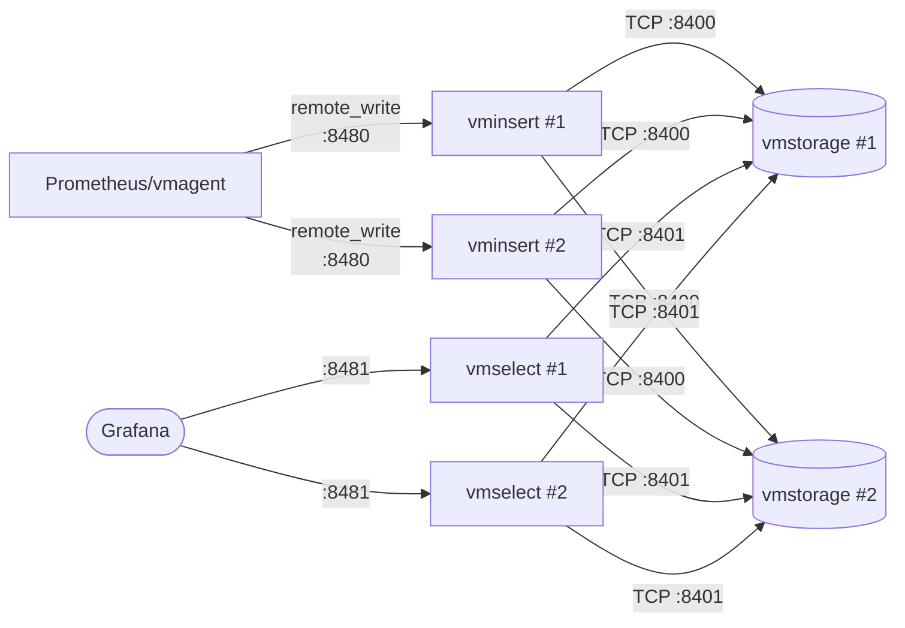

# VictoriaMetrics — Single-node vs Cluster Architecture

## What it does

> Single-node giống một quán ăn gia đình — 1 người vừa order, vừa nấu, vừa bưng bê, đơn giản nhưng chỉ phục vụ được tới một lượng khách nhất định. Cluster giống chuỗi nhà hàng có bộ phận riêng: người nhận order (vminsert), kho bếp riêng (vmstorage), người phục vụ riêng (vmselect) — phục vụ được nhiều khách hơn nhưng vận hành phức tạp hơn hẳn.

Single-node VictoriaMetrics chạy mọi chức năng (nhận ghi, lưu trữ, query) trong 1 process duy nhất. Cluster version tách thành 3 loại component độc lập — **vminsert** (nhận remote write, định tuyến tới vmstorage), **vmstorage** (lưu trữ thật, trả data khi được query), **vmselect** (nhận query, gộp kết quả từ các vmstorage) — theo kiến trúc shared-nothing.

## Why it exists

Single-node scale tốt theo chiều dọc (thêm CPU/RAM/disk cho 1 máy) nhưng tới một ngưỡng ingest rate nhất định (tài liệu khuyến nghị dưới ~1 triệu data point/giây dùng single-node) thì 1 máy không còn đủ, hoặc muốn tách rời khả năng chịu lỗi của từng lớp (ghi/lưu/đọc) để scale độc lập. Cluster giải quyết đúng việc đó, đổi lại độ phức tạp vận hành tăng lên đáng kể — nhiều component hơn, nhiều port hơn, nhiều thứ cần giám sát hơn.

## How it works

Kiến trúc **shared-nothing**: mỗi vminsert biết địa chỉ của mọi vmstorage (qua flag cấu hình danh sách node), tự chia (shard) data ghi tới các vmstorage theo hash; mỗi vmselect cũng biết mọi vmstorage, gửi query tới tất cả rồi tự gộp kết quả lại. Không node nào là "trung tâm" duy nhất — mất 1 vminsert hoặc 1 vmselect không ảnh hưởng tới các vminsert/vmselect khác đang chạy song song.

### Các lựa chọn — Replication factor

| Lựa chọn | Là gì | Khi nào dùng | Bẫy |
|---|---|---|---|
| `-replicationFactor=1` (default) | Không replicate, mỗi sample chỉ nằm ở 1 vmstorage | Lab, dev, hoặc khi đã chấp nhận rủi ro mất data nếu 1 node chết | Mất 1 vmstorage là mất thật phần data đã route vào node đó |
| `-replicationFactor=2` | Mỗi sample được ghi vào 2 vmstorage khác nhau | Production cần chịu được mất 1 node mà không mất data | Tốn gấp ~2x tài nguyên lưu trữ; cần tối thiểu `2×2-1 = 3` vmstorage node để giữ đúng RF khi 1 node down |
| `-replicationFactor=N` theo group (`-replicationFactor=groupName:rf`) | Cấu hình RF riêng theo từng nhóm tenant/data | Multi-tenant cần mức độ chịu lỗi khác nhau theo nhóm | Phức tạp hơn khi audit — dễ quên nhóm nào đang chạy RF thấp |

### Ai thắng khi xung đột

Nguyên tắc chung: **`-replicationFactor` phải khớp giữa vminsert và vmselect**, vì đây là 2 nơi dùng giá trị này cho 2 mục đích khác nhau (ghi N bản vs chấp nhận trả kết quả đầy đủ khi thiếu tới N-1 node).

| Bên A | Bên B | Kết quả | Im lặng hay báo lỗi? |
|---|---|---|---|
| vminsert `-replicationFactor=2` | vmselect `-replicationFactor=1` | vmselect coi là đủ data ngay khi 1 vmstorage trả lời, có thể trả kết quả **thiếu** dù bản sao thứ 2 vẫn tồn tại ở node khác chưa kịp trả lời | Im lặng — không có cảnh báo |
| Số vmstorage node < `2×RF - 1` | Mất 1 node vmstorage | Không đủ node để duy trì đúng replication factor cho data mới ghi vào | Im lặng ở tầng ghi, chỉ thấy rõ khi node thứ 2 cũng gặp vấn đề |

## Config gotchas

| Config | Default | Khuyến nghị | Vì sao |
|---|---|---|---|
| `-replicationFactor` | `1` | `≥2` cho production | Xem bảng lựa chọn ở trên |
| Số lượng vmstorage node | Không có default — tự quyết | Tối thiểu `2×RF - 1` | Thiếu node làm cluster không chịu được mất node đúng như kỳ vọng từ RF đã cấu hình |
| `-storageNode` (trên vminsert/vmselect) | Không có default — bắt buộc khai danh sách | Khai đầy đủ, đồng bộ giữa vminsert và vmselect | Thiếu 1 vmstorage trong danh sách ở vmselect làm query luôn thiếu data từ node đó dù data vẫn tồn tại |

## Hay nhầm lẫn

- **vminsert route data theo hash, không theo "ai gần hơn"** — dễ lầm tưởng có thể ưu tiên route theo locality, thực tế việc chia shard là theo thuật toán hash cố định trên label set.
- **Single-node "upgrade" lên cluster không phải đổi 1 flag** — là đổi hẳn sang bộ binary khác (`vminsert`/`vmstorage`/`vmselect`) với cách deploy khác, không phải thêm flag vào binary single-node.

## Ops notes

- Theo dõi riêng từng loại component: `vm_rows_inserted_total` (vminsert), dung lượng + `vm_storage_is_read_only` (vmstorage), độ trễ query (`vm_request_duration_seconds` hoặc tương đương) ở vmselect — mỗi lớp có bottleneck khác nhau, dồn chung vào 1 dashboard dễ làm mờ nguyên nhân thật.
- Khi scale thêm vmstorage node mới vào cluster đang chạy, data cũ **không tự rebalance** sang node mới — chỉ data mới ghi vào mới được chia đều; cần tính toán thời điểm thêm node sớm trước khi node cũ quá tải.

## Network

Toàn bộ port nội bộ cluster (`8400`, `8401`, `8480`, `8481`, `8482`) đã nằm trong bảng Network ở root note: [[VictoriaMetrics#7. Network — Port & Firewall Rules]].

## Security notes

- Port nội bộ cluster (`8400`/`8401` giữa vminsert/vmselect ↔ vmstorage) nên giới hạn chỉ trong network nội bộ cluster, không cần (và không nên) expose ra ngoài — đây không phải API dành cho client.

## Refs

- [[VictoriaMetrics]] — note gốc.
- [[victoriametrics--ingestion-dedup]] — dedup diễn ra ở cả single-node và cluster, nhưng cluster cần đồng bộ thêm giữa vmselect/vmstorage.
- Official docs: <https://docs.victoriametrics.com/victoriametrics/cluster-victoriametrics/>
