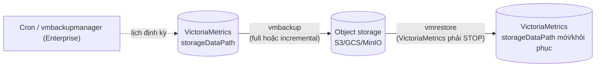

# VictoriaMetrics — Backup & Restore (vmbackup/vmrestore)

## What it does

> vmbackup giống việc chụp ảnh toàn bộ kho hàng rồi gửi ảnh đó lên cloud lưu trữ — lần sau chụp chỉ cần chụp phần đã thay đổi (incremental), không phải chụp lại từ đầu. vmrestore là mở ảnh đó ra, dựng lại kho hàng giống y như lúc chụp.

**vmbackup** tạo backup dữ liệu VictoriaMetrics lên object storage (S3/GCS, kể cả S3-compatible như MinIO/Ceph). **vmrestore** phục hồi dữ liệu từ backup đó vào `-storageDataPath`. **vmbackupmanager** (Enterprise) tự động hoá lịch backup định kỳ thay vì phải tự chạy vmbackup bằng tay/cron.

## Why it exists

Dữ liệu time-series tích luỹ theo thời gian — mất dữ liệu đồng nghĩa mất lịch sử không thể tạo lại được (khác code, có thể viết lại; metric đã qua thì không đo lại được). vmbackup/vmrestore giải quyết rủi ro mất dữ liệu do hỏng disk/node, tách biệt hoàn toàn khỏi object storage để không phụ thuộc vào chính hạ tầng đang chạy VictoriaMetrics.

## How it works

Điểm quan trọng nhất: **VictoriaMetrics phải dừng (stop) trong lúc vmrestore chạy** — không giống backup (có thể chạy khi VictoriaMetrics vẫn sống), restore ghi trực tiếp vào `-storageDataPath` nên cần đảm bảo không có process nào khác đang đọc/ghi cùng lúc.

### Các lựa chọn — Loại backup

| Lựa chọn | Là gì | Khi nào dùng | Bẫy |
|---|---|---|---|
| **Full backup** | Backup toàn bộ data hiện có | Lần backup đầu tiên, hoặc định kỳ dài hạn (tuần/tháng) | Tốn thời gian + băng thông hơn incremental, không nên chạy quá thường xuyên |
| **Incremental backup** | Chỉ backup phần đã thay đổi từ lần backup trước | Backup hằng ngày sau lần full đầu tiên | Phục hồi đầy đủ cần cả chuỗi backup (full + các incremental sau đó), mất 1 mắt xích giữa chuỗi là khó phục hồi đúng mốc |
| **vmbackupmanager** (Enterprise) | Tự động lịch backup, quản lý retention của chính các bản backup | Muốn tự động hoá hoàn toàn, không tự viết cron/script | Chỉ có ở Enterprise — OSS phải tự dựng cron gọi vmbackup |

### Ai thắng khi xung đột

Nguyên tắc chung: backup/restore **không có khái niệm "merge"** — restore là thay thế hoàn toàn nội dung `-storageDataPath` đích bằng nội dung backup, không gộp với data đang có sẵn ở đó.

| Bên A | Bên B | Kết quả | Im lặng hay báo lỗi? |
|---|---|---|---|
| `-storageDataPath` đích đã có data cũ | vmrestore chạy backup khác vào cùng path | Hành vi phục hồi tuỳ cách vmrestore xử lý thư mục đích — nên dùng path **trống** để tránh lẫn data cũ/mới | Có thể báo lỗi hoặc hành vi không như kỳ vọng tuỳ version, luôn dùng path sạch để an toàn |
| vmbackup đang chạy | VictoriaMetrics vẫn đang ghi data mới | Backup vẫn chạy được (không cần stop để backup), nhưng bản backup là "điểm chụp" tại thời điểm bắt đầu, không bao gồm data ghi vào sau đó | Im lặng — đúng theo thiết kế, cần hiểu rõ mốc thời gian backup đại diện cho gì |

## Config gotchas

| Config | Default | Khuyến nghị | Vì sao |
|---|---|---|---|
| `-dst` (đích backup) | Không có default — bắt buộc khai | Luôn trỏ tới bucket/path cụ thể, versioned nếu object storage hỗ trợ | Trỏ sai path dễ ghi đè backup của môi trường khác nếu dùng chung bucket |
| Lịch chạy vmbackup (cron, nếu tự dựng ở OSS) | Không có — tự thiết lập | Chạy đều đặn + alert khi job backup fail | Thiếu alert cho job backup fail là nguyên nhân phổ biến khiến "tưởng có backup" nhưng thực ra backup đã hỏng từ lâu |
| Restore-test định kỳ | Không có gì tự động nhắc | Lên lịch restore-test thủ công (quý/năm) | Chưa restore-test coi như chưa chắc có backup dùng được — backup file tồn tại không đồng nghĩa restore được |

## Hay nhầm lẫn

- **Backup chạy được khi VictoriaMetrics đang sống, nhưng restore thì không** — đây là điểm dễ quên nhất, dẫn tới việc lên kế hoạch restore giữa giờ hành chính mà không tính downtime cần thiết để stop service.
- **vmbackupmanager vs tự viết script gọi vmbackup** — vmbackupmanager (Enterprise) quản lý cả lịch chạy và retention của bản backup; tự viết script chỉ gọi vmbackup, phần quản lý lịch/retention backup phải tự lo, dễ thiếu nếu không thiết kế kỹ từ đầu.

## Ops notes

- Luôn log + alert riêng cho job backup (exit code, thời gian chạy) — backup chạy trong "im lặng" không có nghĩa là thành công.
- Restore-test nên làm trên môi trường tách biệt (không phải production), verify bằng cách query lại vài metric đã biết giá trị trước đó, không chỉ nhìn "restore chạy xong không lỗi".

## Network

Port tới object storage (thường `443/tcp`) đã nằm trong bảng Network ở root note: [[VictoriaMetrics#7. Network — Port & Firewall Rules]].

## Security notes

- Credential truy cập object storage cho vmbackup/vmrestore nên dùng quyền tối thiểu (write-only cho backup job thường dùng, không cần quyền xoá/đọc toàn bucket).
- Backup chứa toàn bộ dữ liệu time-series — coi bucket backup nhạy cảm tương đương dữ liệu production, không để public/misconfigured ACL.

## Refs

- [[VictoriaMetrics]] — note gốc, xem [[VictoriaMetrics#9. Ops Runbook — Production Notes]].
- [[victoriametrics--architecture-cluster]] — backup/restore cho cluster cần thực hiện riêng từng vmstorage node.
- Official docs: <https://docs.victoriametrics.com/vmbackup/>, <https://docs.victoriametrics.com/vmrestore/>, <https://docs.victoriametrics.com/vmbackupmanager/>
