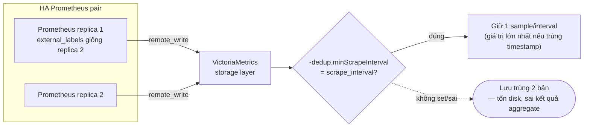

# VictoriaMetrics — Ingestion & Deduplication

## What it does

> vmagent giống một shipper chuyên đi thu hàng (scrape) rồi giao tới kho (VictoriaMetrics) — nhẹ hơn, chuyên trách 1 việc, không kiêm luôn việc giữ kho hay tính toán như Prometheus server. Dedup giống nhân viên kho kiểm hàng: 2 lô hàng giống nhau gửi tới cùng lúc (từ HA pair), kho chỉ giữ 1 lô, bỏ lô trùng.

Ingestion là quá trình VictoriaMetrics nhận data — qua remote write (từ Prometheus) hoặc tự scrape (qua **vmagent**, công cụ scrape nhẹ thay thế vai trò scrape của Prometheus server). Deduplication là cơ chế loại bỏ sample trùng khi nhiều nguồn giống nhau (ví dụ HA Prometheus pair) cùng gửi data về.

## Why it exists

Prometheus server đầy đủ (scrape + TSDB + PromQL engine + alerting) tốn tài nguyên hơn cần thiết nếu mục đích chỉ là **thu thập rồi gửi đi** (không cần query/alert tại chỗ). vmagent giải quyết việc đó: nhẹ hơn, tốn ít CPU/RAM hơn, có buffer trên disk khi remote endpoint tạm gián đoạn, vẫn giữ được service discovery + relabeling giống Prometheus.

Dedup giải quyết vấn đề của mô hình HA: 2 Prometheus replica (xem [[prometheus--ha-federation-scaling]]) cùng scrape, cùng remote write về VictoriaMetrics sẽ tạo ra 2 bản sample giống nhau — nếu không dedup, disk tốn gấp đôi và `sum()`/`count()` ra kết quả sai gấp đôi.

## How it works

Dedup hoạt động **ở storage layer, lúc ghi**, không phải lúc query — mỗi khoảng `-dedup.minScrapeInterval` chỉ giữ lại 1 sample (giá trị lớn nhất nếu có nhiều sample trùng timestamp trong khoảng đó). Điều kiện để dedup đúng: 2 nguồn (Prometheus/vmagent) phải **cùng `external_labels`** — nếu khác label (ví dụ gắn `replica="1"`/`replica="2"`), VictoriaMetrics coi là 2 series khác nhau, dedup không áp dụng được.

### Ai thắng khi xung đột

Nguyên tắc chung: giá trị `-dedup.minScrapeInterval` phải phản ánh đúng **chu kỳ ghi thật** của nguồn dữ liệu — set sai (quá ngắn hoặc quá dài so với `scrape_interval`) làm dedup hoạt động không đúng ý.

| Bên A | Bên B | Kết quả | Im lặng hay báo lỗi? |
|---|---|---|---|
| `-dedup.minScrapeInterval` = đúng `scrape_interval` nguồn | 2 nguồn cùng `external_labels` | Dedup đúng, chỉ giữ 1 bản/interval | Im lặng — đúng kỳ vọng |
| `-dedup.minScrapeInterval` lớn hơn `scrape_interval` thật | — | Có thể gộp nhầm 2 sample hợp lệ khác thời điểm thành 1, mất chi tiết | Im lặng — không cảnh báo mất sample |
| 2 Prometheus replica khác `external_labels` (ví dụ có label `replica`) | `-dedup.minScrapeInterval` đã set đúng | Dedup **không áp dụng được** vì VictoriaMetrics thấy đây là 2 series khác nhau theo label | Im lặng — vẫn tưởng đã dedup nhưng thực ra chưa |

### Các lựa chọn — vmagent vs Prometheus Agent mode vs Grafana Agent

| Lựa chọn | Là gì | Khi nào dùng | Bẫy |
|---|---|---|---|
| **vmagent** | Scraper riêng của VictoriaMetrics, nhẹ, có buffer disk, hỗ trợ remote write tới cả VictoriaMetrics và hệ khác (InfluxDB protocol) | Khi đã dùng VictoriaMetrics làm storage chính, muốn giảm tải so với Prometheus full server | Không có PromQL/alerting tại chỗ — phải trông chờ hoàn toàn vào backend nhận data |
| **Prometheus Agent mode** (`--agent`) | Chế độ scrape-only của chính Prometheus binary | Khi muốn giữ nguyên tooling/ecosystem Prometheus, chỉ tắt phần query/alert local | Vẫn nặng hơn vmagent về resource dù đã tắt query/alert |
| **Grafana Agent** (hiện đã deprecated, thay bằng Grafana Alloy) | Agent đa năng của Grafana Labs, hỗ trợ metrics/logs/traces | Khi cần 1 agent thống nhất cho nhiều loại telemetry | Cần theo dõi lộ trình migrate sang Alloy, Grafana Agent cũ không còn phát triển thêm |

## Config gotchas

| Config | Default | Khuyến nghị | Vì sao |
|---|---|---|---|
| `-dedup.minScrapeInterval` (trên VictoriaMetrics/vmstorage) | `0` (tắt dedup) | Set bằng `scrape_interval` của nguồn khi có HA pair | Không set → lưu trùng data, tốn disk + sai kết quả aggregate |
| vmagent `-remoteWrite.tmpDataPath` (buffer disk khi remote endpoint down) | Có default thư mục tạm | Đảm bảo đủ disk cho buffer này khi outage kéo dài | Hết disk buffer làm vmagent phải drop data thay vì giữ lại để gửi lại sau |
| `external_labels` giữa 2 replica trong HA pair | Không có default — tự khai | Phải **giống nhau tuyệt đối** (trừ khi cố tình muốn tách biệt, không dedup) | Khác label dù chỉ 1 ký tự làm 2 replica thành 2 series riêng, dedup không hoạt động |

## Hay nhầm lẫn

- **Dedup của VictoriaMetrics vs HA dedup của Thanos/Mimir** — cùng mục đích (loại trùng HA pair) nhưng cơ chế khác: VictoriaMetrics dedup theo thời gian (`-dedup.minScrapeInterval`, giữ giá trị lớn nhất trong khoảng), Thanos/Mimir dedup theo label `replica` ở tầng query. Hai cách tiếp cận khác nhau, không thể áp dụng config của bên này cho bên kia.
- **vmagent remote write tới VictoriaMetrics vs tới hệ khác** — vmagent không bắt buộc chỉ gửi cho VictoriaMetrics, nó hỗ trợ remote write protocol chuẩn (và cả InfluxDB line protocol) nên có thể gửi tới bất kỳ backend tương thích — dễ nhầm tưởng vmagent "chỉ dùng được với VictoriaMetrics".

## Ops notes

- Metric cần theo dõi: `vm_rows_inserted_total` (tốc độ ghi), `vm_dedup_*` (nếu bản cụ thể expose, kiểm tra tên chính xác qua `/metrics`) để xác nhận dedup có đang hoạt động đúng không.
- Khi nghi dedup không hoạt động, cách kiểm tra nhanh: so sánh số series thực tế (`count()` trên 1 metric) với số instance/replica thực tế đang gửi data — nếu gấp đôi bất thường, nghi `-dedup.minScrapeInterval` hoặc `external_labels` sai.

## Refs

- [[VictoriaMetrics]] — note gốc.
- [[victoriametrics--architecture-cluster]] — ở cluster, dedup cần nhất quán giữa vminsert và vmstorage.
- [[prometheus--ha-federation-scaling]] — bối cảnh HA Prometheus pair phía nguồn, bẫy tương tự nhưng ở góc nhìn Thanos/Mimir.
- Official docs: <https://docs.victoriametrics.com/victoriametrics/vmagent/>, <https://github.com/VictoriaMetrics/VictoriaMetrics/blob/master/docs/victoriametrics/README.md>
