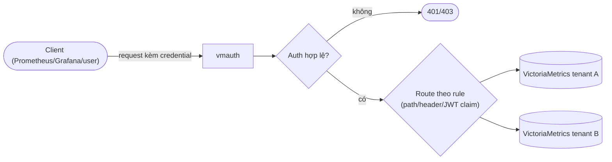

# VictoriaMetrics — vmauth & Security

## What it does

> VictoriaMetrics tự nó như một cái kho không có cổng bảo vệ — ai đi vào cũng lấy/gửi hàng được. vmauth là người gác cổng được thuê thêm: kiểm chứng minh thư (auth), rồi dựa vào đó cho vào đúng khu vực (routing theo rule).

**vmauth** là reverse proxy auth gateway dành riêng cho hệ sinh thái VictoriaMetrics — đặt phía trước vminsert/vmselect/single-node, xác thực request rồi route tới đúng backend. VictoriaMetrics tự thân (storage, vminsert, vmselect) **không có cơ chế auth built-in** cho API.

## Why it exists

Thiết kế VictoriaMetrics ưu tiên đơn giản/hiệu năng ở tầng lưu trữ, nên không nhúng sẵn auth phức tạp vào chính binary lưu trữ. vmauth tách lớp đó ra riêng — cho phép chọn cơ chế auth phù hợp (Basic/Bearer/JWT/mTLS) mà không phải sửa đổi gì ở vminsert/vmselect/vmstorage, đồng thời vmauth còn kiêm luôn việc routing (hữu ích khi có nhiều backend VictoriaMetrics cho nhiều tenant/môi trường).

## How it works

### Các lựa chọn — Cơ chế auth của vmauth

| Lựa chọn | Là gì | Khi nào dùng | Bẫy |
|---|---|---|---|
| **No Auth** | Không xác thực, chỉ dùng vmauth để routing | Network đã kiểm soát chặt (internal only), chỉ cần routing không cần auth | Dễ bị hiểu nhầm là "đã có vmauth nên đã an toàn" — thực ra không auth gì cả |
| **Basic Auth** | Username/password | Đơn giản, đủ cho nội bộ team nhỏ | Cần đi kèm TLS, nếu không password đi plaintext qua network |
| **Bearer token** | Token cố định trong header | Service-to-service, dễ rotate hơn user/password | Token tĩnh nếu lộ thì valid tới khi bị revoke tay |
| **JWT token** | Token có claim, hỗ trợ route theo `match_claims` | Multi-tenant cần route theo claim trong token (ví dụ tenant ID) | Bản <1.152.0 có lỗ hổng authorization bypass qua `match_claims`, đã fix ở 1.152.0 |
| **Client TLS certificate (mTLS)** | Xác thực bằng certificate 2 chiều | Cần mức bảo mật cao nhất, nội bộ giữa service tin cậy | Quản lý lifecycle certificate (renew, revoke) phức tạp hơn các cơ chế khác |
| **Auth token qua HTTP header tuỳ ý** | Header tự định nghĩa làm token | Tích hợp với hệ thống auth nội bộ đã có sẵn cơ chế riêng | Dễ cấu hình sai tên header, dẫn tới âm thầm bỏ qua auth nếu client không gửi đúng header |

### Ai thắng khi xung đột

Nguyên tắc chung: **rule routing khớp đầu tiên trong danh sách được áp dụng**, tương tự mô hình route-tree đã thấy ở Alertmanager/Grafana Alerting.

| Bên A | Bên B | Kết quả | Im lặng hay báo lỗi? |
|---|---|---|---|
| Request có JWT hợp lệ nhưng không khớp `match_claims` của rule nào | vmauth có rule default | Nếu có rule default/fallback, request được xử lý theo đó; nếu không, bị reject | Tuỳ cấu hình — có thể báo lỗi 403/404 rõ ràng |
| Nhiều rule route trùng điều kiện match | — | Rule **đầu tiên khớp** trong danh sách được dùng, rule sau không được xét | Im lặng — dễ nhầm tưởng rule sau mới áp dụng |

## Config gotchas

| Config | Default | Khuyến nghị | Vì sao |
|---|---|---|---|
| Auth mode | Không bật gì nếu không cấu hình → No Auth | Luôn cấu hình ít nhất Basic/Bearer + TLS phía trước | Không auth nghĩa là bất kỳ ai chạm network đều đọc/ghi được data |
| Version vmauth | — | Giữ ≥1.154.0 | Bản ≤1.146.0 thiếu brute-force protection (GHSA-c7pm-322g-r9gf) — không giới hạn số lần login sai, không lock account |
| JWT `match_claims` | — | Giữ ≥1.152.0 | Bản <1.152.0 có authorization bypass qua JWT claims |
| Rate limiting cho auth endpoint | Không có built-in mạnh ở bản cũ | Đặt thêm rate limit ở reverse proxy phía trước vmauth nếu cần lớp bảo vệ bổ sung | Brute-force protection built-in chỉ mới cải thiện gần đây, thêm lớp ngoài vẫn là thực hành tốt |

## Hay nhầm lẫn

- **vmauth là auth gateway, không phải firewall** — vmauth xác thực + route request hợp lệ, không thay thế được network-level restriction (security group, firewall). Vẫn cần giới hạn network tới port nội bộ cluster song song với vmauth.
- **"Có vmauth" không đồng nghĩa "đã auth"** — nếu cấu hình vmauth ở mode No Auth (chỉ dùng cho routing), hệ thống vẫn không có xác thực thật, dễ gây hiểu nhầm an toàn giả.

## Security notes

- Vì VictoriaMetrics storage layer không tự auth, **mọi** triển khai production nên coi vmauth (hoặc reverse proxy tương đương) là bắt buộc, không phải optional.
- Theo dõi GitHub security advisories của repo chính (`VictoriaMetrics/VictoriaMetrics`) cho các bản vá liên quan vmauth — lịch sử gần đây có 2 advisory đáng chú ý (brute-force protection, JWT bypass) trong cùng vài version gần nhau, cho thấy đây là component đang được siết chặt bảo mật liên tục.

## Refs

- [[VictoriaMetrics]] — note gốc, xem [[VictoriaMetrics#8. Security Considerations]].
- [[victoriametrics--architecture-cluster]] — vmauth thường đặt trước vminsert/vmselect trong mô hình cluster.
- Official docs: <https://docs.victoriametrics.com/victoriametrics/vmauth/>
- Security advisory: <https://github.com/VictoriaMetrics/VictoriaMetrics/security/advisories/GHSA-c7pm-322g-r9gf>
