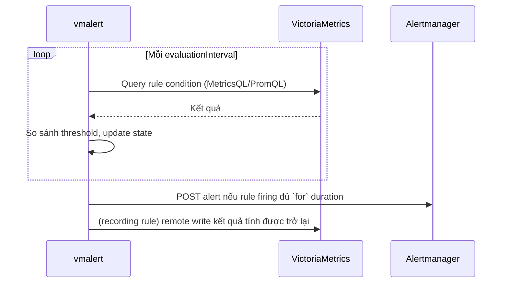

# VictoriaMetrics — vmalert

## What it does

> vmalert giống một thanh tra đi kiểm tra sổ sách định kỳ — nó không giữ sổ (đó là việc của VictoriaMetrics), nó chỉ đọc sổ, so với quy định (rule), rồi báo cho đội xử lý (Alertmanager) khi có vi phạm.

vmalert là component riêng, tách biệt khỏi VictoriaMetrics storage, chịu trách nhiệm evaluate alerting rule và recording rule — đọc dữ liệu từ VictoriaMetrics (hoặc bất kỳ TSDB tương thích PromQL khác), rồi gửi alert tới Alertmanager khi rule match.

## Why it exists

VictoriaMetrics (cả single-node và cluster) chỉ tập trung vào lưu trữ + trả lời query, không tự đánh giá rule định kỳ. Tách vmalert ra riêng giúp scale độc lập: nhiều team có thể chạy nhiều instance vmalert với rule khác nhau, cùng đọc từ 1 VictoriaMetrics, mà không ảnh hưởng tới nhau hoặc tới tải của storage layer theo cách khó kiểm soát.

## How it works

Điểm cần để ý: vmalert vừa **đọc** (query rule condition) vừa **viết** (remote write kết quả recording rule) vào VictoriaMetrics — giống hệt mô hình Prometheus server tự evaluate rule rồi tự lưu lại kết quả recording rule vào TSDB của chính nó, chỉ khác là ở đây 2 việc đọc/viết đi qua network tới 1 service riêng (VictoriaMetrics) thay vì nằm trong cùng process.

### Ai thắng khi xung đột

Nguyên tắc chung: vmalert hoàn toàn **độc lập** với cách VictoriaMetrics lưu trữ/dedup data — rule evaluation chỉ nhìn thấy data **sau khi** đã qua dedup.

| Bên A | Bên B | Kết quả | Im lặng hay báo lỗi? |
|---|---|---|---|
| vmalert evaluationInterval ngắn hơn chu kỳ ghi data thật (ví dụ scrape interval nguồn) | — | vmalert có thể evaluate nhiều lần trên cùng 1 tập data chưa đổi, tốn tài nguyên vô ích | Im lặng — không lỗi, chỉ lãng phí |
| Nhiều vmalert instance cùng chạy cùng 1 rule group, cùng gửi tới 1 Alertmanager | Alertmanager chưa dedupe đúng | Gửi trùng notification cho cùng 1 alert | Im lặng — giống bẫy HA pair ở [[prometheus--alertmanager#Network]] |

## Config gotchas

| Config | Default | Khuyến nghị | Vì sao |
|---|---|---|---|
| `-evaluationInterval` (global) hoặc per rule-group `interval` | Theo cấu hình, không có default cố định toàn cục nếu không khai | Khai rõ, cân đối giữa độ nhạy alert và tải query lên VictoriaMetrics | Evaluate quá thường xuyên cho rule nặng tốn tài nguyên VictoriaMetrics không cần thiết |
| `-datasource.url` | Không có default — bắt buộc khai | Trỏ đúng tới VictoriaMetrics (single-node `:8428` hoặc vmselect `:8481` nếu cluster) | Trỏ sai endpoint (ví dụ sai port cluster) làm rule luôn fail silent nếu endpoint vẫn trả HTTP nhưng data rỗng |
| `-remoteWrite.url` (cho recording rule ghi kết quả) | Không có default nếu không dùng recording rule | Khai khi có recording rule, trỏ đúng endpoint ghi (vminsert nếu cluster) | Thiếu/sai → recording rule evaluate "thành công" nhưng kết quả không được lưu, dashboard dùng recording rule luôn trống |

## Hay nhầm lẫn

- **vmalert vs Alertmanager** — vmalert chỉ **evaluate rule**, không route/group/notify; Alertmanager mới là nơi xử lý notification. Hai component tách biệt, giống mô hình Prometheus + Alertmanager — vmalert đóng vai trò tương đương "Prometheus rule evaluator" chứ không thay thế Alertmanager.
- **Recording rule của vmalert vs của Prometheus** — cùng khái niệm, cùng cú pháp PromQL/MetricsQL, nhưng vmalert ghi kết quả qua remote write tới 1 endpoint riêng biệt (`-remoteWrite.url`), không "tự" lưu vào chính nó như Prometheus server làm nội bộ.

## Ops notes

- Metric cần theo dõi: `vmalert_iteration_duration_seconds` (thời gian mỗi lần evaluate), rule evaluation failure (tên cụ thể theo version, kiểm tra qua `/metrics` của chính vmalert) — alert trên các metric này giống cách theo dõi `prometheus_rule_evaluation_failures_total` ở [[prometheus--promql-recording-rules#Ops notes]].
- vmalert có UI riêng hiển thị trạng thái rule (tương tự trang Alert rules của Prometheus) — dùng để debug nhanh rule nào đang firing/pending mà không cần query tay.

## Refs

- [[VictoriaMetrics]] — note gốc.
- [[prometheus--promql-recording-rules]] — cú pháp rule tương đồng, khác ở chỗ tách component riêng.
- [[prometheus--alertmanager]] — nơi vmalert gửi alert tới, mô hình routing/grouping giống nhau.
- Official docs: <https://docs.victoriametrics.com/victoriametrics/vmalert/>
