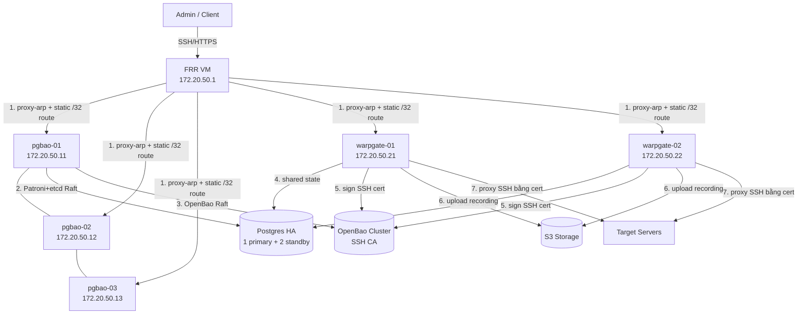

# WarpGate PAM Full Stack - Triển khai HA với FRR, Postgres/Patroni, OpenBao SSH CA và S3 Recording

- **Bối cảnh và vấn đề**: Hiện tại chưa có hệ thống PAM (Privileged Access Management) để kiểm soát và ghi lại truy cập SSH/HTTP/database vào các server quan trọng. Việc cấp quyền SSH đang dựa trên credential tĩnh (password/private key) lưu rải rác, không có session recording, không có điểm kiểm soát tập trung, và dải IP quản trị hiện tại là subnet thông thường nên mỗi host có thể ARP/scan lẫn nhau.
- **Cách giải quyết**: Triển khai WarpGate làm PAM bastion chạy 2 node active-active, dùng Postgres HA (Patroni + etcd, 3 node) làm shared database để các node WarpGate đồng bộ state, dùng OpenBao Raft cluster (3 node, chạy chung hạ tầng với Postgres) với SSH secrets engine ở CA mode để cấp SSH certificate ngắn hạn cho WarpGate khi kết nối vào target - loại bỏ hoàn toàn credential tĩnh lưu cho từng target. Session recording lưu trên S3-compatible storage dùng chung giữa 2 node. Toàn bộ 5 VM ứng dụng chỉ mang IP `/32` (không có subnet), route qua 1 VM FRR riêng để giảm bề mặt tấn công ARP/scan trong mạng quản trị. Mọi service cài bằng Podman + Quadlet.
- **Kết quả sau khi hoàn thành**: Admin login SSH vào các target server thông qua WarpGate, session được ghi lại và replay được trên Admin UI, credential SSH vào target không còn lưu tĩnh ở đâu cả (ký cert ngắn hạn qua OpenBao), và nếu 1 trong 2 node WarpGate hoặc 1 trong 3 node Postgres/OpenBao chết thì hệ thống vẫn hoạt động.

> [!NOTE]
> Lab này **không** triển khai HAProxy đứng trước 2 node WarpGate (để dành cho lab sau), và **không** dùng EJBCA/OpenBao PKI engine để cấp TLS subCA - phạm vi CA ở đây chỉ gồm OpenBao SSH secrets engine (CA mode) để ký SSH certificate. SSH certificate và X.509 certificate là hai cơ chế tin cậy độc lập (SSH CA không có khái niệm chain-of-trust tới root CA X.509 như EJBCA), nên OpenBao SSH CA trong lab này là CA tự ký, không phải subCA của EJBCA.
>
> WarpGate không có concept "active-standby" - tài liệu chính thức chỉ định nghĩa cluster là **active-active** (mọi node đều live, chia sẻ state qua database + storage recording). Lab này triển khai đúng theo thiết kế chính thức đó.

## Prerequisites

- **Hạ tầng**: Mạng upstream (nơi admin/client truy cập vào) đã có router/firewall lõi có thể peer OSPF hoặc nhận static route từ VM FRR. Đã có sẵn 1 S3-compatible endpoint (bucket riêng cho WarpGate recordings) và biết access key/secret key.
- **Máy chủ / VM**: 6 VM Ubuntu 24.04 LTS mới:
  - 1 VM nhỏ (2 vCPU / 2GB RAM / 20GB disk) chạy FRR làm router.
  - 3 VM (4 vCPU / 8GB RAM / 100GB disk - ưu tiên SSD) chạy etcd + Patroni/PostgreSQL + OpenBao raft.
  - 2 VM (2 vCPU / 4GB RAM / 40GB disk) chạy WarpGate.
- **Tài khoản và quyền**: Có quyền root/sudo trên cả 6 VM. Có quyền tạo bucket/CORS policy trên S3 endpoint. Có quyền cấu hình route trên router/firewall lõi phía upstream (hoặc người quản lý thiết bị đó phối hợp cấu hình OSPF).
- **Mạng**: Cả 6 VM nằm trên cùng 1 L2 segment (port group/vSwitch) dành riêng cho lab này. VM FRR có thêm 1 interface thứ hai nối lên mạng lõi/upstream.
- **Kiến thức nền**: Người đọc đã biết các khái niệm cơ bản về Linux routing (`ip route`, proxy ARP), Podman/Quadlet, PostgreSQL streaming replication, Vault/OpenBao (secrets engine, policy, AppRole) và SSH certificate authentication. Lab không giải thích lại các khái niệm nền này.

> [!WARNING]
> Việc đổi toàn bộ dải IP quản trị sang `/32` + đổi gateway sẽ làm mất kết nối tạm thời tới các VM đang cấu hình nếu làm sai thứ tự (mất default route trước khi route mới hoạt động). Luôn giữ 1 session console (ví dụ qua hypervisor) mở song song khi đổi network, không chỉ dựa vào SSH.

## Thông tin Planning liên quan

| Thành phần | Giá trị | Ghi chú |
| --- | --- | --- |
| frr-01 | `172.20.50.1` (lab side) + `<uplink-ip>/<uplink-mask>` (upstream side) | Router cho toàn bộ lab segment |
| pgbao-01 | `172.20.50.11/32` | etcd + Patroni/PostgreSQL + OpenBao node 1 |
| pgbao-02 | `172.20.50.12/32` | etcd + Patroni/PostgreSQL + OpenBao node 2 |
| pgbao-03 | `172.20.50.13/32` | etcd + Patroni/PostgreSQL + OpenBao node 3 |
| warpgate-01 | `172.20.50.21/32` | WarpGate node 1 (active-active) |
| warpgate-02 | `172.20.50.22/32` | WarpGate node 2 (active-active) |
| Lab segment | `172.20.50.0/24` (dùng dạng host-route, không phải subnet thường) | Mỗi VM app chỉ nhận đúng 1 địa chỉ `/32` trong dải này |
| OS | `Ubuntu 24.04 LTS` | Toàn bộ 6 VM |
| FRR | `10.7.1` (deb.frrouting.org, repo `frr-stable`) | Bản stable mới nhất tại thời điểm viết lab |
| etcd | `v3.7.3` | DCS cho Patroni |
| PostgreSQL | `17` | Theo PGDG apt repo |
| Patroni | `4.1.5` | Cài qua `pip`, build image riêng (không có image chính thức) |
| OpenBao | `2.7.3` (image `ghcr.io/openbao/openbao`) | |
| WarpGate | `0.30.6` (image `ghcr.io/warp-tech/warpgate`) | Tính năng "SSH cert ký bởi Vault/OpenBao" có từ v0.30, đã ổn định ở 0.30.6 |
| Podman + Quadlet | Bản mặc định của Ubuntu 24.04 (`podman` >= 4.9) | Quadlet tích hợp sẵn trong podman, không cần cài thêm package |
| DB user WarpGate | `warpgate` / database `warpgate` | Owner riêng, không dùng chung với OpenBao |
| Service account target | `svc_warpgate` | User cục bộ trên từng target server, WarpGate SSH vào bằng cert ký bởi OpenBao, không có password |
| S3 bucket | `<s3-endpoint>` / bucket `<warpgate-recordings>` | Access key/secret key lưu trong secret file trên từng node WarpGate |
| WARPGATE_ENCRYPTION_KEY | `<32+ byte random string>` | Phải **giống nhau tuyệt đối** trên cả 2 node WarpGate, dùng mã hoá credential/secret reference lưu trong DB |

> [!TODO] Cần xác nhận
> Format chính xác của biến môi trường `WARPGATE_PEER_ADDRESS` (địa chỉ:port dùng để 2 node WarpGate nhận diện nhau) chưa được tài liệu chính thức trích dẫn cụ thể dạng giá trị mẫu - khi cấu hình thực tế, kiểm tra lại trong release notes hoặc log khởi động của WarpGate 0.30.6 trước khi áp dụng production.

## Diagram



---

## Installation

### Phần 1 - Networking: FRR + IP /32 cho 5 VM ứng dụng

Phần này dựng nền mạng trước tiên vì tất cả các phần sau đều cần 5 VM app liên lạc được với nhau và với mạng upstream.

#### 1.1 Cài đặt FRR trên VM router

- Thêm repo chính thức của FRR và cài đặt:

```bash
curl -s https://deb.frrouting.org/frr/keys.gpg | sudo tee /usr/share/keyrings/frrouting.gpg > /dev/null
FRRVER="frr-stable"
echo "deb [signed-by=/usr/share/keyrings/frrouting.gpg] https://deb.frrouting.org/frr $(lsb_release -s -c) $FRRVER" | sudo tee -a /etc/apt/sources.list.d/frr.list
sudo apt update
sudo apt install -y frr frr-pythontools
```

- Bật daemon `zebra` và `ospfd` (dùng OSPF để quảng bá các route `/32` ra mạng upstream). Sửa file `/etc/frr/daemons`:

```ini
zebra=yes
ospfd=yes
```

> [!NOTE]
> Chọn OSPF vì đơn giản, không cần AS number như BGP, phù hợp lab 1 router biên. Nếu mạng upstream đã chạy BGP, đổi `bgpd=yes` và áp dụng tương tự ở bước cấu hình `vtysh`.

- Kích hoạt IP forwarding và proxy ARP trên interface nối với lab segment (ví dụ `eth0`). Thêm vào `/etc/sysctl.d/99-frr-lab.conf`:

```ini
net.ipv4.ip_forward = 1
net.ipv4.conf.eth0.proxy_arp = 1
```

> [!WARNING]
> `proxy_arp` bắt buộc phải bật trên interface `eth0` (phía lab segment) vì 5 VM app dùng `/32` không nằm trong 1 subnet thật - FRR phải trả lời ARP thay cho chúng để traffic giữa các VM app đi qua được FRR.

```bash
sudo sysctl --system
```

- Gán IP cho FRR trên 2 interface (lab side và upstream side) qua Netplan. Tạo file `/etc/netplan/01-frr.yaml`:

```yaml
network:
  version: 2
  ethernets:
    eth0:
      addresses: [172.20.50.1/24]
    eth1:
      addresses: [<uplink-ip>/<uplink-mask>]
```

```bash
sudo netplan apply
```

- Khởi động FRR:

```bash
sudo systemctl enable --now frr
```

- Kiểm tra kết quả bước này:

```bash
sudo systemctl status frr --no-pager
```

Kết quả mong đợi: `zebra` và `ospfd` ở trạng thái `active (running)`.

#### 1.2 Cấu hình static route + OSPF trên FRR

- Vào `vtysh` để thêm static route cho từng `/32` của 5 VM app (vì các VM này không chạy FRR, FRR phải biết đường tới chúng bằng route tĩnh) và redistribute ra OSPF:

```bash
sudo vtysh
```

```text
configure terminal
ip route 172.20.50.11/32 eth0
ip route 172.20.50.12/32 eth0
ip route 172.20.50.13/32 eth0
ip route 172.20.50.21/32 eth0
ip route 172.20.50.22/32 eth0
router ospf
 redistribute static
 network <uplink-ip>/<uplink-mask> area 0.0.0.0
exit
write memory
```

> [!NOTE]
> `redistribute static` để router lõi phía upstream tự học được 5 route `/32` này qua OSPF, không phải khai tay trên từng thiết bị mạng khác mỗi khi thêm VM mới.

- Kiểm tra kết quả bước này:

```bash
vtysh -c "show ip route static"
vtysh -c "show ip ospf neighbor"
```

Kết quả mong đợi: 5 route static xuất hiện, và `show ip ospf neighbor` có ít nhất 1 neighbor ở state `Full` với router lõi upstream (sau khi router lõi được cấu hình OSPF phía họ).

#### 1.3 Cấu hình IP /32 + route onlink trên 5 VM ứng dụng

Lặp lại bước này trên cả 5 VM (`pgbao-01/02/03`, `warpgate-01/02`), chỉ đổi địa chỉ IP theo bảng Planning. Ví dụ dưới đây cho `pgbao-01`:

- Tạo `/etc/netplan/01-lab.yaml`:

```yaml
network:
  version: 2
  ethernets:
    eth0:
      addresses: [172.20.50.11/32]
      routes:
        - to: default
          via: 172.20.50.1
          on-link: true
```

> [!WARNING]
> `on-link: true` là bắt buộc. Vì IP của VM là `/32`, kernel sẽ coi gateway `172.20.50.1` là "không cùng subnet" và từ chối route nếu thiếu cờ này.

```bash
sudo netplan apply
```

- Kiểm tra kết quả bước này (chạy trên `pgbao-01`, lặp lại tương tự cho 4 VM còn lại):

```bash
ip route get 172.20.50.21
ping -c3 172.20.50.1
```

Kết quả mong đợi: route đi qua `eth0 via 172.20.50.1`, và ping tới FRR trả lời được. Sau khi làm xong cả 5 VM, ping thử giữa 2 VM app bất kỳ (ví dụ từ `pgbao-01` ping `warpgate-01`) để xác nhận FRR proxy-arp hoạt động đúng.

### Phần 2 - Postgres HA (Patroni + etcd) trên 3 VM

Phần này dựng database dùng chung cho WarpGate (yêu cầu bắt buộc để chạy active-active). Thực hiện trên cả 3 VM `pgbao-01/02/03`, chỉ đổi tên node/IP theo Planning.

#### 2.1 Cài đặt Podman

```bash
sudo apt update
sudo apt install -y podman
```

- Kiểm tra kết quả bước này:

```bash
podman --version
```

Kết quả mong đợi: `podman version 4.9.x` hoặc cao hơn (Quadlet tích hợp sẵn từ bản này).

#### 2.2 Build image Patroni + PostgreSQL 17

Không có image chính thức nào do dự án Patroni phát hành, nên build image riêng để kiểm soát đúng version.

- Tạo thư mục build và `Containerfile`:

```bash
sudo mkdir -p /opt/build/patroni
```

`/opt/build/patroni/Containerfile`

```dockerfile
FROM ubuntu:24.04

RUN apt-get update && apt-get install -y curl ca-certificates gnupg lsb-release python3-pip \
    && install -d /usr/share/postgresql-common/pgdg \
    && curl -o /usr/share/postgresql-common/pgdg/apt.postgresql.org.asc --fail \
       https://www.postgresql.org/media/keys/ACCC4CF8.asc \
    && printf '%s\n' \
       "Types: deb" \
       "URIs: https://apt.postgresql.org/pub/repos/apt" \
       "Suites: noble-pgdg" \
       "Components: main" \
       "Signed-By: /usr/share/postgresql-common/pgdg/apt.postgresql.org.asc" \
       > /etc/apt/sources.list.d/pgdg.sources \
    && apt-get update && apt-get install -y postgresql-17 \
    && pip install --break-system-packages "patroni[etcd3]==4.1.5" \
    && rm -rf /var/lib/apt/lists/*

USER postgres
ENTRYPOINT ["patroni"]
```

```bash
cd /opt/build/patroni
podman build -t localhost/patroni:4.1.5-pg17 .
```

- Kiểm tra kết quả bước này:

```bash
podman run --rm localhost/patroni:4.1.5-pg17 --version
```

Kết quả mong đợi: in ra `patroni 4.1.5`.

#### 2.3 Triển khai etcd cluster 3 node bằng Quadlet

- Tạo thư mục data và file Quadlet `/etc/containers/systemd/etcd.container` (ví dụ nội dung cho `pgbao-01`, đổi `--name`/IP cho từng node):

```bash
sudo mkdir -p /var/lib/etcd
```

`/etc/containers/systemd/etcd.container`

```ini
[Unit]
Description=etcd member - DCS cho Patroni
After=network-online.target

[Container]
Image=gcr.io/etcd-development/etcd:v3.7.3
ContainerName=etcd
Network=host
Volume=/var/lib/etcd:/etcd-data
Exec=/usr/local/bin/etcd --name pgbao-01 --data-dir /etcd-data \
  --initial-advertise-peer-urls http://172.20.50.11:2380 \
  --listen-peer-urls http://172.20.50.11:2380 \
  --listen-client-urls http://172.20.50.11:2379,http://127.0.0.1:2379 \
  --advertise-client-urls http://172.20.50.11:2379 \
  --initial-cluster-token pgbao-etcd \
  --initial-cluster pgbao-01=http://172.20.50.11:2380,pgbao-02=http://172.20.50.12:2380,pgbao-03=http://172.20.50.13:2380 \
  --initial-cluster-state new

[Service]
Restart=always

[Install]
WantedBy=multi-user.target
```

> [!NOTE]
> `Network=host` bắt buộc cho toàn bộ service trong lab này (etcd, Patroni, OpenBao, WarpGate) vì mỗi VM chỉ có đúng 1 IP `/32` - nếu dùng network bridge mặc định của Podman, container sẽ nhận IP nội bộ khác (dải `10.88.0.0/16` của Podman) và không reachable từ các node khác qua FRR.

```bash
sudo systemctl daemon-reload
sudo systemctl enable --now etcd.service
```

- Lặp lại với `--name pgbao-02`/IP `172.20.50.12` trên `pgbao-02`, và `--name pgbao-03`/IP `172.20.50.13` trên `pgbao-03`. `--initial-cluster` giữ nguyên giống nhau trên cả 3 node.

- Kiểm tra kết quả bước này (chạy trên bất kỳ node):

```bash
podman run --rm --network host gcr.io/etcd-development/etcd:v3.7.3 \
  etcdctl --endpoints=http://172.20.50.11:2379,http://172.20.50.12:2379,http://172.20.50.13:2379 \
  endpoint health --cluster
```

Kết quả mong đợi: cả 3 endpoint trả về `healthy`.

#### 2.4 Triển khai Patroni + PostgreSQL 3 node bằng Quadlet

- Tạo thư mục data và config (ví dụ cho `pgbao-01`):

```bash
sudo mkdir -p /var/lib/patroni/data /etc/patroni
```

`/etc/patroni/patroni.yml` (trên `pgbao-01`, đổi `name`/`connect_address`/`listen` cho từng node)

```yaml
scope: pgbao-cluster
namespace: /patroni/
name: pgbao-01

restapi:
  listen: 172.20.50.11:8008
  connect_address: 172.20.50.11:8008

etcd3:
  hosts: 172.20.50.11:2379,172.20.50.12:2379,172.20.50.13:2379

bootstrap:
  dcs:
    ttl: 30
    loop_wait: 10
    retry_timeout: 10
    maximum_lag_on_failover: 1048576
    postgresql:
      use_pg_rewind: true
      parameters:
        password_encryption: scram-sha-256
  initdb:
    - encoding: UTF8
    - data-checksums
  pg_hba:
    - host replication replicator 172.20.50.0/24 scram-sha-256
    - host all all 172.20.50.0/24 scram-sha-256

postgresql:
  listen: 172.20.50.11:5432
  connect_address: 172.20.50.11:5432
  data_dir: /pgdata
  authentication:
    replication:
      username: replicator
      password: "<StrongPassword>"
    superuser:
      username: postgres
      password: "<StrongPassword>"
```

> [!WARNING]
> `password_encryption: scram-sha-256` bắt buộc thay cho `md5` mặc định cũ của PostgreSQL vì scram-sha-256 không gửi hash mật khẩu kiểu có thể replay được qua mạng, an toàn hơn cho môi trường PAM.

`/etc/containers/systemd/patroni.container`

```ini
[Unit]
Description=Patroni-managed PostgreSQL 17
After=etcd.service
Requires=etcd.service

[Container]
Image=localhost/patroni:4.1.5-pg17
ContainerName=patroni
Network=host
Volume=/var/lib/patroni/data:/pgdata
Volume=/etc/patroni/patroni.yml:/etc/patroni.yml:ro
Exec=/etc/patroni.yml

[Service]
Restart=always

[Install]
WantedBy=multi-user.target
```

```bash
sudo systemctl daemon-reload
sudo systemctl enable --now patroni.service
```

- Lặp lại cho `pgbao-02` (`name: pgbao-02`, địa chỉ `172.20.50.12`) và `pgbao-03` (`name: pgbao-03`, địa chỉ `172.20.50.13`). `scope`, `etcd3.hosts`, `pg_hba` giữ nguyên trên cả 3 node.

- Tạo database và user riêng cho WarpGate (chạy 1 lần trên node đang là primary - xác định primary ở bước verify dưới đây):

```bash
podman exec -it patroni psql -U postgres -c \
  "CREATE ROLE warpgate WITH LOGIN PASSWORD '<StrongPassword>'; CREATE DATABASE warpgate WITH OWNER warpgate;"
```

- Kiểm tra kết quả bước này:

```bash
podman exec -it patroni patronictl -c /etc/patroni.yml list
```

Kết quả mong đợi: bảng hiển thị 3 node, đúng 1 node ở `State: running / Role: Leader`, 2 node còn lại `Role: Replica` và `Replication lag` bằng `0`.

### Phần 3 - OpenBao Raft cluster + SSH CA

Triển khai OpenBao trên cùng 3 VM `pgbao-01/02/03` (dùng chung hạ tầng với Postgres theo yêu cầu ban đầu), cluster bằng integrated storage (raft) - không cần Postgres hay etcd làm backend.

#### 3.1 Triển khai OpenBao raft 3 node bằng Quadlet

- Tạo thư mục data/config (ví dụ `pgbao-01`):

```bash
sudo mkdir -p /var/lib/openbao /etc/openbao
```

`/etc/openbao/config.hcl` (trên `pgbao-01`, đổi `node_id`/`retry_join` cho từng node)

```hcl
storage "raft" {
  path    = "/openbao/data"
  node_id = "pgbao-01"

  retry_join {
    leader_api_addr = "https://172.20.50.12:8200"
  }
  retry_join {
    leader_api_addr = "https://172.20.50.13:8200"
  }
}

listener "tcp" {
  address       = "172.20.50.11:8200"
  tls_cert_file = "/openbao/tls/server.crt"
  tls_key_file  = "/openbao/tls/server.key"
}

cluster_addr = "https://172.20.50.11:8201"
api_addr     = "https://172.20.50.11:8200"
disable_mlock = true
```

> [!WARNING]
> `disable_mlock = true` chỉ dùng vì container không có quyền `IPC_LOCK` theo mặc định của Podman. Trên môi trường production thật, cấp capability `IPC_LOCK` cho container và bỏ dòng này để OpenBao khoá memory, tránh secret bị swap ra disk.

> [!TODO] Cần xác nhận
> Lab này giả định đã có sẵn cert TLS (`server.crt`/`server.key`) cho listener `8200` của từng node OpenBao - vì EJBCA không được dùng làm nguồn cấp cert trong phạm vi lab này (xem ghi chú đầu bài), bạn cần tự phát hành cert tạm (self-signed hoặc từ CA nội bộ khác) cho 3 listener này trước khi qua bước 3.1.

`/etc/containers/systemd/openbao.container`

```ini
[Unit]
Description=OpenBao raft node
After=network-online.target

[Container]
Image=ghcr.io/openbao/openbao:2.7.3
ContainerName=openbao
Network=host
Volume=/var/lib/openbao:/openbao/data
Volume=/etc/openbao/config.hcl:/openbao/config.hcl:ro
Volume=/etc/openbao/tls:/openbao/tls:ro
Exec=server -config=/openbao/config.hcl

[Service]
Restart=always

[Install]
WantedBy=multi-user.target
```

```bash
sudo systemctl daemon-reload
sudo systemctl enable --now openbao.service
```

- Lặp lại trên `pgbao-02` (`node_id = "pgbao-02"`, `retry_join` trỏ tới `.11` và `.13`) và `pgbao-03` (`node_id = "pgbao-03"`, `retry_join` trỏ tới `.11` và `.12`).

#### 3.2 Bootstrap và unseal cluster

- Trên **đúng 1 node duy nhất** (`pgbao-01`), khởi tạo cluster:

```bash
export BAO_ADDR=https://172.20.50.11:8200
bao operator init -key-shares=5 -key-threshold=3
```

> [!CAUTION]
> Lệnh này chỉ chạy **một lần duy nhất** trên toàn cluster. Output trả về 5 Unseal Key và 1 Initial Root Token - lưu lại ngay vào password manager, không ghi vào file plaintext trên VM. Mất các key này đồng nghĩa mất toàn bộ dữ liệu đã mã hoá trong OpenBao.

- Unseal node vừa init bằng 3 trong 5 key (lặp lại lệnh 3 lần với 3 key khác nhau):

```bash
bao operator unseal
```

- Trên `pgbao-02` và `pgbao-03`, join cluster rồi unseal bằng cùng 3 key:

```bash
export BAO_ADDR=https://172.20.50.12:8200
bao operator raft join https://172.20.50.11:8200
bao operator unseal
```

- Kiểm tra kết quả bước này:

```bash
bao operator raft list-peers
```

Kết quả mong đợi: 3 node, cột `voter` là `true` cho cả 3, đúng 1 node có `leader` tương ứng trạng thái hiện tại.

#### 3.3 Enable SSH secrets engine ở CA mode

- Đăng nhập bằng root token (chỉ dùng tạm để setup, sau đó tạo policy/token riêng cho vận hành):

```bash
export BAO_ADDR=https://172.20.50.11:8200
bao login
bao secrets enable ssh
bao write ssh/config/ca generate_signing_key=true
```

- Tạo role dùng riêng cho WarpGate:

```bash
bao write ssh/roles/warpgate-pam -<<EOF
{
  "key_type": "ca",
  "allow_user_certificates": true,
  "default_user": "svc_warpgate",
  "allowed_users": "svc_warpgate",
  "ttl": "5m",
  "max_ttl": "10m",
  "allowed_extensions": "permit-pty"
}
EOF
```

> [!NOTE]
> `ttl`/`max_ttl` đặt rất ngắn (5-10 phút) vì cert này chỉ dùng cho đúng 1 lần kết nối của WarpGate vào target, không phải cert dài hạn cho user cuối. `allowed_users` giới hạn chỉ ký cho đúng 1 service account `svc_warpgate` trên target, không ký tuỳ ý cho user khác.

- Kiểm tra kết quả bước này:

```bash
curl -s https://172.20.50.11:8200/v1/ssh/public_key
```

Kết quả mong đợi: trả về 1 public key dạng `ssh-rsa AAAA...` hoặc `ssh-ed25519 AAAA...` - đây chính là CA public key sẽ nạp vào target server ở bước 3.4.

#### 3.4 Cấu hình target server tin tưởng OpenBao SSH CA

Thực hiện trên **từng target server** mà WarpGate sẽ proxy SSH vào (không phải trên 6 VM của hệ thống PAM).

- Tải CA public key và tạo service account:

```bash
sudo curl -s https://172.20.50.11:8200/v1/ssh/public_key -o /etc/ssh/openbao_user_ca.pub
sudo useradd -m -s /bin/bash svc_warpgate
```

- Thêm vào `/etc/ssh/sshd_config.d/openbao-ca.conf`:

```ini
TrustedUserCAKeys /etc/ssh/openbao_user_ca.pub
```

```bash
sudo systemctl restart ssh
```

- Kiểm tra kết quả bước này:

```bash
sudo sshd -T | grep -i trustedusercakeys
```

Kết quả mong đợi: in ra đúng đường dẫn `/etc/ssh/openbao_user_ca.pub`.

#### 3.5 Tạo AppRole cho WarpGate

- Tạo policy chỉ cho phép ký cert qua role `warpgate-pam`, không cấp quyền gì khác:

```bash
bao policy write warpgate-ssh-sign - <<EOF
path "ssh/sign/warpgate-pam" {
  capabilities = ["create", "update"]
}
EOF
```

- Enable AppRole và gắn policy:

```bash
bao auth enable approle
bao write auth/approle/role/warpgate-pam token_policies="warpgate-ssh-sign" token_ttl=1h token_max_ttl=4h
bao read auth/approle/role/warpgate-pam/role-id
bao write -f auth/approle/role/warpgate-pam/secret-id
```

> [!WARNING]
> `secret-id` chỉ hiển thị **một lần duy nhất** ngay sau khi chạy lệnh - copy ngay vào bước khai báo secret ở Phần 4, không chạy lại lệnh này trừ khi cần rotate (chạy lại sẽ sinh `secret-id` mới, không xem lại được cái cũ).

- Kiểm tra kết quả bước này:

```bash
bao write auth/approle/login role_id="<role-id>" secret_id="<secret-id>"
```

Kết quả mong đợi: trả về 1 `client_token` mới hợp lệ, xác nhận AppRole login hoạt động.

### Phần 4 - WarpGate active-active + S3 recording

#### 4.1 Chuẩn bị bucket S3 và CORS

- Áp CORS policy cho bucket (bắt buộc vì Admin UI của WarpGate load recording qua presigned URL trực tiếp từ browser tới S3):

`cors.json`

```json
[
  {
    "AllowedOrigins": ["*"],
    "AllowedMethods": ["GET", "HEAD"],
    "AllowedHeaders": ["*"]
  }
]
```

```bash
aws --endpoint-url <s3-endpoint> s3api put-bucket-cors --bucket <warpgate-recordings> --cors-configuration file://cors.json
```

> [!NOTE]
> Nếu dùng MinIO, bước này có thể không cần thiết - MinIO mặc định cho phép mọi origin mà không cần khai CORS riêng.

#### 4.2 Triển khai WarpGate bằng Quadlet (2 node)

Lặp lại trên cả `warpgate-01` và `warpgate-02`, chỉ đổi IP theo Planning.

- Tạo thư mục data và sinh encryption key chung (chạy 1 lần, copy cùng giá trị sang node thứ 2):

```bash
sudo mkdir -p /var/lib/warpgate
openssl rand -hex 32
```

- Lưu giá trị vừa sinh vào file secret riêng (xem mục "Khai báo thông tin nhạy cảm" bên dưới), rồi chạy setup lần đầu:

```bash
podman run --rm -it -v /var/lib/warpgate:/data ghcr.io/warp-tech/warpgate:0.30.6 unattended-setup \
  --database-url "postgres://warpgate:<StrongPassword>@172.20.50.11:5432/warpgate"
```

> [!TODO] Cần xác nhận
> Lab trỏ `--database-url` trực tiếp vào IP của node Postgres đang là primary tại thời điểm setup (`172.20.50.11`). Vì lab này **chưa** triển khai HAProxy/pgbouncer đứng trước cụm Patroni, khi Patroni failover sang node khác, giá trị `database_url` trong `/var/lib/warpgate/warpgate.yaml` phải được sửa tay sang IP primary mới trên **cả 2 node WarpGate** rồi restart service - đây là hạn chế đã biết của lab, dự kiến xử lý khi thêm HAProxy ở lab sau.

`/etc/containers/systemd/warpgate.container`

```ini
[Unit]
Description=WarpGate PAM node
After=network-online.target

[Container]
Image=ghcr.io/warp-tech/warpgate:0.30.6
ContainerName=warpgate
Network=host
Volume=/var/lib/warpgate:/data
EnvironmentFile=/etc/warpgate/warpgate.env

[Service]
Restart=always

[Install]
WantedBy=multi-user.target
```

```bash
sudo systemctl daemon-reload
sudo systemctl enable --now warpgate.service
```

- Kiểm tra kết quả bước này:

```bash
curl -sk https://172.20.50.21:8888/@warpgate/admin | head -c 200
```

Kết quả mong đợi: trả về HTML của trang login Admin UI (status 200), không phải lỗi connection refused.

#### 4.3 Khai báo thông tin nhạy cảm

- Tạo file secret riêng, chỉ `root` đọc được, trên **cả 2 node** với giá trị `WARPGATE_ENCRYPTION_KEY` **giống nhau tuyệt đối**:

```bash
sudo install -d -m 700 /etc/warpgate
sudo install -m 600 /dev/null /etc/warpgate/warpgate.env
```

`/etc/warpgate/warpgate.env`

```ini
WARPGATE_ENCRYPTION_KEY=<32+ byte random string - giống nhau trên cả 2 node>
```

> [!WARNING]
> Nếu 2 node dùng `WARPGATE_ENCRYPTION_KEY` khác nhau, mỗi node sẽ không đọc được credential/secret reference mà node kia đã mã hoá và lưu trong Postgres dùng chung - gây lỗi kết nối target ngẫu nhiên tùy node nào xử lý request.

- Access key/secret key của S3 và thông tin AppRole của OpenBao (role_id/secret_id từ bước 3.5) **không** khai trong file này - nhập trực tiếp qua Admin UI ở bước 4.4 vì cả hai đều được WarpGate lưu mã hoá trong database, không phải trong file cấu hình tĩnh.

#### 4.4 Cấu hình Secret backend (OpenBao) và Recording S3 qua Admin UI

- Đăng nhập Admin UI tại `https://172.20.50.21:8888/@warpgate/admin` bằng tài khoản admin tạo ở bước `unattended-setup`.
- Vào **Config → Secret backends → Add backend**: chọn kiểu Vault/OpenBao, nhập address `https://172.20.50.11:8200`, auth method AppRole, nhập `role_id`/`secret_id` từ bước 3.5, giới hạn `allowed path prefixes` chỉ gồm `ssh/sign/warpgate-pam`.
- Vào **Targets → thêm/sửa SSH target**: ở phần auth, chọn ký SSH certificate bằng secret backend vừa tạo, role `warpgate-pam`, username `svc_warpgate`.

> [!TODO] Cần xác nhận
> Tên field chính xác trong UI cho "ký SSH certificate qua secret backend" có thể khác đôi chút so với mô tả trên, vì tính năng này còn tương đối mới (thêm từ v0.30 qua PR #2397 trên GitHub). Khi thực hiện thật, đối chiếu lại đúng label hiển thị trên UI của bản 0.30.6 trước khi dùng cho production.

- Vào **Config → Global parameters → Recordings**: bật recording, chọn storage S3, nhập endpoint/bucket/region/access key/secret key đã chuẩn bị ở Phần 4.1.
- Lặp lại đúng 2 bước "Secret backends" và "Recordings" trên **cả 2 node** (vì đây là setting lưu trong Postgres dùng chung, chỉ cần làm trên 1 node là đủ cho cả cluster - không cần lặp lại, nhưng nên đăng nhập node thứ 2 để xác nhận setting đã đồng bộ).

- Kiểm tra kết quả bước này:

Đăng nhập Admin UI trên node thứ 2 (`https://172.20.50.22:8888/@warpgate/admin`), vào **Targets**, xác nhận target SSH vừa tạo ở node 1 hiển thị đầy đủ - chứng minh 2 node đã chia sẻ state qua Postgres đúng như thiết kế active-active.

#### 4.5 Ghi chú cho HAProxy trong tương lai

> [!NOTE]
> Khi thêm HAProxy đứng trước `warpgate-01`/`warpgate-02`, cấu hình TCP balancer (không phải HTTP) cho port `2222`/`8888`, bật PROXY protocol ở cả HAProxy và WarpGate (field `proxy_protocol` trong từng listener - `ssh.proxy_protocol`, `http.proxy_protocol`... đã có sẵn trong schema cấu hình của WarpGate) để WarpGate ghi log đúng IP nguồn thật của client thay vì IP của HAProxy.

## Kiểm tra kết quả

- Từ máy client, SSH vào WarpGate: `ssh -p 2222 <user>@warpgate-vip -J pam-target`. Kết quả mong đợi: WarpGate xác thực user, sau đó tự ký SSH cert qua OpenBao và proxy kết nối vào target bằng user `svc_warpgate`, không hỏi password của target.
- Trên Admin UI, vào **Sessions**, mở lại session SSH vừa thực hiện. Kết quả mong đợi: terminal được replay đầy đủ giống như lúc gõ lệnh thật.
- Trên S3 bucket, kiểm tra có object mới dưới prefix recording của session vừa thực hiện.
- Tắt node Postgres đang là primary (`sudo systemctl stop patroni` trên node đó), đợi vài giây, kiểm tra `patronictl list` từ 1 node còn sống thấy có primary mới được bầu, và WarpGate (sau khi sửa `database_url` theo TODO ở bước 4.2) vẫn hoạt động được.
- Tắt 1 node OpenBao bất kỳ, thử SSH lại vào target qua WarpGate. Kết quả mong đợi: vẫn ký cert và kết nối thành công vì còn 2/3 node raft giữ quorum.

| Hạng mục cần kiểm tra | Cách kiểm tra | Kết quả đúng |
| --- | --- | --- |
| Postgres HA | `patronictl -c /etc/patroni.yml list` | 1 Leader, 2 Replica, lag = 0 |
| OpenBao quorum | `bao operator raft list-peers` | 3 node, có 1 leader |
| WarpGate active-active | Login Admin UI trên cả 2 IP node | Cùng thấy đúng 1 danh sách target/session |
| SSH CA | `ssh-keygen -L -f <cert vừa ký>` trên target (nếu bật log) | `Signing CA` đúng là CA key lấy từ `/v1/ssh/public_key` |
| Session recording trên S3 | List object trong bucket sau khi SSH | Có object mới, size > 0 |

## Troubleshooting

| Triệu chứng | Nguyên nhân | Cách xử lý |
| --- | --- | --- |
| Admin UI không load được video/terminal replay dù session đã ghi | Thiếu CORS GET/HEAD trên bucket S3 | Áp lại `cors.json` ở bước 4.1, S3 tự chọn (MinIO) hoặc S3-compatible khác mặc định chặn origin lạ |
| 2 node WarpGate thấy danh sách target/secret khác nhau | `WARPGATE_ENCRYPTION_KEY` không giống nhau giữa 2 node | So lại nội dung `/etc/warpgate/warpgate.env` trên cả 2 node, đồng bộ giá trị, restart `warpgate.service` |
| WarpGate SSH vào target bị target từ chối, không hỏi password | Target chưa nạp đúng `TrustedUserCAKeys` hoặc `allowed_users` trong role OpenBao không khớp username | Kiểm tra lại bước 3.4 (`sshd -T | grep -i trustedusercakeys`) và field `allowed_users`/`default_user` trong role `warpgate-pam` ở bước 3.3 |

## Rollback

- Dừng và gỡ service WarpGate trên cả 2 node (không xoá volume `/var/lib/warpgate` nếu còn cần dữ liệu):

```bash
sudo systemctl disable --now warpgate.service
```

- Dừng OpenBao, Patroni, etcd trên 3 node theo thứ tự ngược (WarpGate phụ thuộc chúng, nên dừng trước):

```bash
sudo systemctl disable --now openbao.service
sudo systemctl disable --now patroni.service
sudo systemctl disable --now etcd.service
```

- Gỡ static route và tắt OSPF trên FRR:

```bash
sudo vtysh -c "configure terminal" -c "no router ospf" -c "no ip route 172.20.50.11/32 eth0" -c "no ip route 172.20.50.12/32 eth0" -c "no ip route 172.20.50.13/32 eth0" -c "no ip route 172.20.50.21/32 eth0" -c "no ip route 172.20.50.22/32 eth0"
```

> [!CAUTION]
> Dữ liệu OpenBao (`/var/lib/openbao`) được mã hoá bằng Unseal Key sinh ra ở bước 3.2 - nếu xoá volume này mà không có bản backup kèm đúng 3/5 Unseal Key, toàn bộ secret/SSH CA key trong đó **không thể khôi phục lại được**.

## Reference

- [Warpgate - Clustering](https://warpgate.null.page/clustering/)
- [Warpgate - Secret backends (Vault/OpenBao)](https://warpgate.null.page/secret-backends/)
- [Warpgate - Session recordings](https://warpgate.null.page/recordings/)
- [Warpgate - Production checklist](https://warpgate.null.page/production-checklist/)
- [Warpgate - Getting started (native)](https://warpgate.null.page/getting-started/)
- [Warpgate - Getting started on Docker](https://warpgate.null.page/getting-started-on-docker/)
- [Warpgate config-schema.json](https://github.com/warp-tech/warpgate/blob/main/config-schema.json)
- [Warpgate PR #2397 - SSH certificate authentication for targets, issued by Vault](https://github.com/warp-tech/warpgate/pull/2397)
- [OpenBao - Raft storage backend](https://openbao.org/docs/configuration/storage/raft/)
- [OpenBao - SSH secrets engine](https://openbao.org/docs/secrets/ssh/)
- [Patroni documentation](https://patroni.readthedocs.io/)
- [FRRouting documentation](https://docs.frrouting.org/)
